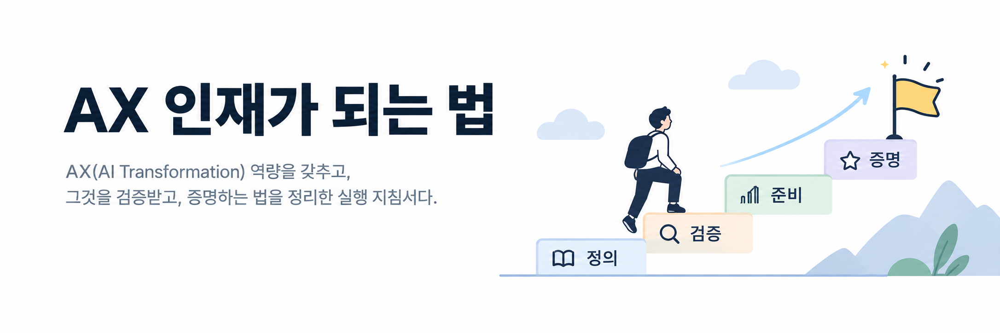
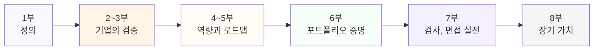

# AX 인재가 되는 법

**AX(AI Transformation) 역량을 갖추고, 그것을 검증받고, 증명하는 법을 정리한 실행 지침서다.**

채용 공고나 사내 평가 공지에 "AX 역량"이라는 말이 등장했을 때, 그 말이 구체적으로 무엇을 가리키는지 아는 사람은 드물다. 이 책은 그 말을 정의에서 시작해 검증 방식, 준비 로드맵, 포트폴리오, 검사와 면접 대응까지 끝까지 따라간다.

---

## 이 책에 대하여

**정의, 검증, 준비 세 가지를 순서대로 다룬다.**

1. **정의** — AX 역량이 무엇이고 DX, AI 리터러시와 어떻게 다른가 (1부)
2. **검증** — 기업이 채용과 평가에서 AX 역량을 확인하는 방식, AX 역량검사류가 공통으로 보는 영역 (2~3부)
3. **준비** — 핵심 역량을 쌓는 방법, 로드맵, 포트폴리오, 검사와 면접 대응, 장기적으로 남는 습관 (4~8부)

**실행 지침서다.** 교양서가 아니다. 각 장 끝에는 체크리스트나 바로 해볼 일을 둔다. 본문 곳곳의 `> 북마크` 표시는 나중에 다시 펼쳐 보게 되는 체크리스트, 판단 기준표, 자가진단 질문이다.

**단정하지 않는 것을 단정하지 않는다.** "AX 직무역량 검사"는 특정 기관 하나가 독점하는 고유명사가 아니라 여러 기업과 기관이 각자 운영하는 검사군의 통칭으로 쓴다. 부록 B의 연습문제는 전부 이 책이 새로 만든 예시이며, 실제 기출문제가 아니다. 확인하지 못한 세부는 `[확인 필요: ...]`로 남겨 둔다.

형식은 마크다운이다. 깃허브에서 읽는 것을 전제로 하고 PDF는 만들지 않는다. 브라우저로 읽으려면 [웹 뷰어](https://leaf-kit.github.io/book-ax/)를 연다. 저장소의 `.md` 파일을 그대로 읽어 그리므로 따로 빌드한 사본이 없고, 왼쪽 차례와 본문 검색이 붙어 있다.

---

## 한눈에 보는 구조

이 책의 아홉 부가 어떤 순서로 이어지는지 한 장의 그림으로 보면 이렇다.

정의가 없으면 검증 대상이 흐려지고, 검증 구조를 모르면 준비 순서가 안 선다. 준비를 마쳐야 증명할 것이 생기고, 증명해 둔 것이 있어야 실전에서 꺼낼 말이 생긴다. 다만 이 순서대로 읽을 필요는 없다. 위 "읽는 경로" 표를 따라 필요한 부로 바로 들어가도 된다.

---

## 읽는 경로

차례대로 읽지 않아도 된다. 목적에 따라 들어오는 곳이 다르다.

| 당신이 | 여기서 시작 |
|---|---|
| "AX 역량"이라는 말 자체가 낯설다 | [1부 AX 역량이란 무엇인가](#1부--ax-역량이란-무엇인가) |
| 채용 공고나 사내 공지를 보고 검사를 준비해야 한다 | [3부 AX 직무역량 검사 들여다보기](#3부--ax-직무역량-검사-들여다보기) → [7부 실전 준비](#7부--실전-준비-검사와-면접-대응) |
| 무엇부터 공부해야 할지 모른다 | [5.1 현재 위치 진단하기](part5/01-self-assessment.md) → [5부 준비 로드맵](#5부--준비-로드맵) |
| 이미 공부는 했는데 증명할 게 없다 | [6부 포트폴리오와 증명](#6부--포트폴리오와-증명) |
| 면접에서 AX 역량을 어떻게 설명할지 모른다 | [6.5 면접에서 포트폴리오를 설명하는 법](part6/05-interview-narrative.md) → [7.5 면접 실전](part7/05-interview-pressure.md) |
| 단기 대비보다 커리어 전체를 보고 싶다 | [8부 장기적으로 가치 있는 습관](#8부--장기적으로-가치-있는-습관) |
| 모르는 용어가 나온다 | [부록 C 용어집](appendix/c-glossary.md) |

---

## 차례

### 0부 — 들어가며

- [0.1 이 책이 다루는 것과 다루지 않는 것](part0/01-scope.md)
- [0.2 왜 지금 AX 인재인가](part0/02-why-now.md)
- [0.3 이 책을 읽는 법](part0/03-how-to-read.md)

### 1부 — AX 역량이란 무엇인가

- [1.1 AX의 정의: DX와 무엇이 다른가](part1/01-definition.md)
- [1.2 AX 역량의 네 층위: 인식, 활용, 설계, 거버넌스](part1/02-four-layers.md)
- [1.3 AX 역량과 AI 리터러시의 경계](part1/03-vs-ai-literacy.md)
- [1.4 직무별로 달라지는 AX 역량의 모습](part1/04-by-role.md)
- [1.5 AX 역량을 둘러싼 흔한 오해](part1/05-misconceptions.md)
- [1.6 개인 단위 AX 역량 성숙도 모델](part1/06-maturity-model.md)
- [1.7 해외 빅테크는 AX 인재를 어떻게 정의하는가](part1/07-global-bigtech.md)

### 2부 — 기업은 왜, 무엇을 검증하는가

- [2.1 기업이 AX 역량을 채용, 평가에 반영하는 이유](part2/01-why-companies-verify.md)
- [2.2 직무기술서와 공고에서 AX 역량이 드러나는 방식](part2/02-job-postings.md)
- [2.3 면접에서 AX 역량을 묻는 질문의 유형](part2/03-interview-types.md)
- [2.4 사내 AX 역량 평가, 인증 제도의 흐름](part2/04-internal-certification.md)
- [2.5 AX 역량검사류가 공통으로 보는 영역](part2/05-common-domains.md)
- [2.6 평가자가 가르는 기준: 통과하는 답변과 탈락하는 답변](part2/06-pass-fail.md)
- [2.7 기업마다 다른 AX 역량 검증 특징](part2/07-company-patterns.md)

### 3부 — AX 직무역량 검사 들여다보기

- [3.1 검사 유형의 분류: 지식형, 판단형, 실무형, 시뮬레이션형](part3/01-test-types.md)
- [3.2 평가 영역 1 — AI 개념과 용어 이해](part3/02-domain-concepts.md)
- [3.3 평가 영역 2 — 프롬프트와 에이전트 활용](part3/03-domain-prompting.md)
- [3.4 평가 영역 3 — 데이터 리터러시와 판단력](part3/04-domain-data.md)
- [3.5 평가 영역 4 — 업무 적용과 프로세스 재설계](part3/05-domain-process.md)
- [3.6 평가 영역 5 — 리스크, 윤리, 거버넌스 감각](part3/06-domain-risk.md)

### 4부 — 핵심 역량 기둥 다지기

- [4.1 AI 리터러시: 모델과 도구를 이해하는 최소 지식](part4/01-ai-literacy.md)
- [4.2 프롬프트 설계: 질문을 설계하는 힘](part4/02-prompt-design.md)
- [4.3 에이전트와 자동화 활용](part4/03-agents-automation.md)
- [4.4 데이터 리터러시: 숫자와 근거를 읽는 눈](part4/04-data-literacy.md)
- [4.5 업무 프로세스 재설계](part4/05-process-redesign.md)
- [4.6 문제정의력: 기술이 아니라 문제에서 시작한다](part4/06-problem-framing.md)
- [4.7 커뮤니케이션과 체인지 매니지먼트](part4/07-change-management.md)
- [4.8 윤리, 거버넌스, 리스크 감각](part4/08-ethics-governance.md)

### 5부 — 준비 로드맵

- [5.1 현재 위치 진단하기](part5/01-self-assessment.md)
- [5.2 3개월 기초 로드맵](part5/02-roadmap-3month.md)
- [5.3 6개월 실무 적용 로드맵](part5/03-roadmap-6month.md)
- [5.4 1년 포트폴리오 로드맵](part5/04-roadmap-1year.md)
- [5.5 직무별 커스터마이징](part5/05-by-role-customization.md)
- [5.6 학습 자원과 커뮤니티 활용법](part5/06-resources.md)

### 6부 — 포트폴리오와 증명

- [6.1 "AX를 했다"는 것을 증명하는 법](part6/01-proving-ax.md)
- [6.2 사이드 프로젝트로 보여주기](part6/02-side-projects.md)
- [6.3 사내 프로젝트를 포트폴리오로 바꾸는 법](part6/03-work-projects.md)
- [6.4 자기소개서, 이력서에서 쓰는 법](part6/04-resume-writing.md)
- [6.5 면접에서 포트폴리오를 설명하는 법](part6/05-interview-narrative.md)

### 7부 — 실전 준비: 검사와 면접 대응

- [7.1 검사 대비 전략: 시간관리와 함정 유형](part7/01-test-strategy.md)
- [7.2 자주 틀리는 유형과 이유](part7/02-common-mistakes.md)
- [7.3 모의 문제 풀이 1](part7/03-mock-test-1.md)
- [7.4 모의 문제 풀이 2](part7/04-mock-test-2.md)
- [7.5 면접 실전: 압박 질문에 답하는 법](part7/05-interview-pressure.md)

### 8부 — 장기적으로 가치 있는 습관

- [8.1 변화 속도를 따라가는 학습 루틴](part8/01-learning-routine.md)
- [8.2 AX 역량의 반감기: 빨리 낡는 것과 오래가는 것](part8/02-half-life.md)
- [8.3 커리어 10년을 보는 AX 포지셔닝](part8/03-ten-year-view.md)
- [8.4 AX 인재가 빠지기 쉬운 함정들](part8/04-traps.md)
- [8.5 체크리스트 모음: 한 장 요약](part8/05-checklist-summary.md)

### 부록

- [A. 자가진단 체크리스트 전체](appendix/a-self-assessment.md)
- [B. 연습문제 뱅크](appendix/b-practice-questions.md) (자체 제작, 실제 시험 문제 아님)
- [C. 용어집](appendix/c-glossary.md)
- [D. 참고 자료와 더 읽을 것](appendix/d-references.md)

---

## 구성

56장(본문 52장 + 부록 4편), 종이책 기준 약 220~260쪽.

| 부 | 장 | 다루는 것 |
|---|---|---|
| 0부 | 3 | 이 책의 범위, 왜 지금 AX 인재인가, 읽는 법 |
| 1부 | 7 | AX 역량의 정의, 네 층위, AI 리터러시와의 경계, 직무별 모습, 오해, 성숙도 모델, 해외 빅테크의 정의 |
| 2부 | 7 | 기업의 검증 이유, 공고, 면접 질문 유형, 사내 인증, 공통 평가 영역, 통과 기준, 기업별 검증 특징 |
| 3부 | 6 | 검사 유형 분류, 평가 영역 5개(개념, 프롬프트, 데이터, 프로세스, 리스크) |
| 4부 | 8 | 핵심 역량 기둥 — AI 리터러시, 프롬프트, 에이전트, 데이터, 프로세스, 문제정의, 체인지 매니지먼트, 거버넌스 |
| 5부 | 6 | 준비 로드맵 — 진단, 3개월, 6개월, 1년, 직무별, 학습 자원 |
| 6부 | 5 | 포트폴리오 — 증명, 사이드 프로젝트, 사내 프로젝트, 이력서, 면접 서사 |
| 7부 | 5 | 실전 대비 — 전략, 흔한 실수, 모의 문제 2세트, 면접 압박 질문 |
| 8부 | 5 | 장기 가치 — 학습 루틴, 반감기, 10년 포지셔닝, 함정, 체크리스트 총정리 |
| 부록 | 4 | 자가진단, 연습문제 뱅크, 용어집, 참고 자료 |

## 이 책이 하지 않은 것

정직하게 적어 둔다.

| 항목 | 상태 |
|---|---|
| 특정 기관의 실제 기출문제 수록 | **하지 않았다** — 부록 B는 전부 자체 제작 예시다 |
| 특정 검사의 비공개 채점 기준 인용 | 하지 않았다 |
| 설문이나 통계로 뒷받침한 수치 제시 | 하지 않았다 — 본문에 등장하는 숫자는 로드맵의 기간, 체크리스트 항목 수처럼 이 책이 설계한 구조에서 나온 것이다 |

본문에 남아 있는 `[확인 필요: ...]` 항목은 특정 기관명이나 제도처럼 독자가 최신 공고를 직접 확인해야 하는 자리다.

## 저작권

leaf meta가 쓰고 무료로 공개한다. 출판사를 거치지 않는다.
