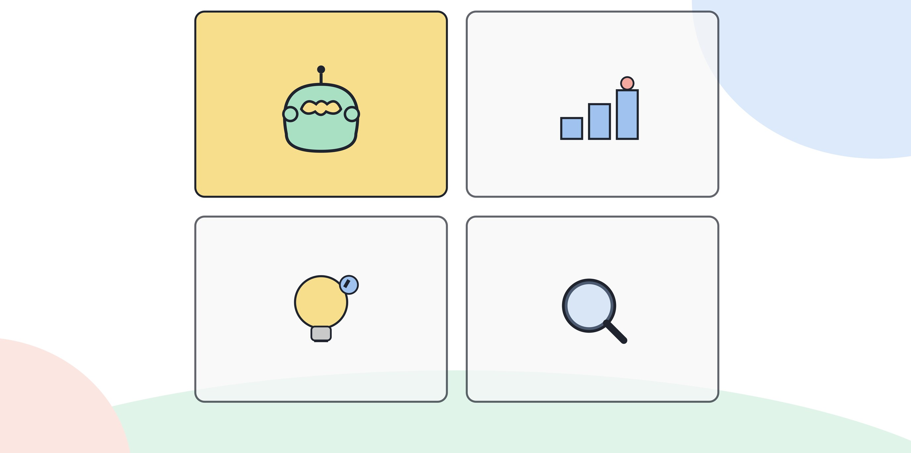

# 1.1 AX의 정의: DX와 무엇이 다른가

## 운전하는 사람과 제안받는 사람

DX(디지털 전환)는 종이와 사람의 기억에 있던 일을 디지털 시스템으로 옮기는 작업이다. 결재를 전자문서로 바꾸고, 엑셀로 하던 집계를 대시보드로 옮기고, 전화로 묻던 재고를 조회 화면에서 바로 본다. 이 과정에서 판단은 그대로 사람에게 남는다. 시스템은 정보를 더 빠르게 보여줄 뿐, 무엇을 결정할지는 건드리지 않는다.

AX(AI 전환)는 다르다. AI가 판단과 실행의 일부를 대신 제안하거나 대행한다. 보고서 초안을 쓰고, 이상 거래를 걸러내고, 다음에 연락할 고객을 추천한다. 사람은 여전히 운전석에 있지만, 옆자리에서 계속 말을 거는 존재가 생겼다. "이쪽으로 가는 게 어때요"라고 제안하는 존재다.

이 차이 하나가 역량의 정의를 완전히 바꾼다. DX 시대의 역량은 도구를 다루는 숙련도였다. 엑셀 함수를 더 많이 알고, 시스템 화면을 더 빠르게 찾아내는 사람이 역량 있는 사람이었다. AX 시대의 역량은 그 제안을 받아들일지 판단하는 능력이다. 도구가 내놓은 답을 그대로 쓸지, 고쳐서 쓸지, 버릴지를 정하는 능력이다.

[그림] DX가 시스템을 바꾸는 일이라면, AX는 그 시스템 안의 판단을 바꾸는 일이다.

## 업무로 보면: 문서 작성, 데이터 분석, 고객 응대

보고서를 쓰는 일로 예를 들어본다. DX 환경에서는 과거 보고서 파일을 찾아보고, 필요한 데이터를 시스템에서 내려받고, 서식에 맞춰 옮겨 적는 과정이 디지털로 바뀐다. 손으로 베끼던 숫자를 복사해서 붙이고, 공유 폴더에서 양식을 찾는다. 속도는 빨라지지만 이 보고서에 무엇을 담을지는 여전히 작성자가 처음부터 끝까지 정한다.

AX 환경에서는 AI가 지난 보고서의 구조를 참고해 초안 자체를 만든다. 작성자는 빈 문서에서 시작하지 않고, 이미 채워진 문서를 놓고 어디를 고칠지부터 본다. 일하는 순서가 "쓰기 → 검토"에서 "검토 → 고치기"로 바뀐다. 이 전환에서 필요한 역량은 타이핑 속도가 아니라, 채워진 초안에서 틀린 곳과 빠진 곳을 짚어내는 눈이다.

데이터 분석도 비슷하게 갈린다. DX 환경에서는 흩어진 자료를 한 화면에 모아 보여주는 것까지가 시스템의 일이다. 그 표를 보고 무엇이 이상한지, 어떤 흐름이 의미 있는지는 분석하는 사람이 판단한다. AX 환경에서는 AI가 먼저 이상치를 짚어주고, 눈에 띄는 패턴을 요약해서 보여준다. 분석가의 일은 그 요약이 맞는지 원자료로 되짚어 확인하는 쪽으로 옮겨간다. 판단을 안 하는 게 아니라, 판단하는 지점이 "자료를 읽고 패턴을 찾는 단계"에서 "AI가 찾은 패턴을 검증하는 단계"로 옮겨간 것이다.

고객 응대에서는 차이가 더 분명하게 드러난다. DX 환경에서는 고객 문의 내역이 전산화되어 상담원이 과거 기록을 바로 조회할 수 있다. 무엇을 답할지는 상담원이 정한다. AX 환경에서는 AI가 답변 초안을 먼저 제시하고, 상담원은 그 답을 그대로 보낼지, 고쳐서 보낼지, 아예 다시 쓸지를 정한다. 반복적인 문의일수록 그대로 보내는 비율이 높아지지만, 예외적인 상황일수록 상담원이 AI의 제안을 걷어내고 처음부터 다시 판단해야 한다. 이 걷어내야 할 때를 알아채는 감각이 AX 역량이 묻는 지점이다.

세 사례 모두 같은 그림을 보여준다. DX는 일하는 속도를 올리고, AX는 일하는 순서와 판단이 놓이는 위치를 바꾼다.

## 이 구분이 역량 기준을 바꾸는 이유

"AI 도구를 잘 쓴다"는 말이 모호해지는 이유가 여기에 있다. DX 관점에서 보면 "잘 쓴다"는 도구를 빠르고 정확하게 다루는 것이다. AX 관점에서 보면 "잘 쓴다"는 도구가 내놓은 제안을 검증하고, 받아들이고, 책임지는 것이다. 둘은 전혀 다른 능력을 가리킨다.

예를 들어 이런 상황을 가정하면 차이가 분명해진다. 두 사람이 같은 AI 도구로 보고서 초안을 만들었다. 한 사람은 도구가 낸 문장을 거의 그대로 제출했다. 다른 사람은 도구가 낸 숫자 중 하나가 최근 자료와 맞지 않는다는 걸 발견하고 고쳐서 제출했다. 둘 다 "AI 도구를 썼다"고 말할 수 있지만, 기업이 채용이나 평가에서 보려는 역량은 뒤 사람 쪽이다. 도구를 다루는 손놀림이 아니라, 도구가 낸 결과를 의심하고 검증하는 판단이다.

이 책이 다루는 "AX 역량"은 이 판단의 영역을 가리킨다. 도구 사용법 교육이 AX 역량 교육이 아닌 이유도 여기에 있다. 사용법은 금방 배우지만, 제안을 검증하는 판단력은 반복된 연습으로만 쌓인다. 채용 공고에 "AI 활용 역량"이라고만 적혀 있어도, 실제로 가려내려는 것은 도구를 아는 사람이 아니라 도구의 결과를 책임질 수 있는 사람이다.

## DX와 AX는 순서가 아니라 혼재한다

DX를 먼저 끝내야 AX로 넘어간다는 생각도 흔한 오해다. 실제로는 한 조직 안에서도 업무마다 DX와 AX가 섞여 있다. 어떤 업무는 아직 전자문서로도 안 바뀌어 있는데, 바로 옆 업무는 AI가 초안을 만드는 단계까지 가 있는 경우가 드물지 않다. 디지털화가 안 된 업무일수록 오히려 AI 도구를 먼저 붙이기 쉬운 경우도 있다. 종이 양식을 디지털 양식으로 바꾸는 중간 단계 없이, 사진을 찍어 AI가 바로 내용을 읽어내게 만드는 식이다.

그래서 "우리 회사는 아직 DX도 안 됐는데 AX를 말한다"는 반응은 절반만 맞다. 조직 전체를 하나의 단계로 묶어 말할 수 없고, 업무 하나하나를 "지금 판단이 어디에 있는가"로 따로 봐야 한다. 개인이 준비할 때도 마찬가지다. 자신이 맡은 여러 업무 중 어느 것이 아직 DX 단계이고 어느 것이 AX 단계로 넘어갔는지 구분해두면, 어느 업무에서 AX 역량을 보여줄 수 있는지가 분명해진다.

## 같은 업무, 두 가지 속도

예를 들어 이런 상황을 가정하면 혼재가 더 분명하게 보인다. 두 팀이 같은 회사에서 일정 조율 업무를 맡고 있다. 한 팀은 참석자의 일정을 모아 회의 시간을 잡는 과정을 여전히 메일과 메신저로 주고받는다. 이 업무는 아직 디지털화조차 되어 있지 않다. 다른 팀은 같은 업무에 AI 비서 도구를 붙여서, 참석자들의 일정을 읽고 가능한 시간대를 먼저 추천받는다. 담당자는 추천받은 시간대 중 하나를 고르거나, 추천이 틀렸다고 판단되면 다시 조건을 알려준다.

앞 팀은 DX도 거치지 않은 상태이고, 뒤 팀은 AX 단계에 들어가 있다. 흥미로운 점은 앞 팀이 뒤 팀보다 먼저 AX로 넘어갈 수도 있다는 것이다. 메일을 전자결재 시스템으로 옮기는 중간 단계 없이, 바로 AI 비서 도구를 붙이는 방식으로 건너뛸 수 있기 때문이다. DX라는 다리를 건너야만 AX로 갈 수 있는 게 아니라는 뜻이다. 이 관찰이 중요한 이유는, 자신의 업무가 "아직 디지털화도 안 됐다"고 해서 AX 역량과 무관하다고 넘겨짚으면 안 된다는 데 있다. 디지털화가 덜 된 업무일수록 오히려 AI 도구를 바로 붙여볼 여지가 큰 경우가 있다.

## DX 역량과 AX 역량 비교

| | DX 역량 | AX 역량 |
|---|---|---|
| 중심 질문 | 이 도구를 어떻게 쓰는가 | 이 제안을 받아들여도 되는가 |
| 판단의 위치 | 전부 사람에게 있음 | 일부가 AI의 제안으로 넘어옴 |
| 숙련의 방향 | 도구 조작 속도 | 제안 검증과 책임 판단 |
| 낡는 속도 | 도구 버전이 바뀌면 다시 배워야 함 | 판단 기준은 도구가 바뀌어도 남음 |
| 실패의 모습 | 도구를 못 써서 일이 늦어짐 | 제안을 검증 없이 받아들여 잘못된 결정을 함 |

이 표는 이후 장에서 계속 참조한다. 2부에서 다룰 기업의 검증 방식, 3부에서 다룰 검사 영역, 4부에서 다룰 핵심 역량 기둥 모두 "제안을 검증하고 책임지는 능력"이라는 이 정의에서 출발한다.

## 오늘 해볼 일

최근 AI 도구로 만든 결과물 하나를 다시 꺼내본다. 그 결과물을 그대로 썼는지, 어딘가를 고쳐서 썼는지 떠올려본다. 고친 적이 없다면, 고칠 만한 지점이 있었는지부터 한번 찾아본다. 찾았다면 그 지점이 숫자였는지, 논리였는지, 맥락이었는지를 적어둔다. 이 기록이 1.6에서 다룰 성숙도 자가진단의 재료가 된다.

> **북마크**
> AX 역량을 한 줄로 판단하는 질문: "AI가 낸 결과를 그대로 썼는가, 아니면 검증하고 고친 지점이 있는가." 이 질문에 구체적으로 답할 수 없다면, 아직 활용 단계에 머물러 있다는 뜻이다. 다음 장(1.2)에서 이 활용 단계를 포함한 네 층위를 자세히 다룬다.

## 체크리스트

- [ ] DX와 AX의 차이를 "판단이 어디에 있는가"라는 질문으로 한 문장으로 설명할 수 있다
- [ ] 최근 AI 도구로 만든 결과물을 검증하거나 고친 경험을 하나 떠올렸다
- [ ] 내 업무에서 DX에 머물러 있는 부분과 AX로 넘어간 부분을 구분해봤다
