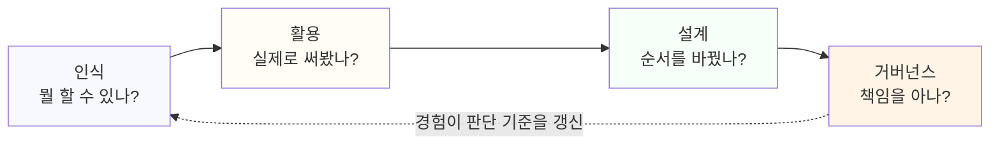

# 1.2 AX 역량의 네 층위: 인식, 활용, 설계, 거버넌스

## 왜 층위로 나누는가

"AX 역량이 있다"는 말은 너무 넓다. AI 도구 이름을 많이 아는 사람도, 매일 업무에 AI를 쓰는 사람도, 팀의 업무 방식을 AI 중심으로 바꾼 사람도 모두 자신을 "AX 역량이 있다"고 말할 수 있다. 이 말이 가리키는 범위가 저마다 다르면 검증도, 준비도 불가능하다.

이 책은 AX 역량을 네 층위로 나눈다. 아래로 갈수록 범위가 넓어지고, 요구되는 경험도 많아진다. 1.1에서 다룬 "판단을 어디까지 AI와 나누는가"라는 질문을 네 단계로 쪼갠 것이라고 보면 된다.

## 1층 — 인식: AI가 할 수 있는 일과 못하는 일을 안다

AI가 무엇을 잘하고 무엇을 잘 못하는지 구분하는 층위다. 생성형 AI가 확률적으로 다음 내용을 만들어낸다는 원리 수준의 이해, 그래서 그럴듯하게 말해도 틀릴 수 있다는 걸 아는 것이 여기에 속한다. 이 층위가 없으면 도구를 과신하거나 반대로 아예 쓰지 않는 쪽으로 치우친다.

자가 점검 질문:
- AI가 틀린 답을 자신 있게 내놓은 경우를 직접 본 적이 있는가.
- 지금 쓰는 도구가 못하는 일을 구체적으로 하나 말할 수 있는가.

## 2층 — 활용: 실제 업무에 도구를 적용한다

알고 있는 것을 실제로 써보는 층위다. 업무 중 반복되는 일 하나를 AI 도구로 처리해본 경험이 여기에 속한다. 1층의 지식이 2층의 경험으로 넘어가지 않으면 역량으로 인정받기 어렵다. "AI를 안다"와 "AI로 일해봤다"는 전혀 다른 문장이다.

자가 점검 질문:
- 지난 한 달 동안 AI 도구로 처리한 업무를 구체적으로 하나 말할 수 있는가.
- 그 결과를 그대로 쓰지 않고 고친 경험이 있는가(1.1에서 다룬 질문과 같다).

## 3층 — 설계: 업무 프로세스 자체를 AI 중심으로 재구성한다

한 가지 일을 AI로 처리하는 것을 넘어, 업무 전체의 순서나 구조를 바꾸는 층위다. 보고서를 AI로 더 빠르게 쓰는 것은 2층이다. 보고서를 쓰는 과정 자체를 바꿔서, 데이터 수집부터 초안 작성, 검증까지의 단계를 다시 설계하는 것은 3층이다. 이 층위는 혼자서는 완성하기 어렵고, 보통 팀이나 조직 단위의 합의가 필요하다.

자가 점검 질문:
- 업무의 순서나 담당을 AI 도입 이후에 바꿔본 적이 있는가.
- 바꾼 뒤와 전의 차이를 설명할 수 있는가.

## 4층 — 거버넌스: 리스크와 품질을 관리하고 책임 소재를 판단한다

AI를 업무에 쓸 때 생기는 위험을 관리하는 층위다. 개인정보, 저작권, 편향, 책임 소재 같은 질문에 답을 가지고 있는 것이 여기에 속한다. 이 층위는 숙련도의 문제가 아니라 판단 기준의 문제다. 이 결과를 썼다가 문제가 생기면 누구의 책임인가에 답이 없으면 아무리 능숙하게 도구를 써도 조직에 위험을 떠안긴다.

자가 점검 질문:
- 업무에 AI 결과를 쓰기 전에 확인하는 절차가 있는가.
- 그 결과가 잘못됐을 때 누구의 책임인지 생각해본 적이 있는가.

네 층위를 그림으로 겹쳐보면 아래 층위가 위 층위를 받치는 구조가 더 분명히 보인다. 거버넌스에서 쌓은 경험은 다시 인식의 판단 기준을 갱신하는 식으로 순환한다는 점을 점선으로 표시했다.

## 네 층위는 쌓인다

네 층위는 순서대로 쌓인다. 인식 없이 활용하면 과신하게 되고, 활용 없이 설계하면 현실에 맞지 않는 계획이 된다. 설계 없이 거버넌스만 따지면 아무것도 못 하는 조직이 된다. 반대로 거버넌스 없이 설계와 활용만 앞서가면 사고가 난 뒤에야 문제를 알게 된다.

## 층위 사이에서 막히는 지점

층위는 쌓이지만, 아래 층위를 잘한다고 위 층위로 자동으로 넘어가지는 않는다. 층위마다 넘어가지 못하고 막히는 이유가 다르다.

1층에서 2층으로 못 넘어가는 사람은 대개 "알지만 써볼 기회가 없었다"고 말한다. 실제로는 기회가 없는 게 아니라, 반복되는 업무 중 AI를 붙여볼 만한 지점을 스스로 찾아본 적이 없는 경우가 많다. 기회는 주어지는 게 아니라 찾아야 하는 것이다.

2층에서 3층으로 못 넘어가는 사람은 활용 자체는 능숙한데, 그 활용을 "내 몫"으로만 여기는 경우가 많다. 업무 프로세스를 바꾸려면 동료나 상급자의 동의가 필요한데, 그 대화를 시작해본 적이 없으면 아무리 능숙해도 개인의 습관으로만 남는다. 활용이 설계로 못 넘어가는 가장 흔한 이유는 기술이 부족해서가 아니라 제안을 해본 적이 없어서다.

3층에서 4층으로 못 넘어가는 사람은 설계까지는 해냈지만, 그 설계에 안전장치를 넣는 일을 번거로운 절차로 여기는 경우가 많다. 프로세스를 바꾸는 데 들인 노력에 비해 검증 절차를 추가하는 일은 성과가 눈에 덜 띄기 때문이다. 이 지점에서 멈추면 효율은 올라갔지만 책임 소재는 흐려진 상태로 남는다.

## 한 업무로 보는 네 층위

같은 업무를 네 층위에 통과시켜보면 각 층위가 실제로 무엇을 가리키는지 더 분명해진다. 월간 실적 보고서를 쓰는 업무를 예로 들어본다.

인식 층위에 있는 사람은 AI가 보고서 초안을 써줄 수 있다는 걸 알지만, 그 초안이 숫자를 지어내는 경우가 있다는 것도 함께 안다. 그래서 AI가 낸 숫자를 원자료 없이 그대로 믿지 않는다.

활용 층위로 넘어간 사람은 실제로 지난달 실적 데이터를 AI에게 넘기고 초안을 받아본 경험이 있다. 처음 받은 초안에서 틀린 숫자를 발견하고 고쳐본 적도 있다. 이 경험이 쌓이면 어떤 자료를 줘야 틀린 숫자가 줄어드는지에 대한 감이 생긴다.

설계 층위에 있는 사람은 여기서 한 걸음 더 간다. 매달 반복되는 보고서 작성 과정 자체를 다시 짠다. 예를 들어 데이터를 입력하면 초안이 자동으로 나오도록 순서를 바꾸고, 담당자는 초안을 검토하는 역할에 집중하도록 업무를 재배치한다. 이 재배치는 혼자 결정할 수 없는 경우가 많다. 팀 전체가 보고서를 보는 방식을 같이 바꿔야 하기 때문이다.

거버넌스 층위에 있는 사람은 이 전체 과정에 안전장치를 둔다. AI가 만든 숫자를 검증하지 않고 그대로 제출했을 때 생기는 위험을 미리 따져보고, 검증 단계를 건너뛸 수 없도록 절차에 못을 박는다. 보고서 하나가 잘못 나갔을 때 누가 책임지는지도 이 층위에서 미리 정해둔다.

네 층위는 한 사람 안에서 순서대로 지나가는 과정이기도 하고, 같은 조직 안에서 서로 다른 사람이 각자 맡는 역할이기도 하다. 지금 자신이 하는 일이 이 네 층위 중 어디에 해당하는지 구분하는 습관을 들이면, 다음에 손댈 지점을 매번 다시 고민하지 않아도 된다.

## 하나만 잘해서는 안 되는 이유

네 층위 중 하나만 잘하는 경우가 흔하다. 도구를 능숙하게 쓰지만 결과를 검증하지 않는 사람, 리스크 개념은 잘 알지만 실제로 업무에 적용해본 적은 없는 사람이다. 평가자는 이 불균형을 쉽게 알아챈다. 2.6에서 다루는 통과와 탈락을 가르는 평가 기준의 상당수가 한 층위에서만 말하고 나머지 층위를 건드리지 못하는 경우에서 나온다.

> **북마크**
> 네 층위 자가 점검표
> - [ ] 인식: AI가 못하는 일을 구체적으로 말할 수 있다
> - [ ] 활용: 지난 한 달 안에 AI로 업무를 처리한 경험이 있다
> - [ ] 설계: 업무 순서나 구조를 바꿔본 경험이 있다
> - [ ] 거버넌스: AI 결과를 쓰기 전 확인하는 절차가 있다
>
> 체크가 안 되는 층위가 이번 주에 손댈 자리다. 아래 층위부터 순서대로 채운다.

## 이 네 층위가 책 전체의 뼈대다

2부에서 다룰 기업의 검증 방식, 3부에서 다룰 검사 평가 영역, 4부에서 다룰 핵심 역량 기둥은 모두 이 네 층위를 전제로 설계되어 있다. 지금 이 표를 채워두면 나머지 장을 읽을 때 지금 이 내용이 어느 층위에 해당하는가를 바로 판단할 수 있다.

## 체크리스트

- [ ] 네 층위 중 내가 확실히 채운 층위와 비어 있는 층위를 구분했다
- [ ] 비어 있는 층위 중 가장 아래 있는 것부터 손댈 순서를 정했다
- [ ] 월간 보고서처럼 반복되는 업무 하나를 골라 네 층위를 대입해봤다
