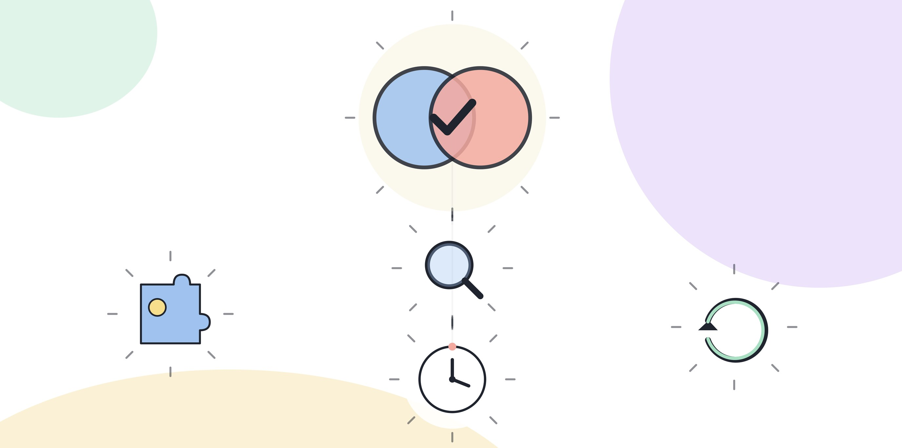

# 1.3 AX 역량과 AI 리터러시의 경계

## 같은 말로 쓰이지만 다른 범위

"AI 리터러시"와 "AX 역량"은 자주 섞여 쓰인다. 둘 다 "AI를 잘 다룬다"는 인상을 주기 때문이다. 하지만 두 말이 가리키는 범위는 다르다. AI 리터러시는 AX 역량의 부분집합이다.

AI 리터러시는 AI라는 기술 자체를 이해하는 능력이다. 모델이 어떻게 동작하는지, 도구를 어떻게 조작하는지, 어떤 입력을 주면 어떤 출력이 나오는지를 아는 것이다. 1.2에서 다룬 네 층위 중 1층(인식)과 2층(활용)의 앞부분에 해당한다.

AX 역량은 그 기술을 조직의 업무 맥락 안에서 가치로 바꾸는 능력까지 포함한다. 같은 도구를 알고 있어도, 그것으로 어떤 업무를 바꿀지, 바꾼 결과를 어떻게 검증할지, 바뀐 프로세스를 동료에게 어떻게 설명할지는 전혀 다른 능력이 필요하다. 1.2의 3층(설계)과 4층(거버넌스), 그리고 조직 안에서의 소통까지가 AX 역량의 영역이다.

[그림] AI 리터러시는 AX 역량의 토대일 뿐, 그 자체가 AX 역량은 아니다.

## 구분표

| | AI 리터러시 | AX 역량 |
|---|---|---|
| 묻는 질문 | 이 도구가 어떻게 동작하는가 | 이 도구로 어떤 업무 가치를 만드는가 |
| 평가 대상 | 도구에 대한 이해 | 업무 맥락에서의 판단과 실행 |
| 범위 | 기술 자체 | 기술 더하기 조직, 업무, 책임 |
| 혼자서 완성되는가 | 그렇다 | 아니다, 보통 팀이나 조직의 합의가 필요하다 |
| 자격시험으로 잘 측정되는 부분 | 많다(개념, 용어, 기본 조작) | 일부만 가능하다(판단, 설계는 실무에서 드러난다) |

## 리터러시가 높아도 역량은 낮을 수 있다

AI 리터러시와 AX 역량이 같은 방향으로 움직이지 않는 경우가 실제로 있다. 모델이 어떤 원리로 다음 단어를 예측하는지 설명할 수 있고, 프롬프트 문법을 정교하게 쓸 수 있고, 여러 도구의 기능 차이를 줄줄 말할 수 있는 사람도, 그 지식을 자기 업무의 구체적인 지점에 연결하지 못하는 경우가 있다.

이런 경우는 대개 두 가지 모습으로 나타난다. 하나는 도구를 업무와 상관없이 혼자 탐구하는 경우다. 새로 나온 모델을 써보고, 설정을 바꿔보고, 흥미로운 결과를 만들어보는 데는 능숙하지만, 그 능숙함이 실제로 처리하는 업무량이나 품질로 이어지지 않는다. 다른 하나는 도구를 업무에 쓰긴 하지만 매번 같은 방식으로만 쓰는 경우다. 프롬프트 하나를 외워서 반복해 쓰고, 업무가 조금만 달라져도 그 프롬프트를 고치지 못한다. 이 경우는 1.2에서 다룬 활용 층위에 머물러 있을 뿐, 설계 층위로 넘어가지 못한 상태다.

반대 방향도 가능하다. 모델의 작동 원리를 정확히 설명하지 못해도, 자기 업무에서 반복되는 지점을 정확히 짚어내고 그 지점에 도구를 적용해 눈에 보이는 차이를 만드는 사람이 있다. 이 사람은 AI 리터러시를 묻는 지식형 시험에서는 낮은 점수를 받을 수 있지만, 실제 업무 평가에서는 AX 역량을 인정받는다. 기업이 궁금해하는 쪽은 결국 이 사람이다.

이 두 방향을 같이 보면 리터러시와 역량이 왜 부분집합 관계인지가 드러난다. 리터러시는 역량이 성립하기 위한 바탕이지만, 바탕이 넓다고 그 위에 세운 것이 저절로 커지지는 않는다. 반대로 바탕 없이 위만 세우려 하면, 도구의 한계를 모른 채 업무를 재설계하는 셈이 되어 리스크를 놓치기 쉽다.

## 리터러시 없이 역량만 앞서가는 경우

반대 방향의 불균형도 있다. 업무에서 눈에 보이는 변화를 만들어냈지만, 그 변화가 왜 가능했는지는 설명하지 못하는 경우다. 예를 들어 이런 상황을 가정하면 보인다. 한 담당자가 AI 도구로 고객 문의 응대 시간을 눈에 띄게 줄였다. 다만 그 도구가 왜 어떤 질문에는 정확하게 답하고 어떤 질문에는 엉뚱하게 답하는지는 설명하지 못한다. 운이 좋을 때는 이 상태로도 문제가 드러나지 않는다. 그러다 도구가 평소와 다르게 틀린 답을 자신 있게 내놓는 순간, 왜 틀렸는지도 모르고 다음에 또 틀릴지도 예측하지 못한 채 그 결과를 그대로 넘기게 된다.

이 경우는 설계 층위까지는 갔지만 인식 층위의 바탕이 얕은 상태다. AI 리터러시가 AX 역량의 바탕이라는 말은 이런 경우를 가리킨다. 바탕이 얕아도 당장은 성과가 나지만, 도구가 평소와 다르게 움직이는 순간 그 성과는 오래가지 못한다.

## 왜 이 구분을 알아야 하는가

"AI를 잘 안다"와 "AX 역량이 있다"가 다른 질문이라는 걸 모르면 준비 방향이 엉킨다. 도구 사용법 강의를 듣고 자격증을 모으는 것으로 준비를 끝냈다고 생각하기 쉽다. 하지만 2부에서 다룰 기업의 검증 방식을 보면, 기업이 실제로 궁금해하는 것은 "이 도구를 아는가"가 아니라 "이 도구로 우리 업무에서 무엇을 바꿀 수 있는가"다.

예를 들어 이런 상황을 가정하면 차이가 보인다. 두 지원자가 같은 AI 도구 자격증을 가지고 있다. 한 명은 자격시험에서 요구하는 개념과 기능을 정확히 설명한다. 다른 한 명은 그 도구로 실제 업무 하나를 어떻게 바꿨는지, 바꾼 뒤 무엇이 달랐는지를 구체적으로 말한다. 면접에서 더 높은 평가를 받는 쪽은 대개 뒤 사람이다. 자격증은 AI 리터러시를 증명하지만, AX 역량은 증명하지 못한다.

## 그래서 이 책이 자격시험 대비서가 아닌 이유

이 책이 3부와 7부에서 검사 유형과 모의 문제를 다루지만, 책 전체의 중심은 4부의 핵심 역량 기둥과 6부의 포트폴리오에 있다. 지식형 문제를 맞히는 연습만으로는 AX 역량을 증명할 수 없기 때문이다. AI 리터러시는 AX 역량의 바탕이지만 전부가 아니다.

## 지금 할 일

자신이 "AI를 잘 다룬다"고 말할 때, 그 말이 도구 사용 경험을 가리키는지 업무를 바꾼 경험을 가리키는지 구분해본다. 전자만 있다면 1.2의 설계, 거버넌스 층위로 넘어가는 게 다음 단계다. 두 층위 모두 4부에서 구체적인 방법을 다룬다.

> **북마크**
> 다음 질문에 둘 다 답할 수 있어야 AX 역량이 있다고 말할 수 있다.
> 1. (리터러시) 지금 쓰는 도구가 어떤 원리로 동작하는지 한 문장으로 설명할 수 있는가.
> 2. (AX 역량) 그 도구로 바꾼 업무 하나와, 바뀐 뒤의 구체적인 차이를 말할 수 있는가.
>
> 1번만 답할 수 있다면 AI 리터러시 단계다. 4부에서 2번을 채우는 법을 다룬다.

## 체크리스트

- [ ] AI 리터러시와 AX 역량을 구분표의 다섯 기준으로 설명할 수 있다
- [ ] 내가 가진 AI 관련 지식 중 업무 변화로 이어진 것과 아직 안 이어진 것을 나눠봤다
- [ ] 자격증이나 수료증이 증명하는 범위가 리터러시인지 역량인지 확인했다
