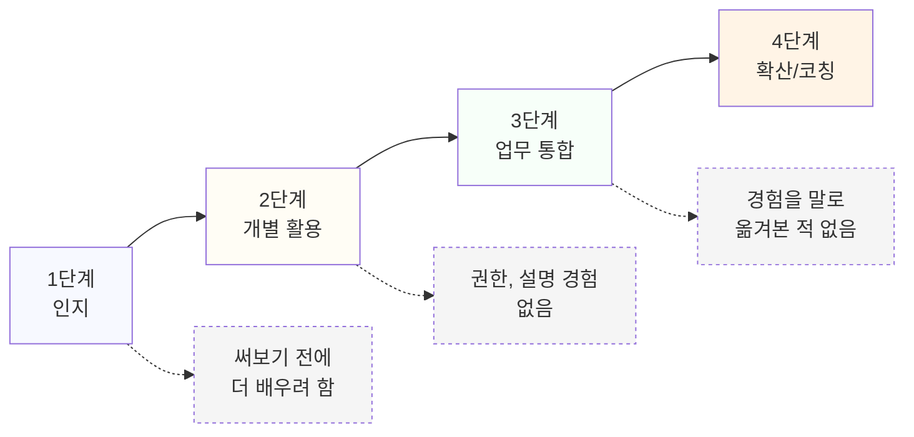

# 1.6 개인 단위 AX 역량 성숙도 모델

## 층위와 단계는 다른 축이다

1.2에서 다룬 인식, 활용, 설계, 거버넌스는 역량의 "영역"을 가른 축이다. 이번 장에서 다루는 성숙도 모델은 "시간이 지나면서 그 영역들을 얼마나 깊고 넓게 채웠는가"를 보는 축이다. 두 축을 같이 쓰면 "지금 어떤 영역이 부족한가"와 "그 영역에서 얼마나 더 나아갔는가"를 동시에 말할 수 있다.

성숙도는 네 단계로 나뉜다. 인지 단계, 개별 활용 단계, 업무 통합 단계, 확산 및 코칭 단계다. 단계가 올라갈수록 영향을 미치는 범위가 자신에서 팀으로, 팀에서 조직으로 넓어진다.

## 1단계: 인지 단계

AI가 무엇을 할 수 있는지 알지만, 실제 업무에 써본 경험은 거의 없는 단계다. 뉴스나 사내 공지로 AI 도구 소식을 접하고, 가끔 궁금해서 한두 번 써본 정도다. 1.2의 인식 층위에만 머물러 있는 상태와 거의 겹친다.

이 단계에서 다음으로 넘어가는 조건은 하나다. 실제 업무 하나를 AI 도구로 끝까지 처리해보는 것이다. 호기심으로 몇 번 눌러보는 것과, 업무 결과물을 내는 것까지 끝까지 가져가는 것은 다르다. 후자를 한 번이라도 완결하면 2단계로 넘어간다.

## 2단계: 개별 활용 단계

업무 중 일부를 AI 도구로 처리하는 것이 익숙해진 단계다. 반복되는 보고서 초안, 데이터 요약, 메일 작성 같은 일을 AI로 먼저 처리하고 다듬어서 쓴다. 이 단계의 특징은 활용이 개인의 습관으로 자리 잡았다는 점이다. 다만 아직 업무 프로세스 자체를 바꾸지는 않고, 자신이 하던 일의 일부만 도구로 대체한 상태다.

이 단계에 머무는 사람이 가장 많다. 넘어가지 못하는 이유는 보통 두 가지다. 하나는 자기 업무의 범위를 넘어서는 결정을 할 권한이 없다고 느끼는 것이고, 다른 하나는 바꾼 방식을 동료나 팀에 설명해본 적이 없는 것이다. 3단계로 넘어가는 조건은 이 둘 중 하나를 시도하는 것이다. 자신의 업무 방식을 팀에 제안해보거나, 작더라도 업무 순서를 실제로 바꿔보는 것이다.

## 3단계: 업무 통합 단계

AI 활용이 개인의 습관을 넘어 업무 프로세스의 일부로 자리 잡은 단계다. 1.2의 설계 층위에 해당한다. 보고서를 쓰는 과정 자체가 자료 수집, AI 초안 생성, 검증, 보완의 흐름으로 재구성되어 있고, 이 흐름이 자신뿐 아니라 업무를 넘겨받는 동료에게도 적용된다. 이 단계에서는 거버넌스 질문도 함께 따라온다. 바뀐 프로세스에서 무엇을 검증하고 누가 책임지는지가 정리되어 있어야 프로세스로 인정받는다.

이 단계에서 다음으로 넘어가는 조건은 범위의 확장이다. 자신의 업무를 넘어 팀이나 다른 사람의 업무 방식에 영향을 주는 경험이다. 이 영향은 거창한 프로젝트가 아니어도 된다. 동료 한 명에게 자신이 바꾼 방식을 설명하고 그 동료가 따라 해보는 것으로 시작되는 경우가 많다.

## 4단계: 확산 및 코칭 단계

자신이 만든 업무 방식을 다른 사람에게 전달하고, 그 방식이 팀이나 조직 단위로 퍼지는 단계다. 신입이나 동료에게 AX 관련 업무 방식을 가르치거나, 사내 가이드나 체크리스트를 만들어 공유하는 활동이 여기에 속한다. 이 단계에서는 네 층위 전부가 요구된다. 인식이 없으면 가르칠 수 없고, 활용 경험이 없으면 구체적으로 가르칠 수 없고, 설계 경험이 없으면 프로세스로 전달할 수 없고, 거버넌스 감각이 없으면 퍼진 방식이 위험을 안고 퍼진다.

이 단계는 도달해야 할 목표라기보다, 조직이 AX 역량을 평가할 때 가장 높게 보는 지점이다. 사내 평가나 승진 기준에서 "AX를 확산시킨 경험"을 묻는다면 이 단계를 가리키는 것이다.

네 단계와 각 단계에서 다음으로 못 넘어가는 흔한 이유를 함께 그리면 아래와 같다. 점선 노드가 그 단계에 머물게 되는 이유다.

## 단계마다 멈추는 흔한 이유

네 단계 각각에서 멈추는 이유를 조금 더 구체적으로 짚어본다. 1단계에서 멈추는 사람은 보통 "아직 배울 게 많다"는 생각으로 실제 업무 적용을 뒤로 미룬다. 더 알고 나서 써보겠다는 생각이지만, 역설적으로 실제로 써보기 전까지는 무엇을 더 알아야 하는지도 분명해지지 않는다.

2단계에서 멈추는 사람은 앞서 짚었듯 권한과 설명의 문제에 걸리지만, 그 밑에 더 흔한 이유가 하나 있다. 지금 방식이 이미 편해서 굳이 바꿀 필요를 못 느끼는 것이다. 개인 차원에서는 이 편안함이 문제가 안 되지만, 평가자 입장에서는 2단계에 오래 머문 사람과 3단계로 넘어간 사람을 다르게 본다.

3단계에서 멈추는 사람은 자신의 업무를 재설계하는 데는 성공했지만, 그 경험을 언어로 옮겨서 남에게 전달하는 연습을 해본 적이 없다. 손으로는 할 수 있는데 말이나 글로는 설명하지 못하는 상태다. 이 상태는 6부에서 다룰 포트폴리오 작성에서도 똑같이 걸림목이 된다.

4단계에 이미 있다가 다시 3단계로 내려오는 경우도 있다. 전달할 상대가 바뀌거나 조직이 바뀌면, 이전에 통했던 설명 방식이 새 환경에서는 안 통할 수 있다. 이 경우는 역량이 사라진 게 아니라 전달 방식을 다시 조정해야 하는 상태다.

## 단계는 되돌아갈 수 있다

성숙도 단계는 한 번 올라가면 고정되지 않는다. 새로운 유형의 AI 도구가 등장하면 그 영역에서는 다시 1단계부터 시작해야 할 때가 있다. 텍스트 생성 도구에서는 3단계에 있던 사람도, 전혀 다른 방식으로 동작하는 도구를 처음 접하면 그 도구에 대해서는 인지 단계로 돌아간다. 이 되돌아감은 실패가 아니라 자연스러운 과정이다.

## 자가진단과 다음 장

이 모델을 쓰는 법은 "지금 내가 몇 단계인가"를 정직하게 답하는 것에서 시작한다. 5부 5.1에서 이 자가진단을 바탕으로 3개월, 6개월, 1년 로드맵을 구체적으로 짠다. 지금은 단계만 정확히 짚어두면 된다.

> **북마크**
> 아래 질문에 순서대로 답하면서 멈추는 지점이 현재 단계다.
> 1. AI 도구로 업무 하나를 끝까지 처리해본 적이 있는가. 없다면 1단계.
> 2. 그 처리가 반복되는 습관으로 자리 잡았는가. 아니라면 2단계 초반, 그렇다면 2단계.
> 3. 업무 프로세스 자체를 바꾸고, 그 변화에서 검증과 책임 소재를 정리해본 적이 있는가. 아니라면 2단계에 머무는 것이고, 그렇다면 3단계.
> 4. 그 방식을 다른 사람에게 전달해서 그 사람도 따라 하게 된 적이 있는가. 아니라면 3단계, 그렇다면 4단계.
>
> 이 결과를 5.1의 로드맵 설계에 그대로 가져간다.

## 체크리스트

- [ ] 내가 지금 몇 단계인지 자가진단으로 짚었다
- [ ] 다음 단계로 넘어가는 조건을 구체적으로 안다
- [ ] 최근 새로운 도구 앞에서 단계가 되돌아간 경험이 있는지 돌아봤다
- [ ] 이 결과를 5부 로드맵에 연결할 준비가 됐다
