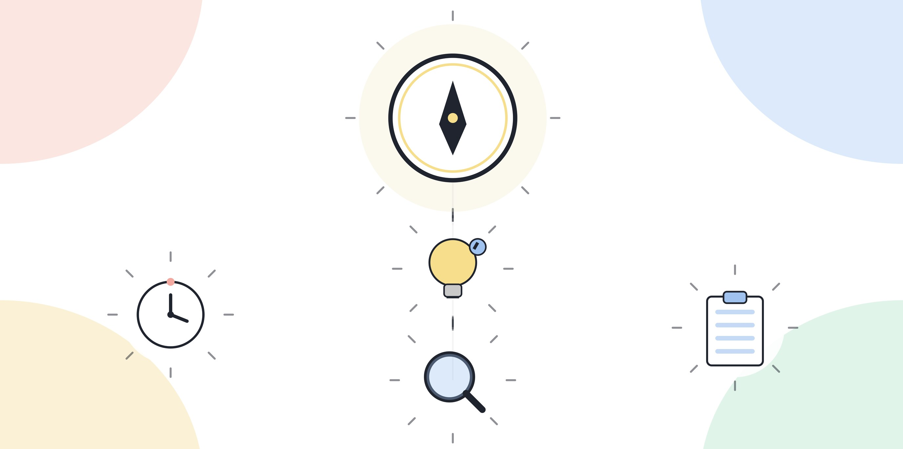

# 1.7 해외 빅테크는 AX 인재를 어떻게 정의하는가

이 책이 1부에서 세운 정의(1.1~1.6)는 한국 기업의 채용과 사내 평가를 기준으로 삼았다. 같은 질문을 해외로 넓혀 보면 어떨까. 글로벌 빅테크의 CEO들도 비슷한 시기에 비슷한 질문과 씨름하고 있다. 회사마다 쓰는 말은 다르지만, 공개 발언과 기술 블로그를 모아보면 몇 가지 줄기가 겹친다.

**이 장의 인용은 전부 공개된 인터뷰, 컨퍼런스 발언, 에세이, 기업 블로그에서 가져왔고, 출처를 바로 옆에 달았다.** CEO의 발언은 그 회사의 공식 채용 기준과 다를 수 있고, 인터뷰나 팟캐스트라는 맥락 때문에 과장되거나 홍보성 표현이 섞일 수 있다는 점을 감안하고 읽는다.

## "익숙함"이 아니라 "숙련도"를 요구한다 — 마이크로소프트

마이크로소프트는 2025~2026년 채용을 재개하면서 채용 기준 자체를 바꿨다. 사티아 나델라는 신규 채용 후보가 AI를 "안다"는 수준이 아니라 실제로 능숙하게 다룬다는 것을 입증해야 한다는 조건을 내걸었다고 보도됐다. ([finalroundai.com](https://www.finalroundai.com/blog/satya-nadella-ai-push-microsoft))

2026년 3월에는 "AI 덕분에 누구나 소프트웨어 개발자가 될 수 있다"면서도, 그렇다고 숙련된 개발자의 자리가 사라지는 것은 아니라고 선을 그었다. ([itpro.com](https://www.itpro.com/software/development/satya-nadella-ai-software-development-skills))

마이크로소프트의 Tech Community 블로그는 이 구분을 "AI 유창성(AI fluency)"이라는 용어로 정리한다. "AI 유창성은 생성형 AI를 이해하고 효과적으로 상호작용하는 능력의 정도"라고 정의하고, 언제 AI가 가치를 더하는지 알아보고 그것을 업무 흐름에 실제로 끼워 넣는 능력까지를 포함한다고 설명한다. ([techcommunity.microsoft.com](https://techcommunity.microsoft.com/blog/skills-hub-blog/bringing-ai-fluency-to-every-corner-of-the-organization-even-yours/4494105)) 관련된 90일 적응 프레임워크는 업무를 "AI 혼자 할 수 있는 일, 사람과 AI가 같이 해야 하는 일, 사람의 판단에만 의존하는 일" 세 더미로 나누라고 제안하고, 호기심, 창의성, 소통, 공감, 용기라는 다섯 가지 "오래가는 인간 역량"을 같이 강조한다. ([windowsforum.com](https://windowsforum.com/news/microsofts-90-day-ai-fluency-plan-task-mapping-human-skills-career-impact.415567/))

이 구분은 이 책의 1.3(AX 역량과 AI 리터러시의 경계)이 세운 구분과 거의 겹친다. "안다"와 "능숙하게 다룬다"의 차이가 곧 이 책에서 말하는 AI 리터러시와 활용 층위의 차이다.

[그림] 회사마다 쓰는 말은 달라도, 가리키는 역량의 결은 비슷하게 수렴한다.

## "모두가 프로그래머다"와 "쓰는 사람에게 밀린다" — 엔비디아

젠슨 황은 2023년 컴퓨텍스 타이베이에서 "프로그래밍의 장벽이 극도로 낮아졌다. 이제는 누구나 프로그래머다. 컴퓨터에게 뭔가를 말하기만 하면 된다"고 말했다. ([finance.yahoo.com](https://finance.yahoo.com/news/nvidia-ceo-jensen-huang-says-085646712.html))

이후 가장 많이 인용되는 문장은 2025년 밀컨 인스티튜트 글로벌 콘퍼런스에서 나온 말이다. "당신은 AI에게 일자리를 뺏기지 않는다. AI를 쓰는 사람에게 일자리를 뺏긴다." ([cnbc.com](https://www.cnbc.com/make-it/2025/05/28/nvidia-ceo-jensen-huang-youll-lose-your-job-to-somebody-who-uses-ai.html))

동시에 그는 AI가 없애는 일자리만큼 새로운 직군도 만든다고 짚는다. 데이터 엔지니어링, AI 팩토리 운영, AI 안전 엔지니어, 프롬프트 엔지니어링을 예로 들었다. (대만국립대 졸업식 연설 인용, [medium.com](https://medium.com/@nirmal_J/nvidia-ceo-jensen-huang-how-ai-is-redefining-the-need-for-programming-skills-05582d08d2a3))

"AI 안전 엔지니어"와 "AI 팩토리 운영"은 이 책의 네 층위 중 거버넌스에 가깝고, "프롬프트 엔지니어링"은 활용과 설계 사이에 걸쳐 있다. 황의 발언을 그대로 옮기면 "도구를 쓸 줄 아는 사람"을 가리키는 것처럼 들리지만, 그가 예로 든 새 직군들은 이 책이 활용보다 위라고 구분한 층위와 맞닿아 있다.

## 엔지니어의 역할이 옮겨간다 — 메타

마크 저커버그는 2025년 1월 한 팟캐스트에서 "2025년 안에 메타를 포함한 회사들이 중급 엔지니어 수준으로 코드를 짤 수 있는 AI를 갖게 될 것"이라고 말했다. ([windowscentral.com](https://www.windowscentral.com/software-apps/mark-zuckerberg-ai-engineers-might-claim-coding-jobs))

같은 해 4월에는 한 걸음 더 나아가 "앞으로 12~18개월 안에 메타 코드 대부분을 AI가 작성하게 될 것이고, 품질은 팀의 평균 우수 인력보다 높을 것"이라고 말했다. ([remunerationlabs.substack.com](https://remunerationlabs.substack.com/p/mark-zuckerberg-says-ai-could-soon))

이 발언이 가리키는 것은 "코드를 짜는 능력"의 가치가 낮아진다는 것이지, 엔지니어가 필요 없어진다는 뜻은 아니다. 코드 작성이 AI로 넘어갈수록 사람에게 남는 일은 더 높은 단계의 문제 정의와 판단이라는 해석이 뒤따른다. 이 책의 4.6(문제정의력)이 다루는 내용과 같은 방향이다.

## "AI 네이티브"로 조직을 설계한다 — 구글

순다르 피차이는 2023년 블룸버그와의 인터뷰에서 "지금은 경쟁이 치열한 순간이지만, 나는 오랫동안 회사를 AI 네이티브로 만들어왔다"고 말했다. ([Fortune](https://fortune.com/2023/06/14/google-ceo-sundar-pichai-interview-better-position-ai-than-mobile))

채용 기준에 대해서는 "정말 뛰어난 프로그래머, 컴퓨터과학을 잘 이해하고 새로운 상황에 유연하게 적응하고 성장할 수 있는 사람"을 찾는다고 설명했고, "슈퍼스타급 소프트웨어 엔지니어를 찾고 있다"고 덧붙였다. ([seekingalpha.com](https://seekingalpha.com/news/4455725-alphabet-ceo-pichai-eyes-engineering-talent-amid-ai-advances) 보도 종합)

여기서 "유연하게 적응하고 성장하는 능력"은 특정 도구 하나를 잘 다루는 것과는 다른 말이다. 이 책이 1.6에서 다룬 성숙도 모델의 마지막 단계(확산, 코칭)와 같은 방향을 가리킨다.

## 재교육이 핵심이라는 경고 — 앤트로픽

다리오 아모데이는 2024년 에세이 "Machines of Loving Grace"와 2026년 1월 후속 에세이에서 AI가 향후 1~5년 안에 신입, 초급 사무직 일자리의 상당 부분을 대체할 수 있다고 경고했다. ([claudeainews.com](https://www.claudeainews.com/news/dario-amodei-adolescence-technology-essay))

이 경고와 함께 반복되는 제안이 재교육이다. 일자리 전환의 핵심은 사람들이 AI와 함께 일하는 새로운 역할로 옮겨갈 수 있도록 교육과 훈련을 제공하는 데 있다는 해석이 그의 에세이를 다룬 여러 매체에서 공통으로 나온다. ([forbes.com](https://www.forbes.com/sites/johnwerner/2024/10/14/anthropics-dario-amodei-posits-an-ai-future/))

이 책의 8부가 "검사 하나를 통과하는 지식"보다 "오래가는 습관"을 강조하는 이유가 여기서도 반복된다. 특정 시점의 AI 활용 능력은 그 시점이 지나면 낡는다. 낡지 않는 것은 새로운 역할로 옮겨가는 능력 자체다.

## 다섯 회사를 겹쳐보면

회사마다 쓰는 단어는 다르다("AI 유창성", "AI 네이티브", "AI를 쓰는 사람"). 그런데 겹쳐 보면 세 가지가 반복된다.

1. **도구를 써봤다는 것과 역량이 있다는 것을 구분한다.** 마이크로소프트의 "익숙함 vs 숙련도", 구글의 "유연하게 적응하는 능력"이 같은 구분을 가리킨다. 이 책 1.3의 구분과 같다.
2. **AI가 대체하는 일 옆에 새로 생기는 역할이 있다.** 엔비디아의 AI 안전 엔지니어, 프롬프트 엔지니어, 데이터 엔지니어, 메타의 "더 높은 단계의 문제 정의"가 여기 해당한다. 이 책 1.2의 설계, 거버넌스 층위와 겹친다.
3. **재교육과 적응력이 반복해서 강조된다.** 앤트로픽의 경고, 마이크로소프트의 다섯 가지 "오래가는 인간 역량"이 같은 결론으로 수렴한다. 이 책 8부의 주제와 같다.

다섯 회사의 발언이 서로 다른 날, 다른 맥락(인터뷰, 에세이, 블로그, 팟캐스트)에서 나왔는데도 같은 세 가지로 모인다는 것이, 이 책이 1부에서 세운 틀(네 층위, 성숙도 모델)이 한국 기업만의 특수한 기준이 아니라는 근거가 된다.

> **북마크**
> 빅테크 발언을 읽을 때 걸러내는 질문
> - [ ] 이 발언은 공식 채용 기준인가, 아니면 인터뷰나 에세이에서 나온 개인 의견인가
> - [ ] 이 발언이 가리키는 역량은 이 책의 네 층위(인식, 활용, 설계, 거버넌스) 중 어디에 해당하는가
> - [ ] 발언 시점의 기술 수준을 전제로 한 말인가, 아니면 시간이 지나도 남는 구조에 대한 말인가

## 오늘 할 일

이 장에서 인용한 발언 중 하나를 골라 원문 기사를 직접 열어 전체 맥락을 읽어본다. 요약된 한 문장과 원문의 맥락이 같은 뜻인지 확인한다. 그 발언이 이 책의 네 층위 중 어디를 가리키는지 한 줄로 적어본다.

다음 장은 2부에서 이어진다. 해외 빅테크가 정의하는 방식과 국내 기업이 실제로 검증하는 방식(2.7)을 비교해보면, "AX 인재"라는 말이 지역을 넘어 공통으로 가리키는 지점이 더 뚜렷해진다.
