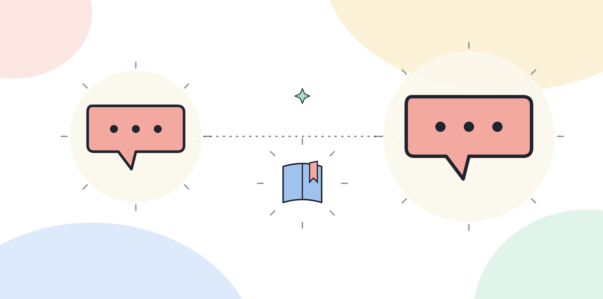

# 2.3 면접에서 AX 역량을 묻는 질문의 유형

## 질문의 생김새는 달라도 보려는 것은 같다

면접관이 AX 역량을 확인하려고 던지는 질문은 겉모습이 여러 가지다. 어떤 질문은 과거 경험을 묻고, 어떤 질문은 가상의 상황을 던지고, 어떤 질문은 답변 뒤에 또 질문을 이어 붙인다. 겉모습은 갈리지만 이 질문들이 공통으로 확인하려는 것은 하나다. 지원자가 AI 도구를 켜고 쓰는 수준을 넘어, 그 결과를 판단하고 책임질 수 있는가다.

이 장은 면접에서 반복적으로 나오는 질문을 네 유형으로 나눠서, 유형마다 면접관이 실제로 보려는 지점을 설명한다.

[그림] 질문의 형태는 달라도 결국 같은 판단력을 겨냥한다.

## 경험형 — "AI를 활용해 업무를 바꿔본 경험을 말해보라"

가장 흔한 유형이다. 질문 자체는 과거를 묻지만, 면접관이 실제로 채점하는 지점은 경험의 존재 여부가 아니다. 그 경험을 얼마나 구체적으로 설명하는가다. "AI로 보고서를 더 빠르게 썼다"는 답변은 경험이 있다는 사실만 보여준다. "보고서 작성 중 통계 요약 단계를 AI에 맡기고, 그 요약에서 틀린 수치 하나를 발견해 고쳤다"는 답변은 그 경험 안에서 어떤 판단을 했는지를 보여준다. 면접관은 후자를 찾는다.

경험형 질문에 약점을 가진 사람은 경험이 없는 사람이 아니라, 경험을 뭉뚱그려 말하는 사람이다. "AI를 많이 써봤다"는 문장은 구체적인 장면 하나보다 설득력이 떨어진다.

## 판단형 — "이 업무에 AI를 적용한다면 어디부터 적용하겠는가"

이 유형은 과거 경험이 아니라 지금의 판단력을 직접 시험한다. 질문에 등장하는 업무는 지원자가 모를 수도 있는 업무일 때가 많다. 면접관이 보려는 것은 정답을 맞히는 능력이 아니라, 낯선 업무를 받았을 때 어떤 기준으로 우선순위를 정하는가다.

좋은 답변은 보통 두 단계를 밟는다. 먼저 그 업무를 몇 개의 작은 단계로 쪼갠다. 그다음 그 단계 중 반복적이고 규칙이 뚜렷한 단계를 먼저 지목하고, 판단이 많이 들어가는 단계는 뒤로 미루거나 사람이 맡아야 한다고 구분한다. 이 구분 자체가 답이다. 업무를 쪼개지 않고 "전체에 AI를 적용하겠다"고 답하면 우선순위를 정하는 능력이 없다는 신호로 읽힌다.

## 리스크형 — "AI가 낸 결과를 어떻게 검증하는가"

이 유형은 판단력보다 한 단계 더 들어간다. AI를 쓰기로 정한 뒤에 생기는 책임을 묻는다. "다시 한번 확인한다"는 답변은 구체적인 절차가 없으면 통과하기 어렵다. 면접관이 찾는 것은 검증의 구체적인 방법이다. 원본 자료와 대조하는가, 다른 사람에게 재확인을 받는가, 특정 항목(숫자, 날짜, 인용)만 따로 체크하는가 같은 절차다.

이 유형에서 자주 나오는 후속 질문은 "검증했는데도 틀렸다면 어떻게 하겠는가"다. 이 질문은 완벽한 검증 절차를 요구하려는 게 아니다. 실패를 인정하고 책임 소재를 설명할 수 있는지를 본다.

## 시뮬레이션형 — 가상의 업무 상황을 주고 연속으로 대응을 묻는 방식

앞의 세 유형이 질문 하나에 답 하나로 끝난다면, 시뮬레이션형은 하나의 상황에서 시작해 면접관이 조건을 바꿔가며 계속 되묻는다. "이 보고서를 AI로 작성하려 한다. 어떻게 시작하겠는가"로 시작해서, 지원자가 답하면 "그런데 마감이 오늘 저녁으로 당겨졌다면"으로 조건을 바꾸고, 다시 답하면 "그 데이터 중 하나가 최신이 아니라는 걸 나중에 알았다면"으로 또 바꾼다.

이 유형은 답변의 내용보다 답변이 바뀌는 방식을 본다. 조건이 바뀌어도 같은 답을 반복하면 유연성이 없다는 신호다. 반대로 조건마다 원칙 없이 전혀 다른 답을 내면 일관성이 없다는 신호다. 면접관은 조건이 바뀌어도 지키는 기준과, 조건에 맞춰 바뀌는 방법을 구분해서 말하는 사람을 찾는다.

## 네 유형이 실제로 섞여서 나오는 방식

실제 면접에서는 네 유형이 분리된 질문으로 하나씩 나오기보다, 한 질문 안에서 섞여 나오는 경우가 많다. 예를 들어 이런 상황을 가정하면 이 섞임을 더 분명히 볼 수 있다. 면접관이 "최근에 AI로 업무를 바꿔본 경험이 있는가"라고 경험형으로 질문을 연다. 지원자가 "거래처 응대 메일 초안을 AI로 작성했다"고 답하면, 면접관은 바로 "그 초안을 그대로 보냈는가, 아니면 확인했는가"라고 리스크형으로 되묻는다. 지원자가 "거래처명과 금액을 다시 확인했다"고 답하면, 면접관은 "만약 그 확인 절차를 건너뛰어도 되는 상황이 생긴다면 어떻게 하겠는가"라고 판단형 겸 시뮬레이션형으로 조건을 바꾼다.

이 흐름에서 보듯, 하나의 경험형 질문에서 시작한 대화가 리스크형과 판단형으로 자연스럽게 이어진다. 그래서 네 유형을 각각 다른 사례로 준비하는 것보다, 하나의 사례를 깊이 준비해서 어느 방향으로 질문이 이어져도 같은 사례 안에서 답할 수 있게 만드는 쪽이 효율적이다. 얕은 사례 네 개보다 깊은 사례 하나가 이 연쇄 질문에 더 잘 버틴다.

## 꼬리질문에서 드러나는 것

네 유형 모두에서 면접관은 첫 답변보다 꼬리질문에 대한 답변을 더 눈여겨본다. 첫 답변은 준비한 그대로 나올 수 있지만, 꼬리질문은 그 자리에서 즉흥적으로 답해야 하기 때문에 실제 경험인지 아닌지가 더 잘 드러난다. 첫 답변에서 말한 내용과 다른 디테일이 꼬리질문에서 자연스럽게 나오면(예: "그때 몇 시간 정도 걸렸는가"에 구체적인 숫자나 상황이 바로 나오면) 실제 경험으로 받아들여질 가능성이 높아진다. 반대로 꼬리질문마다 답이 모호해지거나 앞서 한 말과 어긋나면, 첫 답변이 꾸며낸 이야기라는 신호로 읽힐 수 있다.

## 네 유형을 준비하는 순서

> **북마크**
> 면접 유형별 준비 질문
> - [ ] 경험형: 업무를 AI로 바꿔본 장면 하나를 숫자나 세부까지 구체적으로 말할 수 있는가
> - [ ] 판단형: 낯선 업무를 받으면 먼저 어떻게 쪼갤지 순서를 말할 수 있는가
> - [ ] 리스크형: AI 결과를 검증하는 자신만의 절차가 있는가
> - [ ] 시뮬레이션형: 조건이 바뀌어도 지키는 원칙과 바뀌는 방법을 구분해서 말할 수 있는가

네 유형은 따로 준비하는 것보다 경험형 하나를 깊게 준비해두면 나머지 세 유형에서도 그 경험을 변형해서 쓸 수 있다. 하나의 경험을 네 방향에서 설명해보는 연습이 네 가지 경험을 얕게 준비하는 것보다 남는다.
