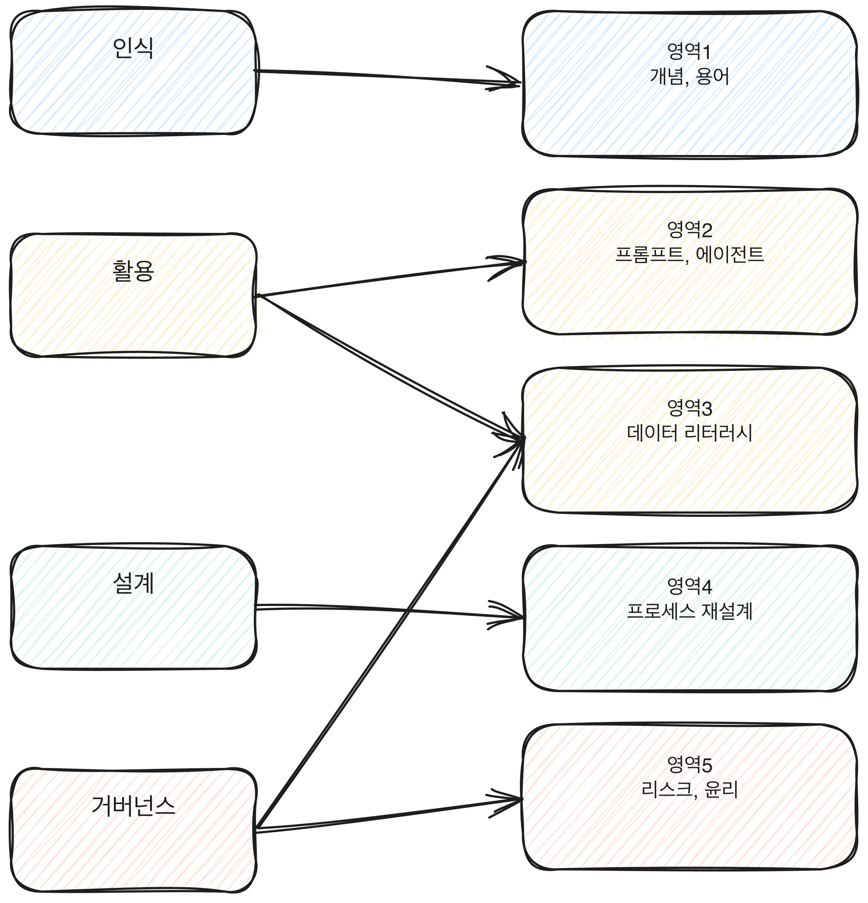

# 2.5 AX 역량검사류가 공통으로 보는 영역

## 이름은 여러 가지로 불려도 영역은 겹친다

여러 기업과 기관이 각자 "AX 직무역량 검사", "AI 활용능력 평가", "AX 적성검사" 같은 이름으로 검사를 운영한다. 이름도, 문항 형식도, 채점 기준도 기관마다 다르다. 이 책은 이 검사들을 하나의 고유한 공식 시험으로 다루지 않는다. 여러 기관이 각자 운영하는 검사군을 묶어 "AX 역량검사류"라고 부른다.

이름과 형식은 달라도, 여러 검사류를 겹쳐놓고 보면 공통으로 다루는 영역이 드러난다. 이 장은 그 공통 영역 다섯 가지를 소개한다. 각 영역을 깊게 다루는 것은 이 장의 목적이 아니다. 전체 지형을 먼저 보여주고, 각 영역의 평가 포인트는 3부에서 하나씩 다룬다.

[그림] 검사 이름은 회사마다 달라도 보는 영역은 자주 겹친다.

## 영역 1 — AI 개념과 용어 이해

AI가 무엇이고, 생성형 AI가 기존 규칙 기반 시스템과 어떻게 다른지, 환각(hallucination), 파인튜닝, 토큰 같은 용어가 무엇을 가리키는지 묻는 영역이다. 이 영역은 지식형 문항으로 나오는 경우가 많다. 다만 단순 암기를 넘어, 그 개념이 실무에서 왜 문제가 되는지까지 묻는 경우가 늘고 있다. 자세한 내용은 3부 3.2에서 다룬다.

## 영역 2 — 프롬프트와 에이전트 활용

AI에게 원하는 결과를 끌어내기 위해 질문이나 지시를 설계하는 능력, 그리고 여러 작업을 연결해 자동으로 처리하는 에이전트형 도구를 다루는 능력을 묻는 영역이다. 단순히 "질문을 잘 쓴다"가 아니라, 같은 요청도 조건을 어떻게 나눠서 넣는지, 결과가 기대와 다를 때 지시를 어떻게 고치는지를 본다. 자세한 내용은 3부 3.3에서 다룬다.

## 영역 3 — 데이터 리터러시와 판단력

숫자와 데이터를 읽고, AI가 내놓은 분석이나 요약이 근거와 맞는지 판단하는 능력을 묻는 영역이다. 통계를 계산하는 능력보다는, 제시된 숫자가 말이 되는지 의심하는 감각에 가깝다. 자세한 내용은 3부 3.4에서 다룬다.

## 영역 4 — 업무 적용과 프로세스 재설계

AI를 단순히 쓰는 것을 넘어, 업무의 순서나 담당을 다시 짜는 능력을 묻는 영역이다. 1부에서 다룬 네 층위 중 3층(설계)에 해당하는 역량이고, 검사에서는 보통 가상의 업무 상황을 주고 어디서부터 바꿀지 순서를 매기게 하는 방식으로 나온다. 자세한 내용은 3부 3.5에서 다룬다.

## 영역 5 — 리스크, 윤리, 거버넌스 감각

개인정보, 저작권, 편향, 책임 소재 같은 질문에 답을 가지고 있는지를 묻는 영역이다. 이 영역은 정답이 뚜렷한 지식 문항과, 상황을 주고 판단을 묻는 문항이 섞여서 나온다. 자세한 내용은 3부 3.6에서 다룬다.

다섯 영역이 1부의 네 층위 중 어디에서 주로 나오는지 그림으로 먼저 본다.

[그림] 네 층위가 다섯 평가 영역으로 갈라지는 지점을 보면 검사가 무엇을 재는지 보인다.

## 다섯 영역과 네 층위의 대응

1부에서 정의한 네 층위(인식, 활용, 설계, 거버넌스)와 이 다섯 영역을 겹쳐 보면 검사가 왜 다섯 영역으로 나뉘는지가 더 뚜렷해진다.

| 평가 영역 | 주로 대응하는 층위 |
|---|---|
| 영역 1 — AI 개념과 용어 이해 | 인식 |
| 영역 2 — 프롬프트와 에이전트 활용 | 활용 |
| 영역 3 — 데이터 리터러시와 판단력 | 활용, 거버넌스 |
| 영역 4 — 업무 적용과 프로세스 재설계 | 설계 |
| 영역 5 — 리스크, 윤리, 거버넌스 감각 | 거버넌스 |

네 층위는 하나가 다른 하나를 포함하는 수직 구조였지만(인식 위에 활용이, 활용 위에 설계가 쌓이는 식), 다섯 영역은 그 수직 구조를 검사가 측정하기 쉬운 단위로 수평으로 펼쳐놓은 것이다. 그래서 영역 1에서 막히면 영역 2부터 5까지 전부 영향을 받는다. 개념을 모르면 프롬프트도, 데이터 판단도, 프로세스 설계도 기반이 흔들린다.

## 다섯 영역이 겹치는 이유

다섯 영역을 따로 보면 서로 관련 없어 보이지만, 실제 업무에서는 겹쳐서 나타난다. 예를 들어 이런 상황을 가정하면 이 겹침이 분명해진다. 한 사람이 고객 문의 답변을 AI로 초안을 만드는 업무를 맡았다. 프롬프트를 정교하게 설계해서(영역 2) 자연스러운 답변을 받아냈지만, 그 답변에 포함된 환불 규정 수치를 의심하지 않고 그대로 보냈다면(영역 3을 놓침) 사고로 이어진다. 업무 프로세스를 잘 재설계해서 반복 문의를 AI가 먼저 분류하게 만들어도(영역 4), 분류 과정에서 특정 고객군에게 불리한 패턴이 반복되는 것을 점검하지 않으면(영역 5를 놓침) 역시 사고로 이어진다. 검사류가 다섯 영역을 따로 측정하면서도 결국 이 영역들이 맞물려 작동하는지를 보는 이유가 여기에 있다. 한 영역만 뛰어나고 나머지가 비면, 그 빈 영역에서 전체 결과가 무너진다.

## 지금 할 수 있는 것

5개 영역을 한 번에 준비할 필요는 없다. 지금 자신의 업무에서 가장 약하다고 느끼는 영역 하나를 먼저 고르고, 3부의 해당 장으로 바로 넘어가는 편이 낫다.

> **북마크**
> 다섯 영역 자가 진단
> - [ ] 영역 1(개념): AI 관련 용어 5개를 뜻을 설명할 수 있다
> - [ ] 영역 2(프롬프트/에이전트): 결과가 기대와 다를 때 지시를 고쳐본 경험이 있다
> - [ ] 영역 3(데이터): AI가 낸 숫자를 원본과 대조해본 경험이 있다
> - [ ] 영역 4(프로세스): 업무 순서를 바꿔본 경험이 있다
> - [ ] 영역 5(리스크): AI 결과를 쓰기 전 확인하는 절차가 있다
>
> 체크가 안 된 영역의 평가 포인트는 3부에서 번호 순서대로 이어진다(3.2부터 3.6까지).
