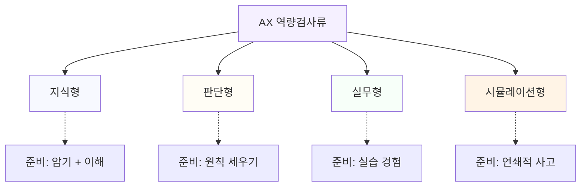

# 3.1 검사 유형의 분류: 지식형, 판단형, 실무형, 시뮬레이션형

## "검사"라는 말 하나로 묶이지 않는다

채용 공고나 사내 평가 공지에 "AX 역량검사"라는 말이 나오면, 그 검사가 하나의 정해진 형식을 따를 것이라고 짐작하기 쉽다. 실제로는 그런 이름을 쓰는 검사가 기업과 기관마다 다르게 설계되어 있고, 같은 기업이라도 해마다 구성이 바뀐다. 이 장에서 "AX 직무역량 검사"는 특정한 하나의 시험이 아니라, 여러 조직이 각자 운영하는 AX 역량검사류를 가리키는 통칭으로 쓴다.

다만 이름이 다양해도 문항이 취하는 형식은 크게 네 가지로 좁혀진다. 지식을 확인하는 형식, 판단을 확인하는 형식, 실제 수행을 확인하는 형식, 연속된 시나리오 대응을 확인하는 형식이다. 같은 검사 안에 네 형식이 섞여 나오는 경우가 많으므로, 공고에 적힌 검사 이름보다 이 네 형식을 기준으로 준비 계획을 짜는 쪽이 실용적이다.

이 분류는 AX 역량검사류에만 해당하는 것이 아니라, 인적성검사나 직무능력검사에서 쓰던 형식을 AI 역량이라는 소재에 그대로 가져온 경우가 많다. 그래서 과거에 다른 종류의 적성검사를 준비해 본 경험이 있다면, 형식 자체는 낯설지 않을 수 있다. 달라지는 것은 소재이지 형식의 틀이 아니다.

## 지식형: 용어와 개념을 객관식으로 확인한다

가장 흔한 형식이다. 토큰, 파인튜닝, 환각, 프롬프트 엔지니어링 같은 용어의 뜻을 묻거나, 생성형 AI와 판별형 AI의 차이처럼 개념을 구분하는 문항이 나온다. 정답이 정해져 있고 채점 기준이 명확해서 출제와 채점이 쉬운 형식이기도 하다.

자체 제작 예시 문제: "다음 중 LLM(거대 언어 모델)의 기본 동작 방식을 가장 정확히 설명한 것은?" 같은 사지선다 문항이 여기에 속한다.

준비 방식은 개념 정리에 가깝다. 용어를 뜻으로만 외우지 않고, 그 용어가 실무에서 왜 문제가 되는지와 묶어서 이해하면 변형된 문항에도 흔들리지 않는다. 이 부분은 3.2에서 더 자세히 다룬다.

지식형 문항은 선택지 함정이 흔하다. 비슷하게 생긴 용어 둘을 나란히 놓고 미묘한 차이를 묻거나, 맞는 설명에 틀린 조건 하나를 끼워 넣는 식이다. 용어를 한 문장으로 정의하는 연습보다, 비슷한 용어 쌍을 묶어서 차이를 설명하는 연습이 이런 함정에 더 잘 먹힌다.

## 판단형: 상황을 주고 적절한 선택지를 고르게 한다

업무 상황을 서술하고, 그 상황에서 어떤 대응이 적절한지 고르게 하는 형식이다. 지식형과 달리 정답이 사실관계가 아니라 판단에 가깝고, 선택지 여러 개가 "그럴듯하게" 보이도록 설계된다.

자체 제작 예시 문제: "AI가 작성한 보고서 초안에 사실과 다른 통계가 포함된 것을 발견했다. 마감이 한 시간 남았다. 다음 중 가장 적절한 대응은?" 같은 상황 판단형 문항이 여기에 속한다.

준비 방식은 용어 암기가 아니라 원칙을 세워두는 것이다. "결과를 그대로 쓰지 않고 검증한다", "책임 소재가 불분명한 선택지는 피한다"처럼 평소에 쓰는 기준이 있으면, 처음 보는 상황이라도 같은 기준으로 답을 고를 수 있다.

판단형 문항은 선택지 양 끝에 있는 극단적인 답을 피하는 것만으로 절반은 걸러진다. "AI 결과를 절대 쓰지 않는다"처럼 과도하게 보수적인 선택지나, "AI 결과를 그대로 제출한다"처럼 과도하게 낙관적인 선택지는 대개 오답으로 설계된다. 남은 선택지 중에서 검증 절차가 구체적으로 적힌 쪽을 고르면 적중률이 올라간다.

## 실무형: 실제 과제를 수행하거나 산출물을 평가한다

주어진 과제를 직접 수행하게 하거나, 완성된 산출물(프롬프트, 보고서, 데이터 분석 결과 등)을 두고 무엇이 문제인지 짚게 하는 형식이다. 지식형이나 판단형보다 응시자의 실제 숙련도가 드러나는 형식이고, 출제와 채점에 손이 많이 들어가서 모든 검사에 포함되지는 않는다.

자체 제작 예시 문제: "다음 프롬프트로 생성된 결과물에서 개선이 필요한 부분 세 가지를 지적하라" 같은 과제형 문항, 또는 실제 도구를 켜고 특정 작업을 완료하게 하는 실습형 문항이 여기에 속한다.

준비 방식은 읽어서 되는 것이 아니다. AI 도구를 실제 업무에 써 본 경험이 그대로 실력이 된다. 평소에 프롬프트를 쓰고 결과를 고쳐 본 사람과 이론으로만 아는 사람의 차이가 이 형식에서 가장 크게 벌어진다.

시간제한이 있는 실무형은 "완벽한 결과"보다 "검증 흔적이 남는 결과"를 더 쳐주는 경우가 많다. 산출물만 제출하기보다, 어떤 부분을 어떻게 검증했는지 한두 줄 덧붙이는 습관을 미리 들여두면 실무형 과제에서 유리하다.

## 시뮬레이션형: 가상 업무 시나리오에 연속으로 대응한다

하나의 문항으로 끝나지 않고, 앞선 선택이 다음 상황에 영향을 주는 형식이다. 예를 들어 AI 도입 프로젝트를 가정하고, 초기 설계 단계의 선택에 따라 중간에 등장하는 문제 상황이 달라지는 식이다. 네 형식 중 설계가 가장 복잡해서 모든 검사에 쓰이지는 않지만, 응시자의 종합적인 판단력을 보려는 검사일수록 이 형식을 포함하는 경향이 있다.

준비 방식은 판단형과 비슷하되 범위가 넓다. 한 번의 선택이 끝이 아니라는 전제를 가지고, 앞의 선택이 뒤에 어떤 제약을 남기는지 생각하는 연습이 필요하다. 평소 업무에서 "지금 이 결정이 다음 단계에 어떤 영향을 주는가"를 따져보는 습관이 여기서 그대로 쓰인다.

예를 들어 1단계에서 "검증 없이 AI 결과를 바로 배포한다"를 고르면, 2단계에 오류 보고가 들어오는 시나리오가 이어지고, 3단계에서는 책임 소재를 묻는 질문이 따라온다. 반대로 1단계에서 검증 절차를 끼워 넣는 선택을 하면, 이후 단계는 속도와 품질의 균형을 묻는 쪽으로 흘러간다. 앞 선택이 뒤의 문제를 바꾼다는 점을 알고 접근하면, 매 단계를 독립된 퀴즈처럼 풀 때보다 흐름을 놓치지 않는다.

네 형식과 각 형식에 맞는 준비 방식을 한 그림으로 정리하면 다음과 같다.

## 유형 구분을 어떻게 쓸 것인가

공고에 적힌 검사 이름만 보고 어떤 형식이 몇 문항씩 나올지 미리 알기는 어렵다. 공개된 문항 구성을 제공하지 않는 경우가 많고, 같은 이름의 검사도 회차마다 구성이 바뀔 수 있다. 그래서 특정 검사의 문항 수나 비율을 단정하는 정보는 신뢰하지 않는 편이 안전하다.

대신 네 형식 각각에 최소한의 준비를 해 두는 쪽이 현실적이다. 지식형은 암기로, 판단형은 원칙으로, 실무형은 경험으로, 시뮬레이션형은 연쇄적 사고 연습으로 대응한다는 구도를 세워두면, 어떤 조합으로 문항이 나오든 대응할 축이 생긴다.

준비 시간이 넉넉하지 않다면 순서를 정해두는 것도 방법이다. 지식형은 짧은 시간에 점수를 끌어올리기 쉬운 영역이라 뒤로 미뤄도 벼락치기가 통한다. 반대로 실무형은 벼락치기로 메우기 어렵다. 도구를 직접 써 본 시간이 쌓여야 하는 영역이라 준비 기간 전체에 걸쳐 조금씩 쌓는 쪽이 유리하다. 남은 시간이 짧을수록 실무형에 먼저 시간을 배정하는 편이 합리적이다.

## 혼합형 문항에서 유형이 바뀌는 신호를 알아채는 법

실제 검사는 네 형식을 깔끔하게 나눠서 내지 않는다. 한 섹션 안에서 지식형 문항 다음에 바로 판단형 문항이 이어지고, 중간에 시뮬레이션형이 끼어드는 경우가 흔하다. 문제마다 어떤 형식인지 미리 안내해주지 않는 경우가 많아서, 문제를 읽는 초반 몇 줄로 형식을 스스로 판단하는 것도 하나의 기술이다.

신호는 질문의 끝맺음에서 가장 먼저 드러난다. "~의 뜻은 무엇인가", "~을 가장 정확히 설명한 것은"으로 끝나면 지식형이다. 하나의 정답이 사실관계로 정해져 있다는 뜻이고, 아는 대로 고르면 된다. "~할 때 가장 적절한 대응은", "다음 중 가장 먼저 해야 할 일은"으로 끝나면 판단형이다. 여러 선택지가 전부 그럴듯해 보이도록 설계되어 있다는 뜻이고, 원칙을 세워두고 걸러내야 한다. 상황 설명이 한 문단을 넘어가고 등장인물이나 시점(1단계, 2단계)이 나오면 시뮬레이션형으로 넘어갔다는 신호다. 앞 문항에서 고른 답이 이번 문항의 전제로 깔려 있을 수 있으므로, 앞서 어떤 선택을 했는지 다시 떠올려야 한다. "다음 자료를 보고 문제점을 지적하라", "아래 결과물을 고쳐서 제출하라"처럼 직접 산출물을 다루게 하면 실무형이다.

이 신호를 미리 알아두면 문제를 푸는 속도 자체가 달라진다. 지식형인데 판단형처럼 신중하게 여러 번 다시 읽으면 시간을 낭비하고, 판단형인데 지식형처럼 첫 느낌으로 빠르게 고르면 함정에 걸린다. 형식을 먼저 파악하고 그 형식에 맞는 속도와 태도로 전환하는 것이 네 형식을 각각 따로 공부하는 것보다 실전에서 더 크게 작용한다.

이 장에서는 네 형식을 구분하는 데까지만 다룬다. 유형별로 시간을 어떻게 배분하고 어떤 함정에서 자주 틀리는지는 7부에서 실전 중심으로 더 깊게 다룬다. 지금은 자신이 어느 형식에 약한지 가늠해두는 정도로 충분하다.

> **북마크**
> 유형별 준비 점검표
> - [ ] 지식형: AI 핵심 용어 10개를 설명할 수 있다(3.2 참고)
> - [ ] 판단형: AI 결과 검증에 대한 나만의 원칙이 두세 개 있다
> - [ ] 실무형: 최근 한 달 안에 AI 도구로 실제 업무를 처리한 경험이 있다
> - [ ] 시뮬레이션형: 한 번의 선택이 다음 단계에 남기는 제약을 따져본 적이 있다
>
> 체크가 안 되는 항목이 이번 주에 메울 자리다.

다음 절부터는 AX 역량검사류가 공통으로 다루는 평가 영역을 하나씩 들여다본다. 이 네 형식은 "어떻게 묻는가"의 분류이고, 3.2부터는 "무엇을 묻는가"의 분류다. 두 축을 겹쳐서 보면 자신이 어디가 약한지 더 뚜렷하게 보인다. 예를 들어 "데이터 리터러시 영역의 판단형 문항이 약하다"처럼 구체적으로 말할 수 있으면, 그 다음 할 일도 구체적으로 정해진다.
