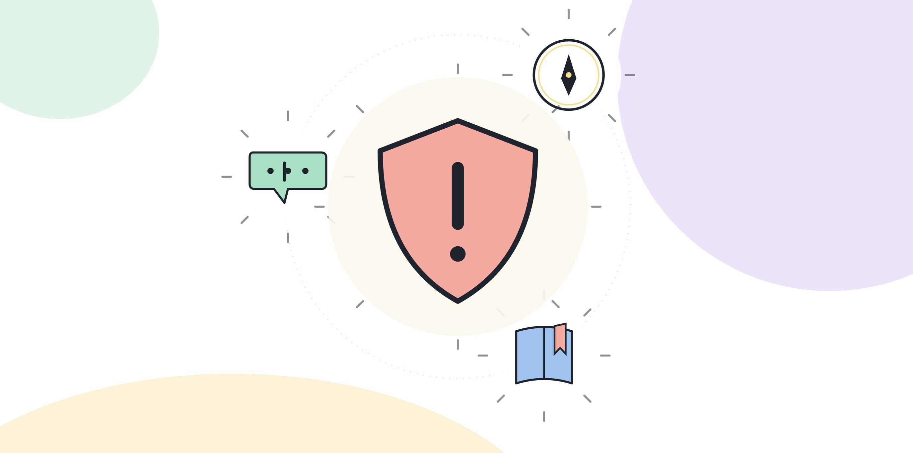

# 3.6 평가 영역 5 — 리스크, 윤리, 거버넌스 감각

AX 역량검사류가 공통으로 보는 다섯 번째 영역은 리스크, 윤리, 거버넌스 감각이다. 앞선 네 영역(개념, 프롬프트와 에이전트, 데이터, 프로세스)이 "AI를 써서 무엇을 할 수 있는가"를 본다면, 이 영역은 "AI를 쓰기 전에 무엇을 멈춰서 확인하는가"를 본다. 네 가지로 나눠서 평가 포인트를 짚는다.

## 개인정보와 저작권 문제를 인식하는가

업무에서 다루는 자료에는 고객 정보, 동료의 인사 자료, 외부 기관에서 받은 문서가 섞여 있다. 이런 자료를 AI 도구에 그대로 입력하기 전에 멈춰서 확인하는지를 이 영역에서 본다.

확인할 것은 세 가지로 좁혀진다. 이 자료를 외부 서버로 전송해도 되는지, 특정 개인을 알아볼 수 있는 정보가 들어 있는지, 이 자료의 이용 범위가 지금 하려는 작업과 맞는지다. 셋 중 하나라도 걸리면 자료를 가공하거나 제외한 뒤에 입력해야 한다. 검사는 이 질문을 평소에 습관처럼 던지는지, 아니면 "일단 넣고 본다"는 태도로 넘어가는지를 가른다.

아래는 이 책이 만든 예시 문제다.

> 외부 고객사의 계약서 초안을 AI 도구로 요약해서 팀 내부 회의 자료로 쓰려 한다. 다음 중 작업을 시작하기 전에 가장 먼저 확인해야 할 것은?
> 1. 요약 결과가 얼마나 짧게 나오는지
> 2. 계약서에 담긴 정보를 외부 서버로 보내는 것이 계약 조건이나 회사 정책에 어긋나지 않는지
> 3. AI 도구의 요약 속도가 충분한지
> 4. 회의 참석자가 몇 명인지

정답은 2번이다. 1번과 3번은 작업의 편의와 관련된 질문이고, 4번은 이 작업의 리스크와 무관하다. 계약서처럼 외부 자료를 다룰 때는 요약의 질보다 먼저 자료 전송 자체가 허용되는지를 확인해야 한다.

저작권 문제는 입력 쪽과 출력 쪽에서 각각 따로 걸린다. 입력 쪽에서는 외부 문서나 이미지를 AI 도구에 넣고 그 결과를 그대로 외부에 배포해도 되는지가 걸리고, 출력 쪽에서는 AI가 만들어낸 글이나 이미지를 누구의 이름으로, 어떤 용도로 쓸 수 있는지가 걸린다. 두 쪽 모두 "결과물이 그럴듯하면 된다"는 기준으로는 판단할 수 없고, 자료와 결과물 각각의 이용 범위를 따로 확인해야 한다.

[그림] 리스크 감각은 지식이 아니라 쓰기 전에 확인하는 절차로 드러난다.

## AI 산출물의 편향 가능성을 점검하는가

AI가 내놓는 추천이나 판단에는 학습 데이터에 섞여 있던 불균형이 그대로 반영될 수 있다. 3.2에서 다룬 편향의 원인(학습 자료의 불균형)을 이미 안다고 해도, 그 지식을 결과를 점검하는 행동으로 옮기는지는 별개의 문제다. 이 영역이 보는 것은 편향의 정의를 아는지보다, 그 지식을 점검 행동으로 옮겼는지다.

채용 후보를 추리거나 고객을 분류하는 작업에 AI 결과를 그대로 쓰면, 특정 집단에 불리한 결과가 반복될 수 있다. 결과를 집단별로 나눠서 비교해보는 습관, 특정 조건(출신 지역, 경력 공백, 나이대 같은)에서 결과가 한쪽으로 쏠리지 않는지 확인하는 습관이 있는지를 평가자는 구체적인 사례로 묻는다. "편향을 조심해야 한다"는 답변만으로는 통과하지 못하고, 무엇을 어떻게 나눠서 비교했는지까지 말할 수 있어야 한다.

## 결과에 대한 책임 소재를 명확히 할 수 있는가

"AI가 그렇게 판단해서 그대로 따랐다"는 답변은 이 영역에서 가장 낮은 평가를 받는다. AI의 제안을 받아들이기로 결정한 것은 언제나 사람이고, 그 결정의 책임도 사람에게 남는다. 좋은 답변은 "AI 제안을 참고했지만 최종 확인과 결정은 내가 했다"는 구조를 분명히 말한다.

이 구분이 느슨해지는 경우는 보통 일이 잘 풀렸을 때가 아니라 틀렸을 때 드러난다. 결과가 틀렸는데 "AI가 그렇게 나와서"라고 설명하면, 같은 실수가 반복될 때 누가 그 과정을 고칠 책임이 있는지도 같이 흐려진다. 평가자가 이 영역에서 보는 것은 결과가 맞았을 때의 설명이 아니라, 결과가 틀렸을 때도 책임의 위치를 똑같이 말할 수 있는가다.

## 업무에 적용하기 전에 리스크를 점검하는 절차가 있는가

실무형이나 시뮬레이션형 문항은 "이 업무에 AI를 적용하기 전에 무엇을 확인하겠는가"를 묻는 식으로 이 역량을 테스트한다. 좋은 답변은 적용 범위를 먼저 좁힌다. 전체 업무를 한 번에 바꾸겠다고 답하지 않고, 영향이 작은 영역에서 먼저 시도하고 결과를 확인한 뒤에 범위를 넓히겠다고 답하는 쪽이 더 높은 점수를 받는다.

아래는 이 책이 만든 예시 문제다.

> 팀에서 AI 도구로 입사 지원자의 자기소개서를 자동으로 요약하고 순위를 매기는 방안을 검토하고 있다. 당신에게 의견을 묻는다면 다음 중 어떤 답을 고르겠는가?
> 1. 효율이 크게 오르므로 전체 지원자에게 바로 적용한다
> 2. 일부 지원자 표본으로 먼저 돌려보고, 특정 조건(출신 학교, 경력 공백 등)에서 순위가 이상하게 쏠리는지 확인한 뒤 적용 범위를 정한다
> 3. 다른 회사도 이미 쓰고 있으니 검증 없이 적용한다
> 4. 리스크가 있을 수 있으니 AI를 아예 쓰지 않는다

정답은 2번이다. 1번과 3번은 검증 없이 범위를 넓히는 답이고, 4번은 리스크를 이유로 적용 자체를 포기하는 답이다. 이 영역이 보려는 것은 AI를 쓰지 않는 조심성이 아니라, AI를 쓰면서 리스크를 관리하는 절차를 설계하는 능력이다. 좁은 범위로 먼저 확인하고 범위를 넓히는 2번이 이 능력을 보여준다.

## 이 영역의 평가 비중이 커지는 이유

생성형 AI 도구는 몇 해 전까지 개인이 혼자 써보는 수준에 머물렀지만, 지금은 산출물이 보고서, 고객 응대, 채용 서류 검토처럼 조직의 의사결정에 바로 연결되는 자리까지 들어와 있다. 산출물이 조직의 결정에 연결될수록, 그 결과가 틀렸을 때 떠안아야 할 책임도 개인을 넘어 조직 전체로 번진다.

문제는 "AI가 그렇게 판단해서"라는 설명이 책임의 위치를 가려버린다는 점이다. 담당자도, 담당자를 지휘한 관리자도, 도구를 들여온 조직도 서로에게 책임을 미룰 여지가 생긴다. 책임 소재가 불분명한 상태로 업무가 돌아가면, 그 업무에서 생기는 문제는 결국 조직이 그대로 떠안는다. 기업과 기관이 다른 네 영역보다 이 영역의 평가 비중을 늘려가는 이유는 여기에 있다. 담당자 한 사람의 판단 실수가 조직 전체가 감당해야 할 위험으로 그대로 번지기 때문에, 그 위험을 채용과 평가 단계에서부터 걸러내려는 것이다.

그래서 이 영역은 평가 방식도 다르다. 다른 네 영역은 점수가 높을수록 좋은 쪽으로 평가하지만, 리스크 감각은 한 번이라도 놓치면 그 한 번이 조직의 문제로 바로 이어진다. 검사는 "대체로 조심한다"는 답보다 "이 지점에서는 반드시 멈춘다"는 구체적인 기준을 가지고 있는지를 더 무겁게 본다.

## 이 영역을 준비하는 방법

지금 쓰고 있는 AI 도구에 어떤 자료를 입력하고 있는지 한 번 점검하는 것이 출발점이다. 고객 정보나 사내 기밀이 섞여 있다면 익명화하거나 제외하는 방법을 찾아둔다. 그 다음 AI 결과를 집단별로 나눠서 비교해보는 연습을 한 번이라도 해본다. 그리고 "AI 제안을 참고했지만 최종 확인은 내가 했다"고 말할 수 있는 구체적인 사례를 하나 만들어둔다. 사례가 없으면 지금 진행 중인 작업 하나를 골라 그 구조로 기록해두는 것부터 시작한다.

네 가지 확인 습관을 한 번에 다 들이려 하지 않아도 된다. 순서를 정한다면 입력 전 점검(개인정보, 저작권)을 가장 먼저 둔다. 한 번 외부로 나간 자료는 되돌릴 수 없어서, 이 습관이 없으면 나머지 세 가지를 아무리 잘해도 첫 단계에서 이미 돌이킬 수 없는 문제가 생길 수 있다. 그 다음은 책임 소재를 말로 정리하는 습관이다. "내가 최종 확인했다"는 문장을 실제로 입 밖에 내거나 기록으로 남겨보는 것만으로도, 결과를 그대로 받아들이기 전에 한 번 멈추는 효과가 있다. 편향 점검과 적용 범위를 좁히는 습관은 상대적으로 업무 경험이 쌓인 뒤에 구체화하기 쉬운 습관이라 뒤에 두어도 무리가 없다.

더 깊은 내용, 특히 조직 단위의 거버넌스 체계를 어떻게 설계하는지는 4부 4.8에서 다룬다. 지금은 개인이 당장 적용할 수 있는 네 가지 확인 습관을 갖추는 데까지면 충분하다.

> **북마크**
> 리스크, 윤리, 거버넌스 감각 영역 자가 점검
> - [ ] AI 도구에 자료를 입력하기 전에 외부 전송 여부와 개인정보 포함 여부를 확인한다
> - [ ] AI 산출물을 집단별로 나눠서 편향 여부를 점검해본 적이 있다
> - [ ] "AI가 그렇게 판단해서"가 아니라 "내가 최종 확인했다"고 말할 수 있는 사례가 있다
> - [ ] 새 업무에 AI를 적용할 때 좁은 범위로 먼저 시도하고 범위를 넓히는 절차가 있다

3부는 여기서 다섯 영역을 모두 다뤘다. 검사가 "어떻게 묻는가"(3.1의 네 형식)와 "무엇을 묻는가"(3.2부터 3.6까지의 다섯 영역)를 겹쳐보면, 자신이 어느 지점에서 자주 막히는지 더 뚜렷하게 보인다. 4부는 이 다섯 영역을 각각 실제로 기르는 방법을 하나씩 다룬다.
