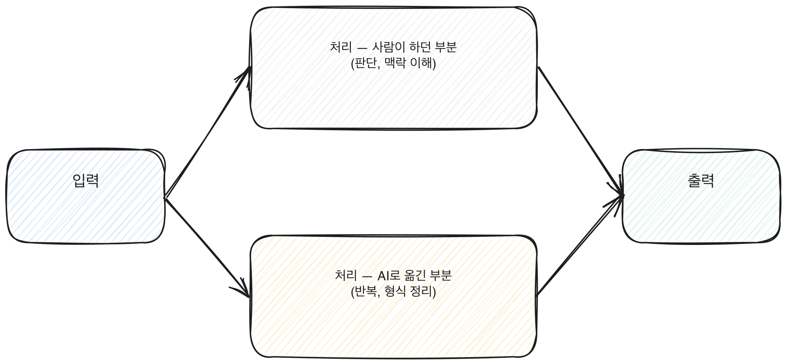

# 4.5 업무 프로세스 재설계

AI 도구를 업무 하나에 끼워 넣는 것과 업무 전체의 흐름을 다시 짜는 것은 다른 작업이다. 끼워 넣기는 기존 순서를 그대로 두고 한 단계만 빠르게 만든다. 재설계는 순서 자체를 다시 본다. 어떤 단계는 통째로 없어도 되고, 어떤 단계는 사람이 손을 더 대야 한다는 걸 발견하는 과정이다. 이 장은 업무를 쪼개서 보는 법을 다룬다.

## 업무를 단계로 쪼개는 법

재설계는 전체를 한눈에 보는 데서 시작하지 않는다. 먼저 업무를 다섯 단계 이내로 쪼갠다. 다섯 단계를 넘기면 각 단계가 너무 작아져서 평가가 흐려진다. 예를 들어 "주간 보고서 작성"이라는 업무는 다음처럼 쪼갤 수 있다.

1. 각 팀에서 자료를 받는다
2. 자료를 하나의 형식으로 정리한다
3. 지난주와 비교해 변화가 큰 항목을 찾는다
4. 보고서 초안을 쓴다
5. 팀장이 검토하고 수정한다

쪼갠 뒤에는 각 단계에 걸리는 시간을 대략이라도 적어본다. 시간이 많이 걸리는 단계와 적게 걸리는 단계가 보이면, 어디를 먼저 손대야 할지 순서가 생긴다.

[그림] AI로 처리할 부분과 사람이 맡을 부분을 가르는 설계가 핵심이다.

## 단계마다 적용 가능성을 평가한다

각 단계에 세 가지 중 하나를 표시한다. 자동화 가능, 부분 지원, 사람 필수다.

**자동화 가능**은 규칙이 분명하고 결과 확인이 쉬운 단계다. 위 예시에서 2번(자료를 하나의 형식으로 정리하는 일)이 여기에 들어갈 수 있다.

**부분 지원**은 AI가 초안이나 후보를 만들고 사람이 고르거나 고치는 단계다. 3번(변화가 큰 항목을 찾는 일)과 4번(초안을 쓰는 일)이 여기에 가깝다. 모델이 후보를 여럿 내놓고 사람이 맥락을 보고 고른다.

**사람 필수**는 조직 내부 사정, 책임 판단, 관계에 대한 이해가 필요한 단계다. 5번(검토와 최종 수정)은 팀장이 왜 그 항목을 강조해야 하는지 아는 사람만 할 수 있다.

표시가 끝나면 전체 흐름에서 "자동화 가능"과 "부분 지원"이 몇 단계인지 센다. 다섯 단계 중 셋이 여기 들어간다면 재설계의 여지가 크다는 뜻이고, 하나뿐이라면 이 업무는 기존 방식을 유지하는 쪽이 나을 수 있다.

앞서 쪼갠 주간 보고서 작성 업무를 표에 채워보면 이렇게 된다. 1번(자료 받기)은 받는 방식이 팀마다 달라서 사람 필수에 가깝고, 2번(형식 정리)은 규칙이 분명해서 자동화 가능, 3번(변화 큰 항목 찾기)은 기준은 있지만 맥락 판단이 섞여서 부분 지원, 4번(초안 작성)도 부분 지원, 5번(검토)은 사람 필수다. 다섯 단계 중 둘이 부분 지원, 하나가 자동화 가능으로 나오면, 전체를 한 번에 바꾸기보다 2번부터 먼저 바꾸고 3번과 4번은 그 다음에 손대는 순서가 안전하다.

입력에서 출력으로 가는 흐름 중 어디를 사람이 맡고 어디를 AI로 옮겼는지를 그림으로 보면 다음과 같다.

[그림] 입력과 출력은 같아도, 그 사이 처리를 사람과 AI로 가르는 설계가 핵심이다.

## 재설계가 오히려 실패하는 경우

모든 단계를 한꺼번에 바꾸려고 하면 재설계가 실패할 확률이 높아진다. 특히 "사람 필수"로 표시한 단계까지 억지로 자동화 가능 쪽으로 밀어붙이는 경우가 그렇다. 예를 들어 위 사례에서 5번(팀장의 검토)을 AI가 대신 요약해서 승인하는 방식으로 바꾸면, 검토가 원래 하던 역할(왜 이 항목을 강조해야 하는지 판단하는 일)을 잃어버리고 형식만 남는다. 재설계는 단계를 줄이는 게 목적이 아니라, 각 단계가 원래 하던 역할을 유지하면서 걸리는 시간이나 반복되는 수고를 줄이는 게 목적이다. 역할이 사라지는 재설계는 당장은 빨라 보여도 나중에 문제가 생겼을 때 그 역할을 누가 다시 채워야 하는지가 비어 있다.

> **북마크 — 업무 재설계 프레임**
>
> | 단계 | 내용 | 자동화 가능 / 부분 지원 / 사람 필수 | 이유 |
> |---|---|---|---|
> | 1 | | | |
> | 2 | | | |
> | 3 | | | |
> | 4 | | | |
> | 5 | | | |
>
> 빈 표를 복사해서 지금 맡고 있는 업무 하나에 채워본다. 다섯 단계를 못 채우면 그만큼 단순한 업무라는 뜻이고, 다섯 단계를 넘으면 더 쪼개야 한다는 뜻이다.

## before와 after를 문서화하는 법

재설계를 하고 나서 그냥 "편해졌다"고 넘기면 나중에 이 변화를 설명할 때 근거가 없다. 문서화할 때는 세 가지를 남긴다.

**이전 흐름**이다. 단계별로 무엇을 했고 각 단계에 걸린 시간을 적는다. 정확한 숫자가 없으면 "대략 반나절"처럼 어림값으로 적어도 된다.

**바뀐 흐름**이다. 어떤 단계를 어떻게 바꿨는지, 어떤 단계를 없앴는지, 어떤 단계를 더 추가했는지 적는다. 재설계는 단계를 줄이는 방향으로만 가지 않는다. 검증 단계를 하나 더 넣어서 오히려 단계가 늘었는데도 전체 시간은 줄어드는 경우도 있다.

**바뀌지 않은 것**이다. 재설계 이후에도 사람이 그대로 맡고 있는 부분을 적어둔다. 이걸 적어두면 "AI가 다 했다"는 과장된 설명을 피할 수 있고, 나중에 이 경험을 포트폴리오로 쓸 때도 정확한 설명이 된다.

## 단계를 쪼개는 기준을 못 잡을 때

업무를 다섯 단계로 못 쪼개고 "그냥 처음부터 끝까지 다 한다"는 식으로 뭉쳐 있다고 느껴질 때가 있다. 이럴 때는 업무가 끝났을 때 나오는 결과물을 먼저 적고, 그 결과물이 나오기 바로 전에 무엇이 있어야 하는지를 거꾸로 물어가며 단계를 채운다. 보고서 작성이라면 결과물은 "팀장이 승인한 보고서"다. 그 바로 전에는 "팀장이 검토하고 수정 요청을 반영한 초안"이 있어야 하고, 그 전에는 "초안"이, 그 전에는 "비교 분석이 끝난 자료"가 있어야 한다. 거꾸로 짚어 올라가면 자연스럽게 단계가 나뉜다.

## 재설계 전후를 비교하는 숫자가 없을 때

before/after를 문서화하려 해도 정확한 시간 측정값이 없을 때가 많다. 이럴 때 숫자를 지어내지 않는다. 대신 "이전에는 하루 중 다른 일을 못 할 정도로 시간이 들었다", "이제는 짧은 틈에 끝낼 수 있다"처럼 체감 수준을 그대로 적는다. 정확한 숫자보다 솔직하게 적은 체감이, 나중에 포트폴리오로 쓸 때 과장으로 지적받을 위험이 더 적다.

## 재설계는 한 번으로 끝나지 않는다

업무 환경이 바뀌거나 쓰는 도구가 바뀌면 같은 업무라도 자동화 가능과 사람 필수의 경계가 움직인다. 한 번 그린 표를 고정된 결론으로 두지 않고, 분기마다 다시 펼쳐서 바뀐 부분이 있는지 확인하는 게 안전하다.

## 오늘 해볼 일

지금 반복하고 있는 업무 하나를 고른다.

1. 다섯 단계 이내로 쪼갠다.
2. 각 단계에 자동화 가능, 부분 지원, 사람 필수 중 하나를 표시한다.
3. 표시한 이유를 한 줄씩 적는다.
4. "자동화 가능"과 "부분 지원"으로 표시한 단계 중 하나를 골라, 이번 주 안에 실제로 시도해본다.
