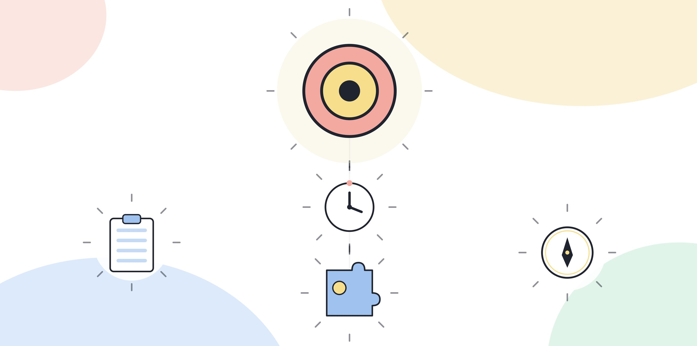
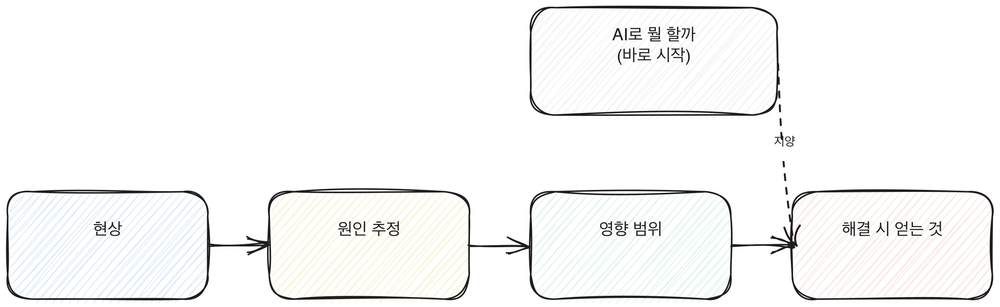

# 4.6 문제정의력: 기술이 아니라 문제에서 시작한다

AI 도구를 손에 쥐면 "이걸로 뭘 할 수 있을까"부터 생각하게 된다. 순서가 바뀐 질문이다. 먼저 물어야 할 건 "이 업무에서 진짜 문제가 뭔가"다. 도구에서 시작하면 도구가 잘하는 일에 맞춰 문제를 억지로 끼워 맞추게 되고, 그렇게 맞춘 해결은 눈에 보이는 불편만 건드리고 진짜 원인은 그대로 둔다.

## 기술에서 시작할 때 생기는 일

"AI로 뭘 할까"라는 질문으로 시작하면 흔히 눈에 가장 잘 보이는 작업을 고른다. 보고서 쓰는 시간이 길다, 이메일에 답하는 게 번거롭다 같은 표면적인 불편이다. 이런 불편을 줄이는 건 나쁘지 않지만, 그 불편이 왜 생기는지는 묻지 않은 채로 넘어가게 된다.

예를 들어 이런 상황을 가정해본다. 매주 보고서를 쓰는 데 한나절이 걸린다는 불편이 있다. AI로 초안을 빠르게 뽑으면 작성 시간은 줄어든다. 그런데 그 보고서를 받는 사람이 매번 같은 질문을 다시 하고, 결국 추가 설명을 위한 회의가 또 열린다면, 진짜 문제는 작성 시간이 아니라 보고서에 담기는 정보의 구성이었을 수 있다. 작성 시간만 줄이면 표면은 개선됐지만 회의는 그대로 반복된다.

[그림] 'AI로 뭘 할까'로 바로 시작하면 문제의 본질을 놓친다.

## 문제정의 프레임

문제를 정의할 때 네 가지를 순서대로 채운다.

**현상**이다. 지금 눈에 보이는 불편이나 반복되는 어려움을 있는 그대로 적는다. 판단이나 원인 분석을 섞지 않고 관찰된 사실만 적는다. "보고서를 받은 사람이 매번 세 가지를 다시 물어본다"처럼 구체적으로 적는다.

**원인 추정**이다. 그 현상이 왜 생기는지 가능한 원인을 적는다. 하나로 단정하지 않고 두세 개를 나열해도 된다. "보고서에 배경 설명이 부족해서", "받는 사람이 원하는 정보와 작성자가 중요하다고 생각하는 정보가 다르다" 같은 식이다.

**영향 범위**다. 이 문제가 지금 당사자 한 명에게만 영향을 주는지, 팀 전체 일정에 영향을 주는지, 다른 부서까지 번지는지를 본다. 영향 범위가 넓을수록 문제를 해결했을 때 얻는 것도 커진다.

**해결 시 얻는 것**이다. 이 문제를 풀었을 때 구체적으로 무엇이 좋아지는지 적는다. "시간이 줄어든다"는 흔히 나오는 답이지만, 더 구체적으로 "같은 질문에 답하는 회의가 줄어든다", "담당자가 바뀌어도 같은 형식으로 인수인계된다"처럼 적으면 해결의 방향이 명확해진다.

이 네 단계를 거치고 나면, 처음에 떠올렸던 "AI로 뭘 할까"라는 질문이 훨씬 구체적인 질문으로 바뀐다. "보고서 작성 시간을 줄이는 도구"가 아니라 "받는 사람이 필요한 정보를 한 번에 담는 보고서 구조"를 먼저 찾게 된다.

앞서 든 보고서 사례를 네 칸에 그대로 채워본다. 현상은 "보고서를 받은 팀장이 매주 비슷한 세 가지(이번 주 변화의 원인, 다음 주 계획, 리스크 여부)를 다시 물어본다"다. 원인 추정은 "보고서가 지난주와 비교한 변화를 숫자로만 보여주고 원인 설명이 빠져 있다", "작성자가 중요하다고 생각하는 항목과 팀장이 궁금한 항목이 다르다" 두 가지로 적는다. 영향 범위는 "작성자 한 명의 추가 업무(재질문에 답하는 시간)로 끝나지 않고, 매주 반복되는 회의 시간까지 늘어난다"로 적는다. 해결 시 얻는 것은 "작성 시간이 줄어든다"가 아니라 "재질문을 위한 회의가 없어지고, 그 시간을 다음 주 계획을 다듬는 데 쓸 수 있다"로 적는다.

이렇게 네 칸을 채우고 나면 해결 방향이 분명해진다. "AI로 초안을 빠르게 뽑는 도구"가 아니라 "원인 설명과 다음 주 계획을 항상 포함하는 보고서 틀"이 먼저 필요하다는 게 보인다. 그 틀을 만든 다음에야 그 틀을 채우는 작업 일부를 AI에게 맡길지 정하면 된다. 틀 없이 작성 속도만 빠르게 만들면, 빨라진 속도로 여전히 같은 질문을 유발하는 보고서를 더 자주 받게 될 뿐이다.

네 칸을 순서대로 거치는 과정과, 그 과정을 건너뛰고 바로 해결책으로 가는 지름길이 왜 위험한지를 그림으로 보면 다음과 같다.

[그림] 현상에서 바로 해결로 건너뛰면 원인과 영향 범위를 놓친다.

## 현상과 해결책을 섞어서 적는 실수

문제정의 프레임을 처음 써보면 "현상" 칸에 이미 해결책을 섞어서 적는 경우가 많다. "보고서 작성 시간이 길다, 그러니 AI로 초안을 뽑아야 한다"처럼 쓰면 현상과 해결책이 한 문장에 묶여서, 다른 해결책을 떠올릴 여지가 없어진다. 현상 칸에는 해결책을 암시하는 표현을 넣지 않는다. "시간이 길다"보다 "받는 사람이 다시 물어보는 일이 반복된다"처럼, 해결책을 특정 방향으로 끌고 가지 않는 문장으로 적는다.

> **북마크 — 문제정의 네 칸**
> - 현상: 지금 반복되는 불편을 판단 없이 그대로 적었는가
> - 원인 추정: 가능한 원인을 하나로 단정하지 않고 적었는가
> - 영향 범위: 이 문제가 누구에게까지 번지는지 적었는가
> - 해결 시 얻는 것: "시간이 준다" 수준을 넘어 구체적으로 적었는가

## 원인을 하나로 좁히기 전에 멈추는 법

원인 추정 칸을 채울 때 가장 먼저 떠오른 원인 하나만 적고 넘어가기 쉽다. 떠오른 순서가 실제 비중의 순서와 같다는 보장은 없다. 원인을 적을 때는 최소 두 개를 적어보고, 그중 어느 쪽이 더 근본적인지 스스로 반박해본다. 앞선 보고서 사례에서 "배경 설명이 부족해서"라는 원인에 "그런데 배경 설명을 길게 넣은 적도 있었는데 그때도 똑같이 재질문이 왔다"고 반박할 수 있다면, 진짜 원인은 설명의 길이가 아니라 다른 쪽(작성자와 팀장이 중요하다고 생각하는 항목의 차이)에 있다는 게 드러난다. 이 반박 과정을 거치지 않으면 가장 먼저 떠오른, 가장 손대기 쉬운 원인을 고치고 끝내버리기 쉽다.

## 이 프레임이 평가에서도 핵심으로 다뤄지는 이유

기업이 AX 역량을 검증할 때도 "어떤 도구를 쓸 줄 아는가"보다 "문제를 어떻게 정의했는가"를 더 비중 있게 본다. 도구 사용법은 가르칠 수 있지만, 현상과 원인을 구분하고 영향 범위를 가늠하는 판단은 짧은 교육으로 만들어지지 않기 때문이다. 3부에서 다루는 업무 적용 평가 영역도 결국 이 지점, 즉 문제를 제대로 정의한 뒤에 도구를 골랐는지를 가른다.

## 오늘 해볼 일

지금 불편하다고 느끼는 업무 하나를 고른다.

1. 현상을 판단 없이 한 문장으로 적는다.
2. 가능한 원인을 두세 개 적는다.
3. 이 문제가 누구에게까지 영향을 주는지 적는다.
4. 해결됐을 때 구체적으로 무엇이 좋아지는지 적는다.

네 칸을 다 채운 뒤에야 어떤 도구가 필요한지 생각한다. 순서를 거꾸로 하지 않는다.
