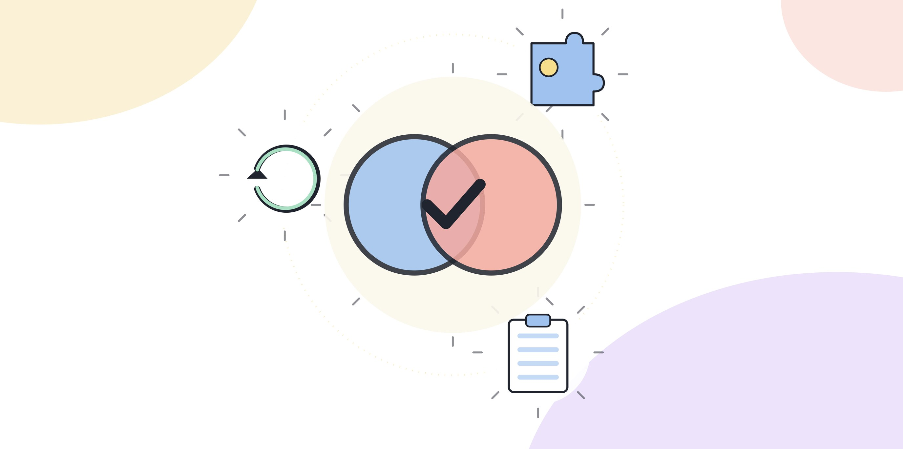

# 4.7 커뮤니케이션과 체인지 매니지먼트

혼자 AI 도구를 잘 쓰는 것과 팀이나 조직에 그 방식을 퍼뜨리는 것은 다른 역량이다. 혼자 잘하는 사람은 자기 업무 하나를 빠르게 처리한다. 조직에 변화를 퍼뜨리는 사람은 다른 사람의 저항과 불안을 다루면서 같은 방식을 여러 사람이 쓰게 만든다. AX 역량을 평가하는 자리에서 후자를 따로 묻는 이유도 여기에 있다. 개인 역량과 확산 역량은 겹치지 않는다.

## 저항이 생기는 이유

새로운 방식에 대한 저항은 게으름이 아니라 대부분 합리적인 이유에서 나온다. 몇 가지 흔한 이유를 짚어본다.

**결과에 대한 불신**이다. AI가 만든 결과물을 그대로 믿고 쓰다가 문제가 생긴 경험이 있으면, 그 경험이 다음 번 제안에도 그대로 이어진다.

**일자리에 대한 불안**이다. 자동화라는 말을 들으면 자기 업무가 줄어들거나 없어질까 걱어한다. 이 불안은 말로 설득해서 없어지지 않는다. 실제로 그 사람의 역할이 어떻게 바뀌는지, 없어지는 일과 새로 생기는 일이 무엇인지 구체적으로 보여줘야 줄어든다.

**익숙한 방식을 바꾸는 데 드는 비용**이다. 지금 방식이 느리더라도 손에 익어 있으면, 새 방식을 배우는 데 드는 시간이 당장은 손실로 느껴진다.

저항을 다루려면 먼저 어떤 이유에서 나온 저항인지 구분해야 한다. 세 가지 이유에 각각 다른 대응이 필요하기 때문이다.

[그림] 혼자 능숙한 것과 동료를 설득해 변화를 만드는 것은 다른 능력이다.

## 기술 언어 대신 업무 언어로 말한다

"이 도구가 자연어 처리 기반으로 문서를 요약해준다"는 설명은 기술을 아는 사람에게만 닿는다. 같은 내용을 "지금 두 시간 걸리는 자료 정리를 20분으로 줄이고, 남는 시간에 다음 단계 검토를 할 수 있다"처럼 바꾸면, 상대방이 자기 업무에 대입해서 들을 수 있다.

기술 언어에서 업무 언어로 바꾸는 방법은 한 가지다. "이게 뭘 할 수 있는가"가 아니라 "이게 당신의 어떤 일을 바꾸는가"로 문장을 다시 쓴다. 상대방이 매일 하는 구체적인 업무 하나를 떠올리고, 그 업무가 어떻게 달라지는지로 설명을 바꾼다.

가상의 대화로 비교해본다. 기술 언어로 말하면 이렇다. "이 도구는 거대언어모델 기반이라 긴 문서도 맥락을 유지하면서 요약할 수 있어요." 상대방은 "그래서 나한테 뭐가 좋은데"라는 질문을 속으로 하게 된다. 업무 언어로 바꾸면 이렇다. "지금 하시는 월간 보고서 취합 작업 있잖아요, 각 팀에서 보낸 자료를 하나씩 읽고 정리하는 데 반나절 걸리는 거요. 그 초안을 20분 안에 뽑아주고, 반나절 남는 시간에 숫자가 이상한 부분만 확인하시면 돼요." 같은 도구를 설명하는데 상대방이 자기 업무로 바로 대입할 수 있는 건 두 번째 쪽이다.

## 불안을 무시하지 않고 다루는 법

일자리에 대한 불안은 "그런 일은 없을 거예요"라는 말로 가라앉지 않는다. 오히려 구체적으로 "없어지는 일"과 "새로 생기는 일"을 같이 말하는 쪽이 더 효과가 있다. 예를 들어 "자료를 정리하는 시간은 줄어들지만, 그 대신 정리된 자료에서 이상한 부분을 찾아내는 역할이 더 중요해진다"처럼, 줄어드는 일과 늘어나는 일을 같이 말하면 상대방이 자신의 자리를 다시 가늠해볼 수 있다. 줄어드는 일만 말하면 불안이 커지고, 늘어나는 일만 말하면 과장처럼 들린다. 둘을 같이 말해야 신뢰가 생긴다.

## 작은 성공 사례부터 공유한다

처음부터 팀 전체의 업무 방식을 바꾸자고 제안하면 저항이 커진다. 대신 본인이 직접 해본 작은 사례 하나를 먼저 공유한다. 전체를 바꾸자는 제안보다 "이번 주에 이 일을 이렇게 해봤는데 이런 결과가 나왔다"는 구체적인 경험이 설득력이 있다.

공유할 때는 좋았던 점만 말하지 않는다. 어디서 막혔는지, 어떤 부분은 사람이 다시 손봐야 했는지도 같이 말한다. 한계를 같이 말하는 사람의 제안을 동료들이 더 신뢰한다. 과장된 성공담은 오히려 경계심을 키운다.

사례를 공유한 뒤에는 따라 해보려는 동료가 바로 시도할 수 있게 구체적인 단계를 같이 건넨다. "나처럼 해보라"는 말만으로는 다음 사람이 같은 결과를 내기 어렵다.

> **북마크 — 확산 전 점검**
> - [ ] 상대방이 저항하는 이유가 불신, 불안, 전환 비용 중 어느 쪽인지 구분했는가
> - [ ] 설명을 기술 언어가 아니라 그 사람의 구체적인 업무로 바꿨는가
> - [ ] 성공 사례와 함께 한계도 같이 말했는가
> - [ ] 따라 할 수 있는 구체적인 단계를 같이 건넸는가

## 직급이 다른 상대는 다르게 설득한다

같은 변화라도 설득해야 할 상대가 동료인지 관리자인지에 따라 강조점이 달라진다. 동료에게는 "당신의 반복 업무가 줄어든다"는 개인적인 이득이 먼저 와야 한다. 관리자에게는 개인의 편의보다 "이 변화가 팀 전체의 처리 속도나 오류율에 어떤 영향을 주는가"가 먼저 와야 한다. 관리자 앞에서 개인의 편의만 강조하면 "그게 왜 팀 차원에서 중요한가"라는 질문으로 되돌아오고, 동료 앞에서 팀 전체의 지표만 강조하면 "그래서 내가 뭘 해야 하는데"라는 거리감이 생긴다. 설득하려는 상대가 매일 무엇을 신경 쓰는 자리에 있는지를 먼저 생각한 뒤에 설명을 고른다.

## 확산은 한 번의 발표로 끝나지 않는다

한 번 소개했다고 방식이 퍼지지 않는다. 처음 시도한 사람은 몇 번 더 막히고, 그 막힌 지점에서 다시 질문이 온다. 이 질문에 꾸준히 답해주는 과정이 확산의 실제 내용이다. 발표 한 번보다 그 뒤에 오는 질문들에 응답하는 태도가 더 오래 영향을 준다.

## 오늘 해볼 일

최근에 직접 해본 AI 활용 경험 하나를 떠올린다.

1. 그 경험을 동료 한 명의 구체적인 업무에 대입해서 설명하는 문장을 써본다.
2. 좋았던 점 하나와 막혔던 점 하나를 같이 적는다.
3. 그 동료가 바로 따라 해볼 수 있는 단계를 두세 줄로 정리해서 전달한다.
