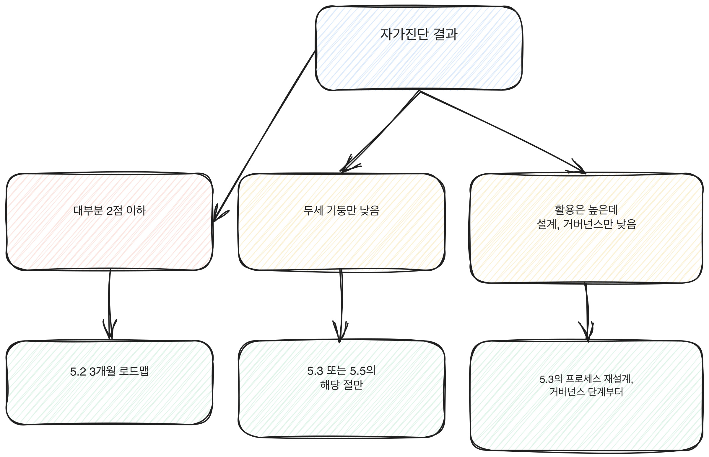

# 5.1 현재 위치 진단하기

채용 공고나 사내 공지에 "AX 역량 평가"라는 말이 등장하면 무엇부터 손대야 할지부터 막힌다. 로드맵을 찾아보면 1개월차에 할 일, 3개월차에 할 일이 나오지만, 그 순서가 자신에게 맞는지는 알 수 없다. 이미 할 수 있는 것을 처음부터 다시 배우거나, 반대로 비어 있는 부분을 건너뛰고 지나갈 위험이 있다.

이 장은 로드맵을 시작하기 전에 자신의 위치를 먼저 확인하는 절차다. 1부에서 다룬 네 층위(인식, 활용, 설계, 거버넌스)와 4부에서 다룬 여덟 개 역량 기둥을 기준으로 삼는다. 두 축을 겹쳐 보면 지금 무엇이 비어 있는지가 구체적으로 드러난다.

## 네 층위로 보는 진단

1.2에서 다룬 네 층위는 아래로 갈수록 쌓이는 구조다. 인식 없이 활용하면 과신하고, 활용 없이 설계하면 현실에 안 맞고, 설계 없이 거버넌스만 따지면 아무것도 못 한다. 아래 네 질문에 1점(전혀 아니다)부터 4점(그렇다)까지 점수를 매긴다.

1. 인식: 지금 쓰는 AI 도구가 못하는 일을 구체적으로 하나 말할 수 있다.
2. 활용: 지난 한 달 안에 AI 도구로 업무 하나를 처리한 경험이 있다.
3. 설계: 업무의 순서나 담당을 AI 도입 이후 바꿔본 적이 있다.
4. 거버넌스: AI 결과를 쓰기 전 확인하는 절차가 있다.

네 문항을 더한 합계보다, 어느 문항에서 점수가 뚝 떨어지는지를 본다. 3번이나 4번이 1번, 2번보다 2점 이상 낮다면, 그 지점이 로드맵에서 먼저 채울 자리다.

[그림] 비어 있는 층위를 알아야 다음에 손댈 자리가 보인다.

## 여덟 개 역량 기둥으로 보는 진단

4부에서 다룬 여덟 개 기둥은 각각 독립된 기술이다. 한 기둥이 높다고 다른 기둥이 따라오지 않는다. 기둥마다 1~4점으로 답한다.

1. AI 리터러시(4.1): 지금 쓰는 도구가 무엇을 예측해서 결과를 내는지 설명할 수 있다.
2. 프롬프트 설계(4.2): 질문에 맥락, 목표, 제약, 형식을 채워서 넣는 습관이 있다.
3. 에이전트와 자동화 활용(4.3): 여러 단계를 묶어 자동으로 처리하는 도구를 업무에 써본 적이 있다.
4. 데이터 리터러시(4.4): AI가 제시한 숫자나 근거를 원자료와 대조해본 적이 있다.
5. 업무 프로세스 재설계(4.5): 업무 하나의 전체 순서를 다시 설계해본 적이 있다.
6. 문제정의력(4.6): 도구를 고르기 전에 풀려는 문제를 먼저 글로 정리하는 습관이 있다.
7. 커뮤니케이션과 체인지 매니지먼트(4.7): 바뀐 업무 방식을 동료나 팀에 설명하고 동의를 받아본 적이 있다.
8. 윤리, 거버넌스, 리스크 감각(4.8): 업무에 AI를 쓸 때 생기는 위험(개인정보, 편향, 책임 소재)을 먼저 따져본 적이 있다.

## 점수를 해석하는 법

여덟 기둥 중 3점 이상인 것과 2점 이하인 것을 나눠 적어본다. 2점 이하가 많으면 5.2의 3개월 로드맵부터 시작한다. 2점 이하가 두세 개로 좁혀져 있고 나머지는 3점 이상이면, 5.2를 건너뛰고 5.3이나 5.5에서 그 부분만 집중적으로 다뤄도 된다.

네 층위 점수와 여덟 기둥 점수를 겹쳐 보면 더 분명해진다. 예를 들어 활용 층위 문항은 높은데 프로세스 재설계(4.5) 점수가 낮다면, 도구는 써봤지만 업무 구조를 바꿔본 적은 없다는 뜻이다. 이런 경우에는 5.3(6개월 로드맵)의 프로세스 재설계 단계에 우선순위를 둔다.

네 층위와 성숙도 단계 사이의 관계는 1.6에서 더 자세히 다룬다. 1단계는 인식만 채워진 상태, 2단계는 인식과 활용이 채워진 상태, 3단계는 설계까지, 4단계는 거버넌스까지 채워진 상태다. 위에서 체크한 네 층위 문항이 몇 번까지 3점 이상으로 이어지는지 보면 자신이 몇 단계에 있는지 가늠할 수 있다.

아래 그림은 진단 결과가 어느 쪽으로 기우느냐에 따라 다음에 볼 로드맵이 달라지는 흐름을 보여준다.

[그림] 자가진단 결과 유형에 따라 다음에 볼 로드맵이 달라진다.

## 점수 패턴 세 가지

진단 결과는 보통 세 가지 모양 중 하나로 나온다.

모든 기둥이 2점 이하인 경우는 AX 역량을 아직 손대지 않은 상태다. 5.2의 3개월 로드맵을 처음부터 그대로 따라간다. 어느 기둥부터 시작할지 고민할 필요가 없다.

두세 개 기둥만 낮고 나머지는 3점 이상인 경우는 이미 기초는 지나왔다는 뜻이다. 5.2를 전부 따라가는 대신, 낮은 기둥만 골라 5.3이나 5.5의 해당 절을 찾아 읽는다.

활용 층위(2번 문항)는 높은데 설계와 거버넌스 층위(3, 4번 문항)가 낮은 경우는 도구를 쓰는 건 익숙하지만 업무 구조를 바꾸거나 리스크를 관리하는 쪽은 아직 손대지 않은 상태다. 이 경우는 5.2를 건너뛰고 5.3의 프로세스 재설계와 거버넌스 단계부터 바로 시작한다.

## 가정해서 채점해보기

점수를 매기는 과정이 막연하게 느껴진다면, 가상의 상황 하나를 가정해서 채점 방식을 먼저 연습해본다. 예를 들어 이런 상황을 가정하면 도움이 된다. 매주 같은 형식의 주간 보고서를 쓰는 사람이 AI 도구로 초안을 뽑아보기 시작한 지 두 달째다. 초안을 받으면 숫자 부분만 눈으로 훑고 그대로 제출한다. 보고서 형식 자체는 입사 때부터 바뀐 적이 없다.

이 상황을 네 층위에 대입하면 인식은 3점에 가깝다(도구가 초안을 만드는 방식은 어느 정도 이해하고 있다). 활용도 3점이다(두 달째 반복 적용 중이다). 그런데 설계는 1점이다(보고서 형식 자체를 바꿔본 적이 없다). 거버넌스는 2점에 가깝다("숫자만 훑어본다"는 확인이 있긴 하지만 원자료 대조까지는 안 한다). 이렇게 네 층위 사이에 2점 이상 차이가 나는 경우, 앞서 설명한 대로 가장 낮은 층위(설계)가 이번 로드맵에서 먼저 채울 자리가 된다.

여덟 기둥에 대입하면 활용 관련 기둥(에이전트와 자동화 활용)은 점수가 괜찮게 나오지만, 데이터 리터러시(원자료 대조를 안 하고 있으므로)와 업무 프로세스 재설계(형식을 안 바꿔봤으므로)가 낮게 나온다. 이 조합이면 5.3의 4개월차와 5개월차부터 시작하는 쪽이 5.2를 처음부터 다 따라가는 것보다 효율적이다.

## 자주 나오는 조합과 그에 맞는 시작점

실제로 진단을 해보면 아래 네 가지 조합 중 하나에 가깝게 떨어지는 경우가 많다. 자신의 결과가 어느 조합에 가장 가까운지 비교해본다.

| 조합 | 특징 | 시작점 |
|---|---|---|
| 전부 2점 이하 | 아직 AI 도구를 업무에 제대로 들여보지 않은 상태 | 5.2를 처음부터 순서대로 |
| 인식, 활용은 3점 이상, 설계와 거버넌스는 2점 이하 | 도구는 쓰지만 업무 구조나 검증 절차는 그대로인 상태 | 5.3의 5개월차(프로세스 재설계)와 4개월차(데이터 리터러시)부터 |
| 설계는 3점 이상인데 거버넌스만 낮음 | 업무 방식은 바꿔봤지만 리스크 점검은 습관이 안 된 상태 | 4.8을 먼저 읽고 5.3의 6개월차 기록 형식에 리스크 점검 항목을 추가 |
| 기둥 대부분 3점 이상인데 체인지 매니지먼트(4.7)만 낮음 | 개인 역량은 쌓였지만 동료나 팀에 설명해본 적이 없는 상태 | 5.4의 7~9개월차, 6부의 포트폴리오 작성으로 바로 진입 |

이 표에 딱 맞지 않아도 괜찮다. 중요한 것은 모든 항목을 순서대로 다시 밟지 않고, 낮은 지점부터 골라서 들어가는 것이다.

## 점수가 헷갈리는 경계

점수를 매기다 보면 2점과 3점 사이에서 자주 멈춘다. "가끔 해봤다"와 "업무에 반영했다"의 경계가 애매하기 때문이다. 기준은 하나로 좁힌다. 그 결과를 본인 혼자 쓰고 끝냈는가, 아니면 보고서나 메일, 자료로 나가서 다른 사람이 받아서 썼는가. 본인 책상에서 끝났다면 2점이고, 동료나 상사가 그 결과를 실제로 받아서 업무에 반영했다면 3점에 가깝다.

자기 평가는 대체로 후하게 나오는 쪽으로 기운다. 특히 한두 번 해본 일을 "꾸준히 한다"로 올려서 적는 경우가 흔하다. 점수를 매기기 전에 최근 한 달 안에 실제로 그 일을 한 날짜를 하나 떠올려본다. 날짜가 떠오르지 않으면 점수를 한 단계 낮춘다. 날짜 하나를 바로 댈 수 있다면 그 점수를 유지한다. 이 기준만 적용해도 평가가 한결 정확해진다.

## 진단은 한 번으로 끝나지 않는다

이 진단은 로드맵을 시작할 때 한 번만 하는 게 아니다. 5.4에서 다룰 1년 로드맵의 끝에서 같은 문항으로 다시 점수를 매겨보면 어디가 바뀌었는지 보인다. 점수가 그대로인 기둥이 있다면, 그 기둥은 로드맵을 따라가는 동안 실제로는 손대지 않았다는 뜻이다.

> **북마크 — 현재 위치 진단 체크리스트**
>
> 네 층위 (1~4점)
> - [ ] 인식: 도구가 못하는 일을 구체적으로 말할 수 있다
> - [ ] 활용: 지난 한 달 안에 AI로 업무를 처리했다
> - [ ] 설계: 업무 순서나 담당을 바꿔본 적이 있다
> - [ ] 거버넌스: 결과를 쓰기 전 확인하는 절차가 있다
>
> 여덟 역량 기둥 (1~4점)
> - [ ] AI 리터러시 (4.1)
> - [ ] 프롬프트 설계 (4.2)
> - [ ] 에이전트와 자동화 활용 (4.3)
> - [ ] 데이터 리터러시 (4.4)
> - [ ] 업무 프로세스 재설계 (4.5)
> - [ ] 문제정의력 (4.6)
> - [ ] 커뮤니케이션과 체인지 매니지먼트 (4.7)
> - [ ] 윤리, 거버넌스, 리스크 감각 (4.8)
>
> 2점 이하 항목이 이번 로드맵에서 먼저 채울 자리다. 더 많은 문항으로 세분화한 통합 체크리스트는 [부록 A](../appendix/a-self-assessment.md)에 있다.

## 오늘 해볼 일

위 열두 문항에 지금 바로 점수를 매긴다. 점수를 매기다가 "이걸 해봤는지 기억이 안 난다"는 문항이 있으면, 그 자체가 2점 이하라는 신호다. 기억에 남을 만큼 뚜렷하게 해본 적이 없다는 뜻이기 때문이다. 점수를 다 매겼으면 5.2로 넘어간다.
