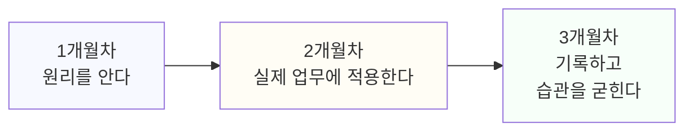

# 5.2 3개월 기초 로드맵

5.1에서 자신의 현재 위치를 확인했다면, 이 장은 그중 네 층위의 인식과 활용이 비어 있는 사람, 또는 여덟 기둥 대부분이 2점 이하인 사람을 위한 첫 3개월이다. 이미 활용 층위를 넘어선 상태라면 이 장을 건너뛰고 5.3으로 가도 된다.

3개월을 한 달 단위로 나눈다. 각 달은 앞 달의 결과를 전제로 한다. 순서를 바꾸면 효과가 떨어진다.

아래 그림은 석 달의 흐름을 한눈에 보여준다. 각 달은 앞 달의 결과를 전제로 한다.

## 1개월차: 원리를 안다

목표는 도구를 "쓰는 것"이 아니라 도구가 "무엇을 하고 있는지" 설명하는 것이다. 4.1에서 다룬 것처럼, 생성형 AI는 정답을 찾는 게 아니라 다음에 올 가능성이 가장 높은 내용을 예측한다. 이 한 문장을 자신의 말로 설명할 수 있어야 1개월차가 끝난다.

1주차 할 일:
- 매일 쓰는 AI 도구 하나를 고른다. 두 개 이상을 동시에 공부하지 않는다.
- 그 도구에게 같은 질문을 세 번 다른 방식으로 던져보고 답이 매번 조금씩 달라지는지 확인한다. 답이 매번 미묘하게 달라진다면, 그 자체가 "다음에 올 내용을 확률적으로 예측한다"는 원리를 눈으로 확인하는 과정이다.

2주차 할 일:
- 그 도구가 낸 결과 중 하나를 원자료와 대조해서 틀린 부분이 있는지 확인해본다. 틀린 부분이 없었다면 확인 없이 믿고 지나갔을 수도 있는 지점이 어디였는지 짚어본다.
- 4.1에서 다룬 환각(그럴듯하지만 사실과 다른 내용)이 실제로 나타난 사례를 하나 찾아 기록해둔다. 못 찾았다면 못 찾았다는 사실도 기록해둔다. 다음 달에 다시 확인할 기준이 된다.

3주차 할 일:
- 4.2에서 다룬 네 요소(맥락, 목표, 제약, 형식) 중 자신이 평소에 빼먹는 요소가 무엇인지 지난 질문들을 돌이켜보고 찾는다. 대부분 맥락이나 제약을 빼먹는다.
- 평소 쓰던 질문 하나를 골라 네 요소를 모두 채워서 다시 써보고, 결과가 어떻게 달라지는지 나란히 비교한다.

4주차 할 일:
- 이번 달에 기록한 것(환각 사례, 네 요소 비교 결과)을 다시 읽어본다. "도구가 무엇을 예측해서 결과를 내는지"를 한 문장으로 설명하는 글을 직접 써본다. 이 한 문장이 써지지 않으면 1개월차를 한 주 더 연장한다.

이 달에 하지 않아도 되는 것도 있다. 여러 도구를 비교하는 것, 최신 기능을 따라가는 것이다. 4.1에서 다뤘듯 도구 이름과 메뉴 위치는 빨리 낡는다. 원리를 먼저 쌓는다.

## 2개월차: 실제 업무에 적용한다

목표는 실제 업무 한두 개에 AI를 적용하고, 그 결과를 검증하는 경험을 쌓는 것이다. 1개월차에서 배운 원리를 실전에 옮기는 단계다.

5주차(1주차) 할 일:
- 반복되는 업무 목록을 10개 적어본다. 매주 같은 형식으로 쓰는 보고서, 반복되는 문의 응답, 정기적으로 정리하는 자료처럼 패턴이 뚜렷한 일부터 적는다. 10개가 안 채워져도 괜찮다. 적다 보면 평소 의식하지 못했던 반복 업무가 보인다.
- 그중 가장 반복 주기가 짧고(매일 또는 매주) 형식이 고정된 업무 하나를 고른다.

6~7주차 할 일:
- 고른 업무에 AI 도구를 적용한다. 처음 몇 번은 결과를 그대로 쓰지 않고, 반드시 원자료나 기존 기준과 대조한다.
- 도구가 자주 틀리는 부분, 입력하기 까다로운 정보를 매번 짧게 적어둔다. 세 번 이상 반복되면 그 지점이 이 업무의 "검증이 꼭 필요한 자리"다.

8주차 할 일:
- 첫 번째와 성격이 다른 업무를 두 번째로 고른다. 예를 들어 첫 번째가 글을 쓰는 업무였다면 두 번째는 자료를 분류하거나 정리하는 업무처럼 다른 성격을 고른다. 성격이 다른 업무 둘을 거치면 적용 범위가 한쪽으로 좁아지지 않는다.
- 두 번째 업무에도 같은 방식(적용, 대조, 기록)을 반복한다.

이 단계에서 가장 흔한 실패는 결과를 검증 없이 그대로 쓰는 것이다. 1.1에서 다뤘듯 AX 역량은 제안을 그대로 받아들이는 게 아니라 검증하고 고치는 지점에서 드러난다. 2개월차의 핵심은 속도가 아니라 이 검증 습관이다.

## 3개월차: 기록하고 검증 습관을 굳힌다

목표는 2개월차에서 한 일을 기록으로 남기고, 검증하는 절차를 매번 반복하는 습관으로 만드는 것이다. 이 기록이 나중에 6부에서 다룰 포트폴리오의 재료가 된다.

9~10주차 할 일:
- 2개월차에 적용한 업무 두 개를 상황, 적용, 결과, 한계 네 가지로 짧게 정리한다. 6.1에서 다루는 증명의 네 요소와 같은 틀이다.
- 결과를 쓰기 전 확인하는 절차를 한 줄로 정해서 고정한다. "표에 들어간 숫자는 원본 데이터와 한 번 대조한다" 같은 구체적인 문장이어야 한다. 문장이 모호하면("꼼꼼히 확인한다" 같은) 다시 구체적인 행동으로 고친다.

11~12주차 할 일:
- 이 절차를 다음 2주 동안 계속 지키고 있는지 매주 한 번 스스로 확인한다. 지키지 못한 주가 있다면 왜 지키지 못했는지(시간이 없었는지, 절차 자체가 번거로웠는지) 적어둔다.
- 번거로워서 못 지켰다면 절차를 더 짧게 줄인다. 예를 들어 "표의 숫자 전부를 대조한다"를 "표의 가장 큰 숫자 하나만 대조한다"로 줄이는 식이다. 완벽한 절차보다 계속 지켜지는 절차가 낫다.

3개월차가 끝나면 네 요소로 정리한 기록이 최소 두 건 남아 있어야 한다. 기록이 없으면 6개월 로드맵(5.3)으로 넘어갈 재료가 없는 상태다.

## 막히는 지점과 대응

3개월 로드맵을 따라가다 보면 특정 주차에서 자주 막힌다. 두 가지 지점이 흔하다.

**2개월차에서 반복 업무를 못 고르는 경우.** 10개를 적어보라고 했는데 3개도 안 떠오른다면, 지난 1주일 동안 한 일을 시간 단위로 그냥 적어본다. 회의, 이메일 답장, 자료 정리처럼 작은 단위로 쪼개서 적으면 반복되는 패턴이 드러난다.

**3개월차에서 확인 절차가 매번 빠지는 경우.** 절차를 정했는데도 계속 빠진다면, 그 절차가 업무 흐름의 어느 지점에 있는지를 본다. 일이 다 끝난 뒤에 확인하려고 하면 빠지기 쉽다. 결과를 받는 즉시, 다른 작업으로 넘어가기 전에 확인하는 자리로 절차의 위치를 옮긴다.

## 3개월이 끝나면

5.1의 진단 문항으로 다시 점수를 매겨본다. 인식과 활용 두 층위의 점수가 올라가 있어야 한다. 설계와 거버넌스 층위는 아직 낮아도 된다. 그 두 층위는 5.3에서 본격적으로 다룬다.

> **북마크 — 3개월 로드맵 표**
>
> | 월차 | 목표 | 핵심 행동 | 확인 질문 |
> |---|---|---|---|
> | 1개월차 | 원리를 안다 | 도구 하나 선정, 결과 대조, 네 요소로 질문 재구성 | 도구가 무엇을 예측해서 결과를 내는지 한 문장으로 설명할 수 있는가 |
> | 2개월차 | 실제 업무에 적용한다 | 반복 업무 1~2개에 적용, 매번 원자료와 대조 | 결과를 그대로 쓴 적이 있는가, 고친 적이 있는가 |
> | 3개월차 | 기록하고 습관을 굳힌다 | 상황, 적용, 결과, 한계로 기록, 확인 절차 한 줄로 고정 | 확인 절차를 매주 지키고 있는가 |

## 다음 단계

이 로드맵을 따라가다가 특정 달에서 계속 막힌다면, 그 지점이 5.1의 진단에서 낮게 나온 기둥과 겹치는지 확인한다. 3개월이 끝난 뒤에는 5.3으로 넘어가 업무 프로세스 재설계와 데이터 리터러시를 다룬다.
