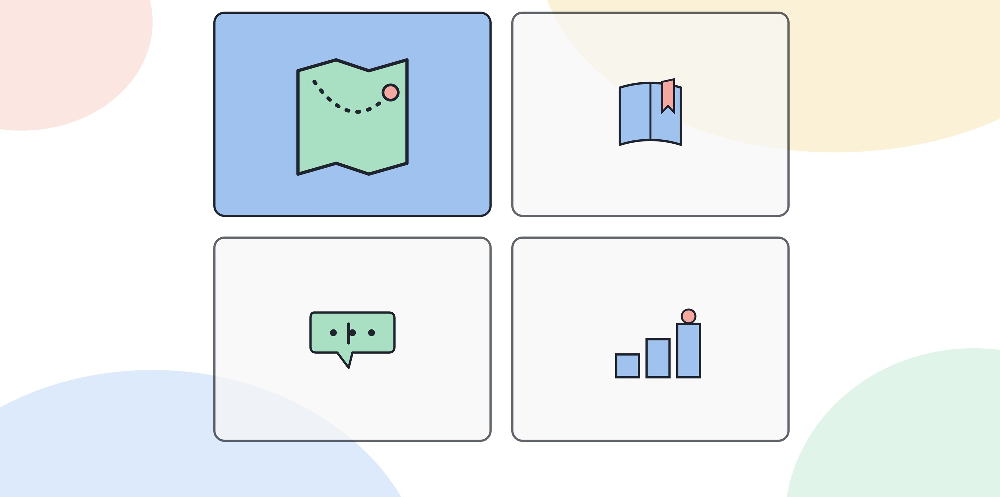

# 5.3 6개월 실무 적용 로드맵

이 장은 AI 도구의 원리를 알고 실제 업무에 적용해본 경험이 있는 사람을 대상으로 한다. 5.2에서 다룬 3개월 로드맵을 마쳤다면 바로 이어서 읽는다. 3개월 로드맵을 거치지 않았어도, 1.2에서 다룬 네 층위 중 인식과 활용이 어느 정도 채워져 있다면 여기서 시작해도 된다. 기준은 간단하다. 지난달 안에 AI 도구로 업무 하나를 처리하고 결과를 고쳐본 경험이 있는가. 없다면 5.2부터 시작한다.

이 단계의 목표는 두 가지다. 업무 프로세스 자체를 재설계하는 경험(1.2의 설계 층위)과 AI가 제시한 근거를 숫자로 검증하는 습관(데이터 리터러시)이다. 4부의 4.4와 4.5에서 다룬 내용을 실무에 옮기는 세 달이다.

## 4개월차: 데이터로 근거를 점검한다

AI 도구가 내놓는 결과에는 숫자나 근거가 따라오는 경우가 많다. 이 숫자를 그대로 받아들이는 것과, 근거가 어디서 왔는지 따져보는 것은 다른 일이다.

할 일:
- 최근 AI 도구가 제시한 숫자나 통계 하나를 고른다. 그 숫자가 어떤 자료에서 나왔는지, 어떤 기간을 기준으로 했는지 원자료에서 직접 확인한다.
- 같은 질문을 다른 방식으로 다시 물어서 숫자가 바뀌는지 비교한다. 바뀐다면 그 숫자가 안정적인 근거가 아니라는 신호다.
- 업무에서 자주 보는 숫자(매출, 응답 시간, 처리 건수 등) 하나를 골라, AI의 해석과 자신의 해석이 다른 지점을 찾아본다.

이 단계에서 중요한 것은 숫자를 더 많이 다루는 게 아니라, 숫자 뒤에 있는 전제를 의심하는 습관이다. "작년 대비 증가했다"는 문장을 보면 비교 기준이 무엇인지부터 묻는다.

막막하다면 이렇게 시작한다. 이번 주에 받은 보고서나 자료 중 숫자가 들어간 문장을 하나 골라 그 옆에 세 가지를 적어본다. 그 숫자의 집계 기간, 집계 범위(전체인지 일부인지), 집계 방식(합계인지 평균인지)이다. 세 가지 중 하나라도 자료에 적혀 있지 않다면, 그 숫자는 아직 검증되지 않은 숫자다. 이 메모를 한 주에 하나씩, 4개월차 동안 적어도 네 번 반복한다.

[그림] 6개월은 배운 것을 실무에 옮겨 반복해서 검증하는 기간이다.

## 자가진단 이후 바로 들어가는 사람을 위한 안내

5.1의 진단을 거쳐 이 장으로 바로 들어온 경우, 4개월차를 시작하기 전에 먼저 확인할 것이 있다. 최근에 받은 보고서나 자료 하나를 꺼내서, 그 안의 숫자 하나를 골라 위 세 가지(기간, 범위, 방식)를 지금 바로 적어본다. 셋 다 쉽게 답할 수 있다면 이미 이 역량의 기초는 갖춘 상태이니 4개월차를 건너뛰고 5개월차로 가도 된다.

## 5개월차: 업무 프로세스 하나를 재설계한다

2개월차(5.2)에서는 업무 하나에 AI를 적용했다. 이번에는 그 업무의 전체 순서를 다시 짠다. 1.2에서 든 예시처럼, 보고서를 더 빠르게 쓰는 것은 활용 층위이고, 보고서를 쓰는 과정의 단계 자체를 바꾸는 것은 설계 층위다.

할 일:
- 5.2에서 적용했던 업무의 전체 단계를 적어본다. 자료 수집, 초안 작성, 검토, 승인처럼 단계를 나눈다.
- 각 단계에서 AI가 들어갈 수 있는 자리와, 사람이 반드시 남아야 하는 자리를 구분한다.
- 단계의 순서를 바꿔본다. 예를 들어 "자료를 다 모은 뒤 쓴다"는 순서를 "가설을 먼저 세우고 자료로 검증한다"는 순서로 바꿀 수 있는지 따져본다.
- 바뀐 순서를 혼자 적용해보고, 가능하면 팀원 한 명에게 설명하고 반응을 들어본다.

재설계는 혼자 완성하기 어려운 경우가 많다. 팀 전체의 업무 방식이 걸려 있으면 혼자 바꿀 수 없는 부분이 나온다. 그 부분은 바꿀 수 없다고 적어두고, 바꿀 수 있는 부분만 먼저 시도한다.

막막하다면 이렇게 시작한다. 업무 단계를 적을 때 "AI가 들어갈 자리"를 찾기 전에 먼저 "가장 오래 걸리는 단계가 어디인가"를 찾는다. 네 단계 중 하나가 전체 시간의 절반 이상을 차지하는 경우가 흔하다. 그 단계부터 들여다보면 재설계의 효과가 눈에 보이는 수준으로 커진다. 가장 오래 걸리는 단계를 못 찾겠다면, 일주일 동안 그 업무를 하면서 각 단계에 걸리는 시간을 직접 재본다.

순서를 바꾸는 시도가 막막하면, 가장 뒤에 있는 단계를 가장 앞으로 옮겨보는 것부터 해본다. 보고서라면 "결론을 먼저 가정하고 자료로 검증한다"는 순서가 대표적이다. 자료 정리 업무라면 "분류 기준을 먼저 정하고 자료를 넣는다"는 순서가 비슷한 역할을 한다.

## 6개월차: 효과를 기록하고 비교한다

재설계한 프로세스를 한 달 정도 실제로 써보고, 바뀌기 전과 비교한다.

할 일:
- 바뀌기 전 업무에 걸리던 시간이나 단계 수를 적어둔다. 숫자가 없으면 "검토 요청이 몇 번 왔는지" 같은 정성적 지표도 괜찮다.
- 바뀐 뒤의 같은 지표를 적는다.
- 차이가 없거나 더 나빠졌다면 그 이유를 짚어본다. 재설계가 잘못된 게 아니라 중간에 검증 단계가 빠졌을 수도 있다.
- 이 비교 결과를 6.1에서 다룰 증명의 네 요소(상황, 적용, 결과, 한계) 형식으로 정리해둔다.

막막하다면 이렇게 시작한다. 비교할 지표가 하나도 없다고 느껴지면, "이 업무를 하면서 짜증났던 순간이 몇 번이었는가"처럼 단순한 정성적 지표부터 센다. 숫자로 재는 지표가 나중에 추가되면 그때 보강해도 된다. 지표가 없어서 비교를 미루는 것보다, 엉성한 지표로라도 비교를 시작하는 쪽이 6.1의 포트폴리오 재료를 더 빨리 쌓는다.

## 6개월이 끝나면

5.1의 진단 문항으로 다시 점수를 매긴다. 설계 층위와 데이터 리터러시(4.4) 점수가 올라가 있어야 한다. 거버넌스 층위는 이 단계에서도 아직 완성되지 않을 수 있다. 업무 재설계 과정에서 리스크를 따지는 감각은 쌓이지만, 조직 전체의 거버넌스 기준까지 다루려면 더 많은 경험이 필요하다. 이 부분은 5.4의 1년 로드맵에서 포트폴리오와 함께 다룬다.

> **북마크 — 6개월 로드맵 표**
>
> | 월차 | 목표 | 핵심 행동 | 확인 질문 |
> |---|---|---|---|
> | 4개월차 | 근거를 점검한다 | 숫자의 출처 확인, 같은 질문 다르게 물어 비교 | 이 숫자의 비교 기준이 무엇인지 설명할 수 있는가 |
> | 5개월차 | 프로세스를 재설계한다 | 업무 단계 분해, AI와 사람의 역할 구분, 순서 변경 시도 | 바뀐 뒤와 전의 단계가 구체적으로 다른가 |
> | 6개월차 | 효과를 기록한다 | 전후 지표 비교, 네 요소로 정리 | 결과가 숫자든 정성적 변화든 구체적으로 남아 있는가 |

## 다음 단계

6개월의 기록이 쌓이면 6부에서 다룰 포트폴리오의 뼈대가 된다. 5.4에서는 이 기록을 1년 단위로 확장해서 사내외에 증명하는 단계까지 연결한다.
