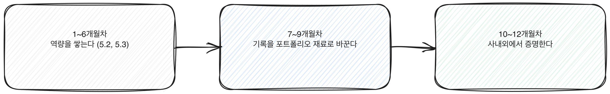

# 5.4 1년 포트폴리오 로드맵

6개월까지의 로드맵(5.2, 5.3)은 역량을 쌓는 데 집중한다. 이 장이 다루는 나머지 6개월은 쌓은 역량을 증명 가능한 형태로 만드는 데 집중한다. 둘은 다른 작업이다. 역량이 있어도 증명할 재료가 없으면 채용이나 사내 평가에서 그 역량이 보이지 않는다.

이 장은 6개월 로드맵을 마친 사람, 또는 1.2의 네 층위 중 활용과 설계가 어느 정도 채워진 사람을 대상으로 한다. 아직 그 단계가 아니라면 5.2와 5.3을 먼저 거친다.

아래 그림은 1년을 세 구간으로 나눠 보여준다. 앞의 6개월(5.2, 5.3)은 역량을 쌓는 구간이고, 이 장이 다루는 나머지 6개월은 그 역량을 증명 가능한 형태로 바꾸는 구간이다.

[그림] 앞 6개월이 역량을 쌓는 기간이라면, 뒤 6개월은 그것을 증명으로 옮기는 기간이다.

## 7~9개월차: 기록을 포트폴리오 재료로 바꾼다

5.3의 6개월차에서 남긴 기록(상황, 적용, 결과, 한계)은 아직 포트폴리오가 아니다. 개인 메모일 뿐이다. 이 메모를 다른 사람이 읽고 판단할 수 있는 형태로 바꾸는 작업이 필요하다.

할 일:
- 6개월 동안 쌓은 기록 중 가장 구체적인 것 두세 건을 고른다. 모든 기록을 다 쓰려 하지 않는다. 6.2에서 다루는 사이드 프로젝트든 6.3에서 다루는 사내 프로젝트든, 좁혀서 깊게 보여주는 쪽이 낫다.
- 각 기록을 6.1의 증명 네 요소 형식으로 다시 정리한다. 특히 "한계와 다음" 항목을 비워두지 않는다. 안 된 부분을 스스로 짚는 기록이 더 신뢰를 준다.
- 사내에서 공유할 수 있는 기록이라면, 작은 발표나 공유 문서로 먼저 팀 안에서 검증받아본다. 반응을 들으면 무엇이 설득력 있고 무엇이 부족한지 보인다.

이 세 달은 새로운 것을 배우는 기간이 아니라 이미 한 일을 정리하는 기간이다. 새 기능이나 새 도구에 손대기보다, 6개월 동안 쌓은 재료의 밀도를 높이는 데 시간을 쓴다.

정리한 재료가 실제로 어떤 형태로 남아야 하는지도 구체적으로 정해둔다. 아래 세 가지 형태 중 최소 하나는 갖추고 9개월차를 마친다.

**문서 형태.** 상황, 적용, 결과, 한계 네 요소를 한 장(A4 한 쪽 분량)으로 정리한 글이다. 숫자가 있으면 표로, 과정이 중요하면 순서대로 서술한다. 이 문서는 6.4에서 다룰 이력서 작성이나 사내 평가 제출에 그대로 쓸 수 있는 기본 단위가 된다.

**비교 수치.** 5.3의 6개월차에서 적어둔 전후 비교(시간, 건수, 또는 정성적 지표)를 다시 꺼내 깔끔한 표로 만든다. 숫자가 없는 경우 "줄었다, 늘었다, 달라지지 않았다"처럼 방향만 적어도 된다. 방향이 분명하면 숫자가 없어도 설득력을 가진다.

**발표나 공유 경험.** 팀 회의나 사내 공유 자리에서 위 문서나 수치를 2~3분 분량으로 말로 설명해본 경험이다. 발표 자체가 목적이 아니라, 설명하면서 어떤 질문을 받았는지, 어느 부분에서 설명이 막혔는지를 기록해두는 것이 목적이다. 그 기록이 10~12개월차에서 쓸 재료가 된다.

[그림] 1년은 역량을 쌓는 전반부와 증명으로 옮기는 후반부로 나뉜다.

## 10~12개월차: 사내외에서 역량을 증명한다

정리된 기록을 실제로 꺼내 쓰는 단계다. 어디에 꺼내는지는 상황에 따라 다르지만 방향은 같다. 구체적인 상황과 적용 과정을 보여주는 것이다.

할 일:
- 사내 평가나 인증 절차가 있다면(2.4에서 다룬 흐름), 정리해둔 기록을 그 절차의 언어로 다시 옮긴다. 평가 기준이 효율성을 묻는다면 결과 항목을, 리스크 관리를 묻는다면 한계와 확인 절차 항목을 앞세운다.
- 이력서나 자기소개서를 손볼 계획이 있다면 6.4에서 다루는 작성법을 참고해 기록을 옮긴다.
- 면접이나 발표에서 설명할 상황이 생기면 6.5에서 다루는 서사 구성법을 참고해 같은 재료를 말로 풀어본다.
- 검사를 앞두고 있다면 7부의 실전 준비로 넘어가되, 이 1년 동안 쌓은 기록이 검사의 실무형, 시뮬레이션형 문항(3.1)에서 쓸 수 있는 배경지식이 된다는 점을 기억한다.

분기별로 쌓이는 결과물의 분량도 미리 가늠해두면 막막함이 줄어든다. 10개월차에는 7~9개월차에서 만든 문서 형태 기록 최소 두 건이 있어야 한다. 11개월차에는 그 두 건 중 하나를 이력서나 자기소개서 문장으로 옮겨본 초안이 있어야 한다. 12개월차에는 그 초안을 다른 사람(동료, 상사, 또는 면접을 가정한 연습 상대)에게 보여주고 받은 피드백이 최소 한 번 있어야 한다. 세 가지 중 하나라도 비어 있다면, 그 분기는 아직 끝난 게 아니다.

## 1년이 끝나면 다시 진단한다

5.1의 진단 문항으로 세 번째 점수를 매긴다. 처음 진단과 비교했을 때 거의 모든 항목이 올라가 있어야 한다. 여전히 낮은 항목이 있다면, 그 항목이 1년 동안 실제로 다뤄지지 않았다는 뜻이다. 다음 해의 로드맵은 그 항목부터 다시 시작한다.

1년이 지났다고 역량 쌓기가 끝나는 것은 아니다. 8.2에서 다루듯 도구와 기능은 계속 낡는다. 하지만 이 1년 동안 쌓은 검증하고 기록하는 습관은 도구가 바뀌어도 남는다. 로드맵의 목적은 이 습관을 몸에 붙이는 것이고, 포트폴리오는 그 습관이 남긴 흔적이다.

> **북마크 — 1년 로드맵 전체 표**
>
> | 기간 | 단계 | 핵심 목표 | 연결 장 |
> |---|---|---|---|
> | 1개월차 | 원리를 안다 | AI 리터러시, 프롬프트 기초 | 4.1, 4.2 |
> | 2개월차 | 실제 업무에 적용한다 | 반복 업무 1~2개 적용, 결과 검증 | 1.1, 4.1 |
> | 3개월차 | 기록하고 습관을 굳힌다 | 증명 네 요소로 정리, 확인 절차 고정 | 6.1 |
> | 4개월차 | 근거를 점검한다 | 데이터 리터러시, 숫자 출처 확인 | 4.4 |
> | 5개월차 | 프로세스를 재설계한다 | 업무 단계 분해와 순서 변경 | 4.5 |
> | 6개월차 | 효과를 기록한다 | 전후 지표 비교, 네 요소 정리 | 6.1 |
> | 7~9개월차 | 재료를 포트폴리오로 바꾼다 | 기록 선별, 네 요소 재정리, 사내 검증 | 6.2, 6.3 |
> | 10~12개월차 | 사내외에서 증명한다 | 평가 절차, 이력서, 면접, 검사 준비에 적용 | 6.4, 6.5, 7부 |
>
> 이 표는 기본 경로다. 직무에 따라 순서나 비중을 바꿔야 하는 경우는 5.5에서 다룬다.

## 다음 단계

이 로드맵은 기본 경로다. 직무마다 우선순위가 달라지는 지점이 있다. 5.5에서는 기획, 마케팅, HR, 영업, 일반 행정 직군별로 이 로드맵을 어떻게 조정하는지 다룬다.
