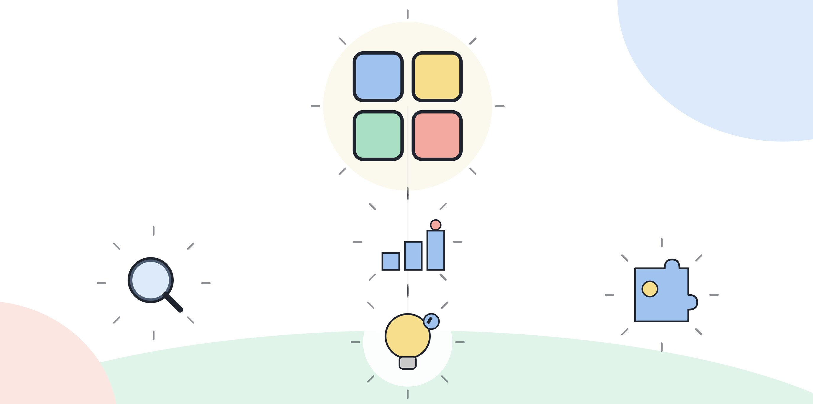

# 5.5 직무별 커스터마이징

5.2~5.4에서 제시한 로드맵은 기본 경로다. 모든 직무에 같은 순서, 같은 비중으로 적용되지는 않는다. 1.4에서 다뤘듯 같은 네 층위라도 직무마다 실제로 드러나는 모습이 다르다. 이 장은 그 차이를 로드맵의 순서와 비중에 반영하는 법을 다룬다.

아래 내용은 1.4에서 다룬 다섯 직무(기획, 마케팅, HR, 영업, 일반 행정/운영)를 그대로 따른다. 자신의 직무가 둘 이상에 걸쳐 있다면 겹치는 부분을 둘 다 반영한다.

## 기획 직군

기획 업무는 자료 수집과 초안 작성을 반복하면서 방향을 정하는 일이다. 1.4에서 짚었듯 이 직군은 거버넌스 층위, 특히 AI가 뽑아낸 요약이 원자료의 맥락을 놓쳤는지 확인하는 습관이 중요하다.

로드맵 조정:
- 5.2의 3개월차(기록하고 검증 습관 들이기)를 한 달 더 늘려도 좋다. 요약의 맥락 누락을 확인하는 습관은 짧게 익혀지지 않는다.
- 5.3의 5개월차(프로세스 재설계)에서 "자료 수집 후 작성"을 "가설 수립 후 자료로 검증"으로 바꾸는 시도를 먼저 해본다. 1.4에서 든 예시와 같은 방향이다.
- 포트폴리오(5.4, 7~9개월차)에서는 보고서나 기획안의 구조를 바꾼 사례를 중심에 둔다. 결과물의 양보다 구조 변화가 더 설득력 있다.

예를 들어 이런 업무를 가정하면 반복 업무 후보로 적당하다. 매주 작성하는 주간 현황 보고서, 분기마다 반복되는 사업 계획 초안, 여러 부서의 의견을 모아 정리하는 회의록 요약이다. 이 중 가장 형식이 고정되어 있고 매번 비슷한 자료를 참고하는 업무를 먼저 고른다.

[그림] 같은 로드맵도 직무에 맞게 속도와 순서를 조정해야 한다.

## 마케팅 직군

마케팅은 콘텐츠와 데이터를 같이 다룬다. 1.4에서 짚었듯 콘텐츠를 많이 만드는 것과 더 나은 콘텐츠를 더 빨리 찾아내는 것은 다른 일이다. 이 구분이 로드맵에도 그대로 적용된다.

로드맵 조정:
- 5.2의 2개월차에서 콘텐츠 초안을 여러 개 만들어보는 것에 그치지 않는다. 초안들의 성과를 비교하는 절차를 2개월차부터 같이 넣는다.
- 5.3의 4개월차(데이터 리터러시)를 앞당겨서 2개월차와 겹쳐서 진행해도 된다. 콘텐츠 성과 데이터를 다루는 경험이 이 직군에서는 더 빨리 필요하다.
- 포트폴리오에서는 "AI로 콘텐츠를 더 많이 만들었다"보다 "AI로 만든 여러 안 중 어떤 요소가 성과 차이를 만드는지 데이터로 확인했다"는 기록이 더 무겁게 평가된다.

예를 들어 이런 업무를 가정하면 반복 업무 후보로 적당하다. 매주 올리는 콘텐츠의 제목이나 썸네일 문구 작성, 매달 반복되는 뉴스레터 초안 작성, 캠페인 종료 후 성과를 정리하는 보고서다. 제목이나 문구처럼 짧고 반복적인 산출물부터 시작하면 성과 비교까지 빠르게 이어갈 수 있다.

## HR 직군

HR 업무는 사람에 대한 판단을 포함한다. 1.4에서 짚었듯 거버넌스 층위의 비중이 다른 직군보다 크다.

로드맵 조정:
- 5.2의 1개월차부터 4.8(윤리, 거버넌스, 리스크 감각)의 기초를 같이 챙긴다. 다른 직군은 이 기둥을 설계 단계 이후에 본격적으로 다뤄도 되지만, HR은 활용 단계부터 편향 가능성을 의심하는 습관이 필요하다.
- 5.3의 5개월차(프로세스 재설계)에서는 효율보다 공정성을 먼저 검증한다. 평가 프로세스를 바꿀 때 "더 빨라졌다"보다 "특정 집단에 불리하게 작용하지 않는지 확인했다"는 기록이 먼저 와야 한다.
- 포트폴리오에서는 결과의 숫자(처리 건수, 소요 시간)보다 검증 절차 자체를 설명하는 쪽에 비중을 둔다.

예를 들어 이런 업무를 가정하면 반복 업무 후보로 적당하다. 채용 지원서 서류를 1차로 거르는 작업, 사내 교육 자료의 초안 작성, 반복되는 인사 공지문 작성이다. 이 중 사람에 대한 판단이 직접 들어가는 업무(서류 거르기)는 가장 먼저 거버넌스 점검 습관을 붙여야 할 대상이다.

## 영업 직군

영업은 고객 데이터와 반복적인 커뮤니케이션을 다룬다. 1.4에서 짚었듯 편의성과 정보 보호 사이의 균형을 판단하는 것이 역량의 일부다.

로드맵 조정:
- 5.2의 1개월차 거버넌스 점검(결과를 쓰기 전 확인하는 절차)에 고객 정보 입력 범위를 반드시 포함한다. 어떤 정보를 AI 도구에 넣을 수 있고 넣을 수 없는지를 먼저 정하고 시작한다.
- 5.3의 5개월차(프로세스 재설계)는 "어떤 고객에게 먼저 연락할지 정하는 기준"을 데이터 기반으로 재구성하는 작업으로 구체화한다.
- 포트폴리오에서는 개인정보를 다루는 과정에서 어떤 기준을 세웠는지를 분명히 적는다. 성과 숫자만 내세우면 거버넌스 층위가 빠진 기록으로 읽힌다.

예를 들어 이런 업무를 가정하면 반복 업무 후보로 적당하다. 거래처별 제안서 초안 작성, 고객 문의에 대한 1차 응답 초안, 영업 활동을 정리하는 주간 보고서다. 고객 정보가 직접 들어가는 업무(제안서, 문의 응답)는 입력 범위를 정하는 일을 가장 먼저 처리해야 한다.

## 일반 행정, 운영 직군

문서 작업과 반복 보고가 많은 직군이다. 1.4에서 짚었듯 활용 층위는 가장 빠르게 적용되지만, 설계 층위로 가려면 "이 문서를 왜 이 형식으로 만드는가"부터 다시 물어야 한다.

로드맵 조정:
- 5.2의 2개월차에서 반복 업무를 고를 때, 그 업무가 지금의 형식으로 존재하는 이유를 먼저 적어본다. 이유가 분명하지 않으면 형식 자체가 재설계 대상이다.
- 5.3의 5개월차는 다른 직군보다 비중을 높인다. 양식화된 문서를 그대로 AI에게 맡기면 비효율까지 자동화되기 때문에, 설계 단계를 건너뛰고 활용만 늘리면 오히려 손해다.
- 포트폴리오에서는 "문서 작성 시간이 줄었다"보다 "문서의 형식이나 승인 단계 자체가 줄었다"는 기록이 더 설계 층위를 보여준다.

예를 들어 이런 업무를 가정하면 반복 업무 후보로 적당하다. 매달 반복되는 정기 보고서 작성, 여러 부서에서 들어오는 요청 문서를 정리해 전달하는 업무, 반복되는 결재 서류 작성이다. 이 중 승인 단계가 여러 번 겹치는 업무(요청 문서 정리, 결재 서류)가 설계 층위로 넘어가기 가장 좋은 대상이다.

> **북마크 — 직무별 우선순위 조정표**
>
> | 직무 | 앞당길 로드맵 구간 | 특히 챙길 기둥 |
> |---|---|---|
> | 기획 | 3개월차(기록 습관) 연장 | 거버넌스(4.8), 문제정의력(4.6) |
> | 마케팅 | 4개월차(데이터 리터러시)를 2개월차와 겹침 | 데이터 리터러시(4.4) |
> | HR | 1개월차부터 거버넌스 병행 | 윤리, 거버넌스, 리스크 감각(4.8) |
> | 영업 | 1개월차 거버넌스 점검에 정보 보호 포함 | 윤리, 거버넌스, 리스크 감각(4.8) |
> | 일반 행정, 운영 | 5개월차(프로세스 재설계) 비중 확대 | 업무 프로세스 재설계(4.5) |

## 직무가 바뀌면 다시 본다

이직이나 직무 전환으로 담당 업무가 바뀌면 이 표를 다시 펼친다. 쌓아둔 네 층위의 역량은 그대로 남지만, 어느 기둥에 먼저 집중해야 하는지는 직무에 따라 달라진다.

## 오늘 해볼 일

자신의 직무에 해당하는 절을 다시 읽고, 위 표의 "앞당길 구간"을 5.2나 5.3의 해당 월차에 메모해둔다. 다음에 그 달에 도달했을 때 이 메모를 먼저 확인한다.
