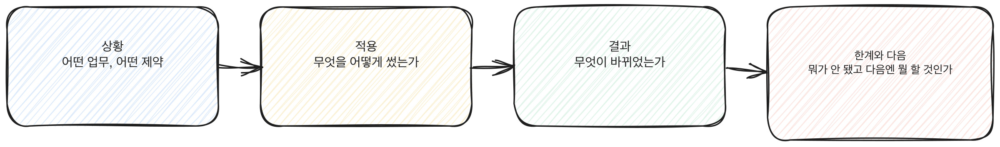

# 6.1 "AX를 했다"는 것을 증명하는 법

AI 도구를 써본 경험과 AX 역량을 증명하는 경험은 다르다. "챗봇으로 보고서 초안을 써봤다"는 경험이다. 그 경험이 증명이 되려면 네 가지가 더 필요하다. 상황, 적용, 결과, 한계와 다음이다.

## 증명이 안 되는 말

면접에서든 이력서에서든 다음과 같은 말은 증명이 아니다.

> "AI 도구를 활용해서 업무 효율을 높였습니다."

이 문장에는 네 가지가 모두 빠져 있다. 어떤 업무인지, 무엇을 어떻게 썼는지, 효율이 어떻게 바뀌었는지, 뭐가 안 됐는지 아무것도 없다. 평가하는 사람 입장에서는 이 문장과 "성실하게 일했습니다"가 구별되지 않는다.

[그림] 상황, 적용, 결과, 한계와 다음이 빠지면 증명이 아니라 나열이 된다.

## 증명의 네 요소

### 1. 상황: 어떤 업무, 어떤 제약

증명은 구체적인 업무에서 시작한다. "마케팅팀 전체 업무"가 아니라 "매주 작성하던 주간 리포트" 같은 단위여야 한다. 제약도 같이 적는다. 시간이 부족했는지, 데이터가 흩어져 있었는지, 같은 작업을 반복하던 사람이 본인뿐이었는지. 제약이 있어야 다음 단계인 "적용"이 왜 필요했는지 설명이 된다.

### 2. 적용: 무엇을 어떻게 썼는가

도구 이름만 쓰는 건 적용이 아니다. 어떤 입력을 줬고, 어떤 과정을 거쳤고, 사람이 어느 지점에서 개입했는지를 적는다. "요약 기능을 썼다"가 아니라 "원본 데이터를 정리한 뒤 세 가지 기준으로 요약하게 하고, 결과를 원본과 대조해서 빠진 항목을 채웠다"처럼 과정이 보여야 한다.

과정이 보이면 자연스럽게 역량이 드러난다. 데이터를 정리한 부분에서 데이터 리터러시가, 원본과 대조한 부분에서 검증 습관이 드러난다. 이 책의 4부에서 다룬 핵심 역량 기둥들이 바로 이 지점에서 증명된다.

### 3. 결과: 무엇이 바뀌었는가

숫자가 있으면 좋지만 없어도 된다. "작성 시간이 절반으로 줄었다"처럼 숫자가 있으면 명확하다. 숫자가 없으면 정성적으로 쓴다. "매번 담당자가 다른 형식으로 쓰던 리포트가 같은 틀을 쓰게 됐다", "리포트를 받는 쪽에서 다시 물어보는 일이 줄었다"도 결과다. 결과가 없으면 적용이 일회성 실험에 그쳤다는 뜻이고, 그건 증명이 아니라 시도다.

### 4. 한계와 다음: 뭐가 안 됐고 다음엔 뭘 할 것인가

이 네 번째 요소가 가장 자주 빠진다. 많은 사람이 결과까지만 말하고 멈춘다. 하지만 한계를 스스로 짚는 사람과 결과만 자랑하는 사람은 평가하는 쪽에서 다르게 읽힌다. "이 방식은 데이터 양이 적을 때만 통했고, 양이 늘면 중간 검증 단계를 하나 더 넣어야 한다는 걸 알게 됐다"는 말은 그 사람이 이 작업을 한 번 하고 끝낸 게 아니라 계속 다룰 수 있다는 신호다.

> 2.6에서 다룬 "평가자가 가르는 기준"도 같은 이야기다. 통과하는 답변은 한계를 스스로 인식한다.

아래 그림은 네 요소가 이어지는 순서를 보여준다. 넷 중 하나라도 비면 증명이 아니라 경험담으로 남는다.

[그림] 상황과 적용만으로는 부족하고, 결과와 한계까지 있어야 서사가 완성된다.

## 네 요소를 실제로 채운 예시

아래는 가상의 상황을 가정해 네 요소를 끝까지 채운 예시다. 실제 인물의 경험이 아니라 구조를 보여주기 위해 만든 것이다.

> **상황**: 영업팀에서 매달 거래처 50곳의 계약 갱신일을 엑셀로 따로 관리했다. 담당자가 바뀔 때마다 파일 형식이 조금씩 달라져서, 갱신일을 놓치는 일이 1년에 두세 번씩 생겼다.
>
> **적용**: 거래처별 계약 정보를 하나의 표로 통일하고, 갱신일 30일 전에 알려야 할 항목(거래처명, 담당자, 갱신 조건)을 정리해 AI 도구가 매주 그 표를 읽고 "이번 주에 확인해야 할 거래처 목록"을 뽑아내도록 했다. 목록이 나오면 사람이 실제 계약 조건을 다시 확인하고 거래처에 연락하는 순서로 바꿨다. AI가 날짜를 계산해서 목록을 거르는 일을 맡았고, 조건을 판단하고 연락하는 일은 그대로 사람이 맡았다.
>
> **결과**: 갱신일을 놓치는 일이 그 이후로는 없었다. 표 형식이 하나로 통일되면서 담당자가 바뀌어도 인수인계가 쉬워졌다는 반응도 있었다.
>
> **한계와 다음**: 이 방식은 계약 정보가 표에 정확히 입력돼 있어야만 작동한다. 담당자가 표를 늦게 채우면 알림도 늦게 나온다. 다음 단계로는 표 입력 자체를 계약서 업로드 시점에 맞춰 알려주는 절차를 추가할 계획이다.

이 예시에서 네 요소 중 가장 많이 빠지는 건 보통 마지막 줄이다. "한계와 다음"을 끝까지 써보면, 이 작업이 아직 끝난 게 아니라 계속 다루고 있는 일이라는 게 드러난다.

## 같은 경험이 형태마다 다르게 압축된다

네 요소를 한 번 채워두면 그 기록을 이력서, 자기소개서, 면접, 사이드 프로젝트 기록에 각각 다른 길이로 꺼내 쓴다. 이력서는 상황과 결과를 한 문장씩, 적용을 한 문장으로 압축하고 한계와 다음은 보통 뺀다(6.4). 자기소개서는 적용 부분을 왜 그 방법을 택했는지까지 풀어 쓸 자리가 있다. 면접은 네 요소에 다섯 번째로 "한계와 다음"을 반드시 포함해서 말로 풀어낸다(6.5). 같은 재료를 형태에 맞게 길이만 조절하면 되므로, 네 요소를 한 번 제대로 적어두는 일이 뒤의 모든 장에서 반복해서 쓰이는 재료가 된다.

반대로 네 요소 없이 시작하면 매번 새로 기억을 더듬어야 한다. 이력서를 쓸 때 다르게 기억하고 면접에서 또 다르게 말하면, 같은 경험인데 세부가 조금씩 어긋난다. 평가하는 쪽은 이런 어긋남을 "과장"으로 읽는다. 네 요소를 먼저 고정해두면 이 문제가 애초에 생기지 않는다.

## 다른 직무에 적용한 예시 하나 더

영업 사례와 다른 직무에서도 같은 구조가 똑같이 작동한다는 걸 보여주는 예시를 하나 더 둔다. 이번에도 가상의 상황이다.

> **상황**: 인사팀에서 신입 입사자 온보딩 서류를 받을 때마다 빠진 항목이 있는지 담당자가 하나씩 눈으로 확인했다. 입사자가 몰리는 달에는 확인이 늦어져 입사 첫 주에 서류를 다시 요청하는 일이 반복됐다.
>
> **적용**: 온보딩에 필요한 서류 항목을 체크리스트로 만들고, AI 도구가 제출된 서류 묶음을 체크리스트와 대조해 빠진 항목만 표시하도록 했다. 표시된 항목만 담당자가 확인하고 입사자에게 바로 안내하는 방식으로 바꿨다. 서류가 맞는지 판단하는 일(예: 서류의 진위나 특수한 예외 처리)은 그대로 담당자가 맡았다.
>
> **결과**: 서류를 다시 요청하는 일이 줄었고, 입사자가 몰리는 달에도 확인이 밀리지 않게 됐다.
>
> **한계와 다음**: 체크리스트에 없는 새로운 유형의 서류가 들어오면 여전히 사람이 처음부터 판단해야 한다. 다음 단계로는 새로운 서류 유형이 나타날 때마다 체크리스트를 갱신하는 주기를 정해두려 한다.

영업 사례와 인사 사례는 업무 내용이 다르지만 네 요소의 뼈대는 같다. "반복되는 판단 중 규칙이 명확한 부분만 AI에게 맡기고, 예외적인 판단은 사람이 남긴다"는 구조가 두 사례 모두에서 되풀이된다. 이 구조를 알아보는 것이 6부 전체를 관통하는 기준이다.

## 네 요소를 다 채울 수 없을 때

사이드 프로젝트 하나로는 네 요소 전부를 채우기 어려울 수 있다. 그럴 때는 상황과 적용만이라도 구체적으로 적고, 결과는 "아직 운영 중"이라고 솔직히 쓰는 게 낫다. 없는 결과를 지어내는 것보다 진행 중인 상태를 정직하게 보여주는 게 평가에서 더 안전하다.

## 바로 해볼 일

지금 떠오르는 업무 하나를 골라 네 요소로 한 문단씩 적어본다. 아직 AI를 적용해본 적이 없다면 "상황"과 "제약"만 먼저 적어도 된다. 그게 다음 장들(6.2, 6.3)에서 다룰 프로젝트를 고르는 출발점이 된다.

> **북마크 — 증명 네 요소 체크**
> - [ ] 상황: 구체적인 업무 단위와 제약을 적었는가
> - [ ] 적용: 입력, 과정, 사람의 개입 지점이 보이는가
> - [ ] 결과: 숫자든 정성적 변화든 "바뀐 것"이 있는가
> - [ ] 한계와 다음: 안 된 것과 다음에 할 일을 스스로 짚었는가

다음 장(6.2)에서는 이 네 요소를 채울 사이드 프로젝트를 고르는 기준을 다룬다.
