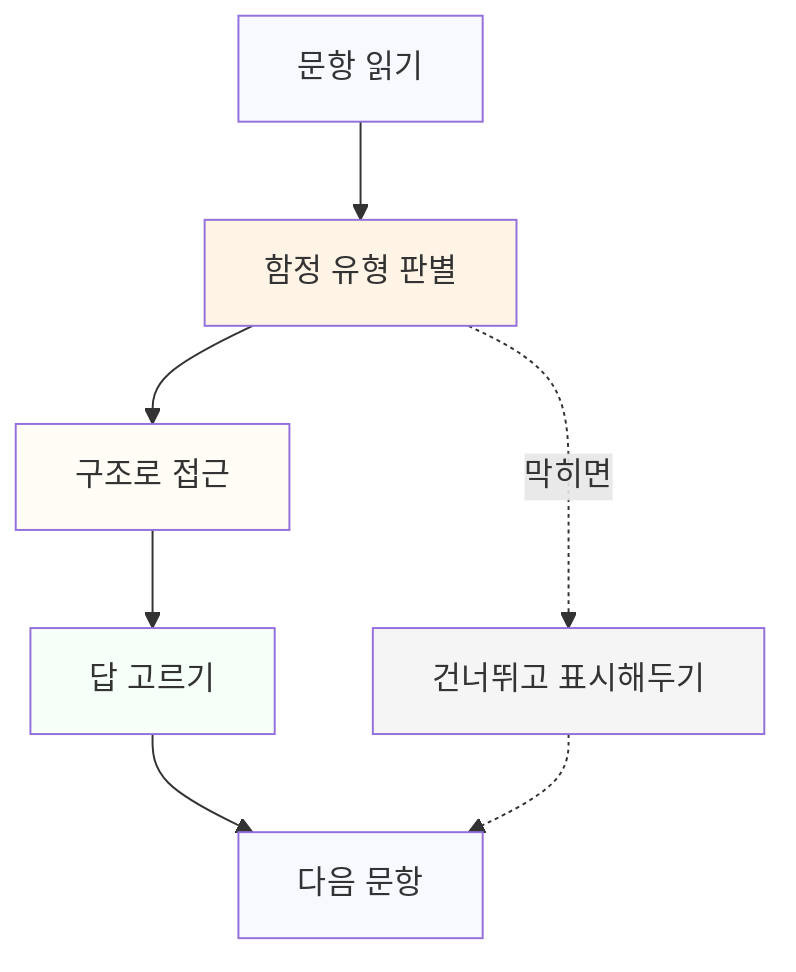

# 7.1 검사 대비 전략: 시간관리와 함정 유형

검사 유형을 모르고 들어가면 시간을 잘못 쓴다. 3부 1장에서 다룬 네 가지 검사 유형(지식형, 판단형, 실무형, 시뮬레이션형)은 각각 다른 방식으로 시간을 요구하고, 같은 시간 관리 전략을 그대로 적용하면 한쪽에서는 시간이 남고 한쪽에서는 모자란다.

## 유형별 시간 배분

지식형 문제는 아는가 모르는가의 문제라서 오래 붙잡고 있어도 답이 나오지 않는다. 모르면 바로 넘기고, 아는 문제에서 시간을 아껴 뒤에 쓴다. 한 문제에 1분 이상 쓰지 않는다는 기준을 미리 정해두면 흔들리지 않는다.

> 예를 들어 "파인튜닝과 프롬프트 엔지니어링의 차이"를 묻는 문제에서 용어가 헷갈려 3분을 쓴다면, 그 3분은 뒤에 나올 판단형 문제 두 개를 풀 시간과 같다. 헷갈리는 순간 일단 가장 근접한 답을 체크해두고 넘어간 뒤, 전체를 다 풀고 시간이 남으면 돌아온다.

판단형 문제는 반대다. 선택지 중 가장 그럴듯한 것을 고르는 문제이기 때문에, 첫눈에 맞아 보이는 선택지를 바로 고르면 함정에 걸리기 쉽다. 선택지를 끝까지 다 읽고, 상황에 전제된 조건(누가, 어떤 데이터로, 어떤 리스크가 있는 업무인지)을 다시 확인한 뒤 고른다.

> 예를 들어 "고객 응대 기록을 AI로 분석한다"는 상황에서 "가장 빠른 방법"을 묻는 선택지가 있다면, 속도만 보고 고르기 전에 그 기록에 개인정보가 섞여 있는지를 먼저 떠올려야 한다. 판단형 문제는 보통 네 개 선택지 중 두 개가 그럴듯해 보이도록 설계되어 있고, 그 둘을 가르는 기준이 대개 리스크 인식이다.

실무형 문제는 산출물을 만들어야 하므로 시간이 가장 많이 든다. 완벽한 산출물을 만들려고 시간을 다 쓰면 뒤의 문제를 못 푼다. 핵심 요구사항만 채운 버전을 먼저 완성하고, 남는 시간에 다듬는다.

> 예를 들어 "업무 프로세스 재설계 계획을 서술하라"는 과제가 나오면, 문장을 다듬는 데 시간을 쓰기 전에 4부 5장에서 다룬 세 요소(단계 구분, 적용 지점, 비교 기준)가 다 들어갔는지부터 확인한다. 세 요소가 다 있는 거친 답이 문장은 매끄럽지만 요소가 빠진 답보다 높은 점수를 받는다.

시뮬레이션형은 앞 단계의 선택이 뒤 단계에 영향을 준다. 중간에 잘못된 선택을 했다고 느껴도 멈추지 않는다. 그 상태에서 다음 판단을 이어가는 능력도 평가 대상이다.

> 예를 들어 1단계에서 리스크를 놓친 선택을 했다는 걸 뒤늦게 깨달아도, 그 사실을 2단계 답변에 반영해서 "앞에서 놓친 부분을 지금 단계에서 보완한다"고 쓰는 쪽이 1단계로 돌아갈 수 없는 상태에서 포기하는 것보다 낫다. 시뮬레이션형은 완벽한 선택의 연속을 보는 것이 아니라, 틀렸을 때 그 상태에서 어떻게 복구하는지를 본다.

문제 하나를 풀 때 거치는 순서를 그림으로 보면 이렇다.

막혔을 때 점선을 따라가는 것이 핵심이다. 구조로 접근하는 단계에서 답이 안 보이면, 그 자리에 멈추지 않고 표시만 해둔 채 다음 문항으로 넘어간다.

## 자주 걸리는 함정 유형

**그럴듯하지만 리스크 인식이 빠진 오답.** 효율이나 속도만 강조하고 검증 절차나 리스크를 언급하지 않는 선택지가 가장 매력적으로 보인다. 3부 6장에서 다룬 리스크 영역의 관점으로 다시 읽으면, 이런 선택지는 "빠르지만 위험한 길"이라는 게 드러난다.

**모호한 상황에서 섣불리 단정하는 실수.** 판단형, 시뮬레이션형 문제는 정보를 일부러 불완전하게 준다. 주어지지 않은 정보를 마음대로 가정하고 확신에 찬 답을 고르면, 그 가정 자체가 틀렸을 때 전체 답이 흔들린다. 불확실한 부분이 있으면 "확인이 필요하다"는 선택지나 서술이 오히려 더 안전한 답일 때가 많다.

**도구 이름을 아는 것과 역량을 혼동하는 함정.** 특정 도구나 서비스 이름이 선택지에 등장하면 그것을 써봤다는 이유로 고르기 쉽다. 하지만 검사가 보는 것은 도구 경험이 아니라 판단 구조다. 이름이 익숙하다는 이유로 고르지 않는다.

**이미 정답을 정해두고 상황을 끼워 맞추는 함정.** 지식형 문제에서 외운 정의를 판단형, 시뮬레이션형 문제에도 그대로 적용하려는 경우다. 예를 들어 "에이전트에게 반복 업무를 맡겨라"는 원칙을 외웠다고 해서, 책임 소재가 걸린 업무까지 "맡기는 것이 맞다"고 답하면 틀린다. 원칙은 상황의 조건(얼마나 반복적인지, 결과가 틀렸을 때 누가 책임지는지)에 따라 다르게 적용돼야 한다.

## 문제를 두 번 읽어야 하는 신호

아래 표현이 보이면 속도를 늦추고 문제를 다시 읽는다. 함정이 섞여 있을 가능성이 높다는 신호다.

| 신호 | 왜 멈춰야 하는가 |
|---|---|
| "가장 빠른", "가장 효율적인" | 효율만 묻는 선택지 뒤에 리스크를 놓친 선택지가 숨어 있을 수 있다 |
| "모두 적용", "전체 데이터" | 범위를 좁혀서 먼저 확인하는 절차가 빠졌을 가능성이 있다 |
| "확인 없이", "바로" | 검증 단계를 건너뛰는 선택지일 가능성이 높다 |
| 상황 설명에 숫자나 기간이 없음 | 전제가 불완전하므로 성급한 결론을 고르면 틀리기 쉽다 |

> **북마크 — 검사 시작 전 10초 체크**
> 1. 이 문제는 네 유형 중 어디에 속하는가
> 2. 이 영역은 3부에서 다룬 5개 영역 중 무엇인가
> 3. 지금 고르려는 답에 리스크 인식이 들어 있는가
> 4. 주어지지 않은 정보를 마음대로 가정하고 있지 않은가

## 시험 시간 전체를 운용하는 법

문제 유형이 섞여 나오는 검사라면, 시작하자마자 전체를 한 번 훑어 유형 비율을 가늠하는 데 1~2분을 쓴다. 지식형이 많으면 전체적으로 속도를 낼 여유가 있다는 뜻이고, 실무형이나 시뮬레이션형이 많으면 뒤로 갈수록 시간이 부족해질 걸 미리 각오해야 한다. 이 1~2분이 아깝게 느껴질 수 있지만, 전체 구조를 모른 채 앞에서부터 순서대로 풀다가 뒤에서 시간에 쫓기는 것보다 낫다.

풀다가 시간이 부족해지는 게 느껴지면, 남은 문제 중 실무형과 시뮬레이션형을 먼저 확보한다. 배점이 같다면 유형별 난이도보다 "완전히 못 풀면 0점인 문제"를 먼저 처리하는 쪽이 유리하다. 지식형은 찍어도 확률이 남지만, 서술형 실무 과제는 아예 손대지 않으면 확실히 0점이다.

## 오늘 해볼 수 있는 것

최근 본 업무 관련 공고나 사내 공지에서 "AX 역량검사"라는 말이 어떤 형식(온라인 객관식, 과제 제출, 면접 병행)으로 안내되어 있는지 다시 확인한다. 형식에 따라 위 네 유형 중 어느 쪽에 더 가까운지 가늠해본다. 그 형식에 맞춰 위 표의 신호 네 가지를 눈에 보이는 곳에 적어두고, 실제로 문제를 풀 때(연습문제든 실전이든) 그 표를 옆에 두고 체크하면서 푼다.
