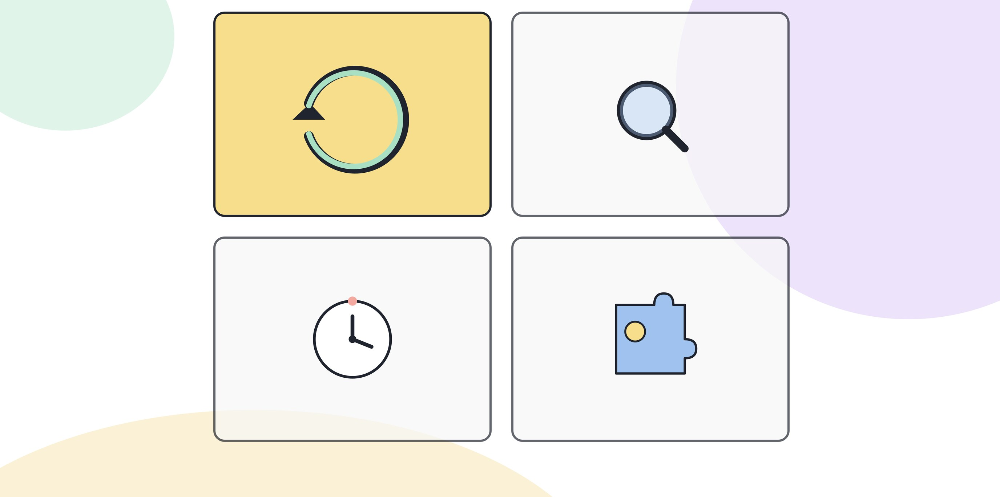

# 8.1 변화 속도를 따라가는 학습 루틴

새 도구가 나올 때마다 전부 써보려는 사람은 오래 못 간다. 두 달을 못 채우고 지친다. 반대로 한 번 익힌 방식만 고집하는 사람은 조용히 뒤처진다. 둘 다 피하는 길은 속도를 따라가는 게 아니라 판단 기준을 유지하는 것이다.

## 쫓아가기와 판단하기의 차이

쫓아가는 사람은 새 도구가 나오면 그 도구를 먼저 본다. 판단하는 사람은 자기 업무를 먼저 본다.

쫓아가는 사람의 질문은 "이 도구가 뭘 할 수 있지"다. 판단하는 사람의 질문은 "내 업무의 어느 지점이 아직 막혀 있지"다. 순서를 바꾸면 결과가 달라진다. 도구를 먼저 보면 도구에 맞춰 업무를 바꾸게 되고, 업무를 먼저 보면 막힌 지점에 맞는 도구를 그때 찾으면 된다.

이 차이는 4부에서 다룬 문제정의력과 같은 자리에 있다. 기술이 아니라 문제에서 시작하는 습관이 학습 루틴에도 그대로 적용된다.

[그림] 도구가 바뀌어도 학습 루틴은 그대로 쓸 수 있다.

## 월 1회 점검이 전부다

매주 새 소식을 확인할 필요는 없다. 한 달에 한 번, 다음 세 가지만 점검하면 된다.

1. **지난 한 달, 내 업무에서 AI로 처리한 일이 늘었는가, 줄었는가.** 늘었다면 어디서 늘었는지 한 줄로 적는다. 줄었다면 왜 안 쓰게 됐는지 적는다. 도구가 불편해서인지, 결과를 못 믿어서인지, 쓸 필요가 없어져서인지는 서로 다른 문제다.
2. **새로 나온 도구나 기능 중에 내 업무와 관련 있는 게 있었는가.** 전체 소식을 다 훑지 않는다. 자기 직무와 겹치는 영역만 본다. 관련 없는 소식은 걸러도 된다.
3. **지금 쓰는 방식 중에 더 이상 효율이 안 나는 게 있는가.** 예전에 유용했던 방식이 지금은 번거로움만 남기는 경우가 있다. 바꿀 시점을 놓치지 않으려면 정기적으로 되물어야 한다.

세 가지를 적는 데 삼십 분이면 충분하다. 길게 쓸 필요가 없다. 길게 쓰기 시작하면 점검이 아니라 또 다른 업무가 된다.

### 세 질문을 더 구체적으로 묻는 법

"늘었는가, 줄었는가" 같은 질문은 처음 몇 달은 쉽게 답이 나오지만 익숙해지면 점점 뭉뚱그려 답하게 된다. 답이 뭉뚱그려지지 않게 하려면 각 질문 아래에 더 좁은 질문을 하나씩 붙여 두는 게 낫다.

- 첫 번째 질문 아래: "이번 달에 AI로 처리한 일 중 지난달에는 안 쓰던 업무가 있었는가." 완전히 새로운 업무가 하나라도 있으면 늘어난 것이고, 없으면 기존 업무를 조금 더 효율적으로 돌린 것이다. 이 둘은 다른 성격의 변화라서 구분해서 적어야 다음 계획이 명확해진다.
- 두 번째 질문 아래: "그 소식을 어디서 접했는가." 동료가 알려줬는지, 회사 공지였는지, 우연히 봤는지를 적어두면 다음 달 점검에서 어느 경로가 자신에게 쓸모 있는 정보를 주는지 보인다. 쓸모없는 소식만 주는 경로는 다음부터 줄여도 된다.
- 세 번째 질문 아래: "효율이 떨어진 지점에서 무엇이 바뀌었길래 그런가." 업무 자체가 바뀌었는지, 도구가 바뀌었는지, 자신의 숙련도가 올라가서 예전 방식이 답답해진 건지 구분한다. 원인이 다르면 고치는 방법도 다르다.

## 새 도구를 만났을 때의 순서

새 도구 소식을 접했을 때 바로 배우지 않는다. 다음 순서를 먼저 거친다.

**첫째, 이 도구가 내 업무의 어느 단계에 들어가는지 specify한다.** 업무를 단계로 쪼개 보고(4부 4.5에서 다룬 방식), 그중 어느 단계에 해당하는지 짚는다. 해당하는 단계가 없으면 당장 배울 필요가 없다.

**둘째, 지금 그 단계에서 쓰는 방식과 비교한다.** 지금 방식이 멀쩡하게 돌아가고 있다면 바꿀 이유가 약하다. 지금 방식이 느리거나 자주 오류가 나는 지점이라면 배울 이유가 생긴다.

**셋째, 바꿨을 때 검증할 방법이 있는지 확인한다.** 결과를 확인할 길이 없는 도구는 업무에 들이지 않는다. 검증 없이 들인 도구는 나중에 리스크로 돌아온다(3부 3.6, 4부 4.8에서 다룬 거버넌스 감각과 같은 자리다).

이 세 단계를 거치고 나서야 실제로 배운다. 순서를 건너뛰고 먼저 써보면, 재미있어서 계속 쓰게 되거나 반대로 복잡해서 포기하게 되는데 둘 다 업무와는 상관없는 판단이다.

예를 들어 이런 상황을 가정해보면 순서가 왜 중요한지 더 분명해진다. 회의 녹음을 요약해주는 기능이 새로 나왔다는 소식을 들었다고 하자. 첫째 단계에서 "회의 내용을 정리해서 공유하는 업무 단계"에 해당한다는 걸 확인한다. 둘째 단계에서 지금은 회의 뒤 직접 메모를 정리해서 공유하는 방식을 쓰고 있는데, 이 방식이 특별히 느리거나 자주 빠뜨리는 내용이 있는 게 아니라면 바꿀 이유가 약하다는 판단이 나온다. 반대로 회의가 길어서 메모가 자주 누락된다면 셋째 단계로 넘어가, 요약 결과를 원본 녹음과 대조해서 빠진 부분이 없는지 확인할 방법이 있는지를 본다. 확인할 방법이 있으면 그때 배운다. 이 순서를 거치면 "새로 나왔다니까 써본다"가 아니라 "내 업무의 이 지점이 느슨해서 써본다"가 된다.

## 유행을 좇는 학습과 루틴의 차이

유행을 좇는 학습은 외부 신호가 시작점이다. 누가 어떤 도구를 쓴다는 글을 보거나, 새 기능 출시 소식을 접하는 순간 학습이 시작된다. 그래서 신호가 많이 뜨는 달에는 배우는 게 많고, 조용한 달에는 아무것도 안 배운다. 배우는 양이 자기 업무와는 무관하게, 바깥의 소음량에 따라 오르내린다.

루틴은 시작점이 안에 있다. 외부에 새 소식이 있든 없든 월 1회 점검은 돌아간다. 점검에서 "관련 있는 소식이 없었다"는 답이 나와도 그건 실패가 아니라 정상적인 결과다. 바깥이 조용한 달에는 점검도 짧게 끝나고, 그 대신 지금 쓰는 방식을 다듬는 데 시간을 돌린다. 루틴의 핵심은 배우는 양을 바깥의 소음에 맞추지 않고, 점검하는 빈도를 자기가 정한 주기에 맞추는 것이다.

## 기록이 루틴을 지속시킨다

점검을 한 번만 하고 끝내면 다음 달에 똑같은 고민을 반복한다. 짧게라도 기록을 남겨야 다음 점검이 쌓인다. 날짜, 바뀐 것, 안 바뀐 것, 다음에 볼 것 네 줄이면 된다.

이 기록은 나중에 6부에서 다룰 포트폴리오의 원재료가 된다. 성과를 정리하려 할 때 "그때 뭘 했더라"를 기억에만 의존하면 대부분 사라져 있다. 매달 네 줄씩 쌓인 기록이 그 공백을 채운다.

> **북마크 — 월 1회 점검 루틴**
> - 지난 한 달, AI로 처리한 업무가 늘었는가 줄었는가. 이유를 한 줄로.
> - 새로 접한 도구나 기능 중 내 직무와 관련 있는 게 있었는가.
> - 지금 쓰는 방식 중 효율이 떨어진 게 있는가.
> - 새 도구를 만나면: 어느 업무 단계에 해당하는가 → 지금 방식과 비교 → 검증 방법이 있는가, 순서로만 판단한다.
> - 날짜, 바뀐 것, 안 바뀐 것, 다음에 볼 것 네 줄로 매달 기록한다.

## 루틴이 멈추는 때

루틴도 영원히 그대로 가지는 않는다. 월 1회 점검을 몇 달 반복하다 보면 점검 자체가 형식만 남는 때가 온다. 세 질문에 매번 비슷한 답을 적고 있다면, 그건 업무가 안정됐다는 뜻일 수도 있고 점검이 눈가림이 됐다는 뜻일 수도 있다. 구분하는 방법은 간단하다. 지난 세 번의 기록을 한꺼번에 펼쳐본다. 적은 내용이 매번 거의 똑같으면 점검이 형식만 남은 쪽이다. 이럴 때는 질문을 한 번 바꿔본다. "AI로 처리한 일이 늘었는가"가 아니라 "AI로 처리하다가 그만둔 일이 있는가"처럼, 같은 주제를 다른 방향에서 물으면 가려져 있던 변화가 다시 보인다.

## 점검 결과를 다음 달 계획으로 옮기는 법

점검만 하고 다음 달 계획으로 이어지지 않으면 루틴은 기록으로만 남고 행동으로 연결되지 않는다. 점검에서 나온 답 하나를 반드시 다음 달의 할 일 하나로 바꿔 적는다. "효율이 떨어진 방식이 있었다"는 답이 나왔으면 다음 달에는 "그 방식을 대체할 방법을 찾아본다"는 할 일을 하나 적는다. "관련 있는 새 소식이 없었다"는 답이 나왔으면 다음 달 할 일은 "지금 쓰는 방식 중 하나를 더 다듬는다"가 된다. 점검과 할 일을 한 줄씩 짝지어 두면, 루틴이 기록을 쌓는 일을 넘어 실제로 업무를 바꾸는 일로 이어진다.

## 오늘 할 일

이번 달 점검을 지금 해본다. 위 세 가지 질문에 각각 한 줄씩 답을 적고, 날짜를 붙여 어딘가에 저장해 둔다. 다음 달 같은 날, 그 기록을 다시 펼쳐 보는 것부터 루틴이 시작된다.
