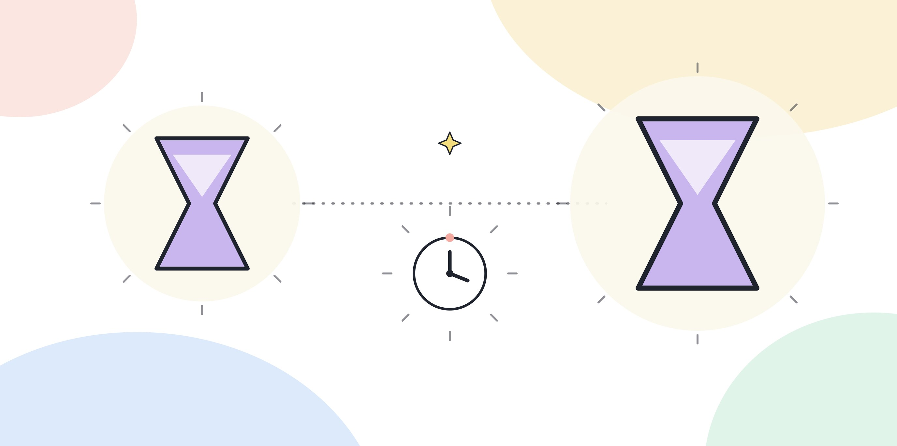
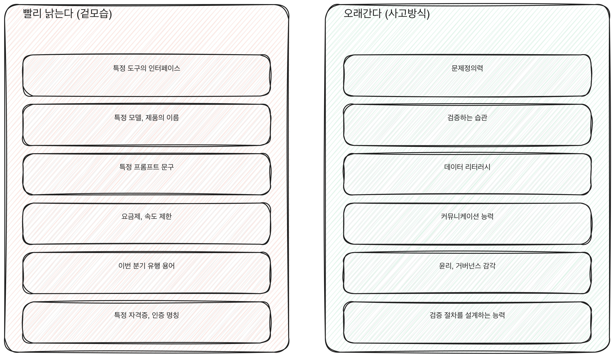

# 8.2 AX 역량의 반감기: 빨리 낡는 것과 오래가는 것

AX 역량이라는 말 안에는 수명이 전혀 다른 두 가지가 섞여 있다. 하나는 몇 달이면 낡는다. 다른 하나는 몇 년이 지나도 그대로 쓸 수 있다. 이 둘을 같은 무게로 공부하면 수명이 짧은 쪽에 들인 시간이 그대로 사라진다. 이 장은 이 책에서 가장 오래 참고할 장이다. 지금 배우는 것 중 무엇을 계속 붙잡고 무엇을 흘려보내도 되는지 가르는 기준을 담는다.

## 반감기라는 말을 쓰는 이유

반감기는 원래 방사성 물질이 절반으로 줄어드는 데 걸리는 시간을 가리킨다. 여기서는 비유로 쓴다. 특정 지식이나 기능이 "지금 그대로 쓸모 있다"에서 "절반쯤 쓸모 있다"로 줄어드는 데 걸리는 시간이라는 뜻이다. 절반쯤 줄었다는 건 완전히 사라졌다는 뜻이 아니라, 그 지식을 그대로 믿고 쓰면 절반은 맞고 절반은 틀리게 된다는 뜻이다.

AX 역량에서 반감기가 중요한 이유는, 이 영역의 겉모습이 다른 영역보다 훨씬 빨리 바뀌기 때문이다. 도구의 화면 구성, 기능 이름, 모델 이름은 자주 바뀐다. 반면 그 아래에서 요구되는 사고방식은 거의 안 바뀐다. 겉모습과 사고방식을 구분하지 못하면 겉모습이 바뀔 때마다 "나는 또 뒤처졌다"고 느끼게 된다. 실제로는 사고방식은 그대로 유효한데, 겉모습만 새로 익히면 되는 경우가 대부분이다.

[그림] 겉모습은 빨리 낡지만 사고방식은 오래간다.

## 반감기가 짧은 것들

### 특정 도구의 인터페이스

버튼이 어디 있는지, 메뉴가 몇 단계인지, 설정값을 어디서 바꾸는지 같은 지식이다. 이런 지식은 다음 업데이트에서 바뀔 수 있다. 화면을 외우는 데 시간을 많이 쓰는 사람은 화면이 바뀌는 순간 그 시간을 전부 잃는다.

### 특정 모델이나 제품의 이름

지금 널리 쓰이는 이름이 몇 년 뒤에도 같은 자리에 있을지는 아무도 보장하지 못한다. "이 모델을 잘 안다"는 말은 지식이 아니라 그 시점의 경험담이 된다. 면접이나 평가에서 특정 이름을 대는 것보다, 그 이름이 가리키는 기능을 설명할 수 있는 쪽이 오래간다.

### 특정 프롬프트 문구

"이렇게 쓰면 결과가 더 좋다"는 문구는 특정 시점, 특정 도구에서만 통하는 경우가 많다. 도구가 업데이트되면 똑같은 문구가 더 이상 안 통하거나, 반대로 안 쓰던 문구가 갑자기 잘 통하기도 한다. 문구 자체를 외우는 것보다 4부 4.2에서 다룬 맥락, 목표, 제약, 형식을 챙기는 틀을 익히는 쪽이 문구가 바뀌어도 그대로 쓰인다.

### 특정 서비스의 요금제나 제한

무료로 쓸 수 있는 범위, 속도 제한, 가격 구간은 회사의 정책에 따라 자주 바뀐다. 지금 아는 수치를 그대로 믿고 몇 달 뒤에 다시 꺼내면 틀릴 확률이 높다.

### 이번 분기에 유행하는 용어

특정 활용법이나 작업 방식을 가리키는 신조어는 한동안 여기저기서 쓰이다가 다음 유행어로 대체되는 경우가 많다. 그 용어가 가리키던 작업 방식 자체는 남더라도, 용어를 외워서 아는 것은 그 용어가 통용되는 동안만 쓸모가 있다. 용어보다 그 용어가 가리키는 실제 행동이 무엇인지를 기억해두면 용어가 바뀌어도 그대로 쓸 수 있다.

### 특정 자격증이나 인증 명칭

사내 인증이나 민간 자격증은 제도 자체가 개편되거나 명칭이 바뀌는 일이 잦다. "이 인증을 땄다"는 사실은 그 인증 제도가 유효한 동안만 통용된다. 반면 그 인증을 준비하며 실제로 익힌 역량(3부에서 다룬 다섯 평가 영역 같은)은 제도가 바뀌어도 그대로 남는다.

## 반감기가 긴 것들

### 문제정의력

4부 4.6에서 다룬, 도구가 아니라 문제에서 시작하는 습관이다. 이 습관은 도구가 몇 번을 바뀌어도 똑같이 쓰인다. "이 불편이 증상인지 원인인지", "이 문제를 겪는 사람이 실제로 원하는 게 무엇인지"를 묻는 순서는 AI가 등장하기 전에도 유효했고 AI가 지금과 다른 모습이 되어도 유효하다.

### 검증하는 습관

결과를 그대로 쓰지 않고 원자료와 대조하거나 한계를 확인하는 습관이다. 어떤 도구를 쓰든 산출물을 검증하는 단계는 똑같이 필요하다. 도구가 더 정교해져도 검증이 필요 없어지는 게 아니라, 검증해야 할 지점이 바뀔 뿐이다.

### 데이터 리터러시

숫자와 근거를 읽는 눈이다. 어떤 통계가 어떤 전제 위에서 나왔는지, 표본이 무엇을 대표하는지를 가리는 능력은 도구와 무관하게 쌓인다. 도구가 숫자를 더 빨리 뽑아줄수록 그 숫자를 읽는 눈의 가치는 오히려 올라간다.

### 커뮤니케이션 능력

4부 4.7에서 다룬 체인지 매니지먼트의 기반이다. 새로운 방식을 동료에게 설명하고, 반대를 예상하고, 설득하는 능력은 기술이 바뀌어도 똑같이 요구된다. 오히려 기술이 자주 바뀔수록 그 변화를 설명해야 하는 일이 더 자주 생긴다.

### 윤리와 거버넌스 감각

리스크를 미리 점검하는 습관, 책임의 경계를 분명히 하는 습관이다. 규정의 세부 조항은 바뀌지만 "이 일을 하기 전에 무엇을 확인해야 하는가"를 묻는 감각 자체는 바뀌지 않는다.

> **북마크 — 반감기가 짧은 것 / 긴 것**
>
> | 반감기가 짧다 (겉모습) | 반감기가 길다 (사고방식) |
> |---|---|
> | 특정 도구의 인터페이스 | 문제정의력 |
> | 특정 모델, 제품의 이름 | 검증하는 습관 |
> | 특정 프롬프트 문구 | 데이터 리터러시 |
> | 요금제, 속도 제한 같은 운영 정책 | 커뮤니케이션 능력 |
> | 이번 분기 유행하는 기능이나 용어 | 윤리, 거버넌스 감각 |
> | 특정 자격증, 인증 명칭 | 검증 절차를 설계하는 능력 |
>
> 새로 배울 것이 생기면 오른쪽 어느 항목과 연결되는지부터 확인한다. 연결되는 게 없으면 급하게 배울 필요가 없다.

위 대조표를 그림으로 나란히 두면 이렇다.

[그림] 인터페이스나 모델 이름은 낡아도 문제정의력과 검증 습관은 남는다.

왼쪽 항목들이 빨리 낡는 이유는 공통된다. 전부 "누군가의 결정"에 수명이 묶여 있다. 도구 회사가 화면을 바꾸기로 결정하면 인터페이스 지식이 낡고, 조직이 요금제를 바꾸면 그 지식이 낡고, 인증 기관이 제도를 개편하면 자격증 명칭이 낡는다. 반면 오른쪽 항목들은 누군가의 결정에 좌우되지 않는다. 문제정의력이나 검증하는 습관은 특정 회사나 기관의 결정과 무관하게 자신이 계속 쓰는 능력이다. 이 차이, 즉 수명을 쥔 사람이 자신인지 남인지가 반감기를 가르는 가장 근본적인 기준이다.

## 경계에 있는 것들

표의 두 칸이 늘 선명하게 갈리지는 않는다. 애매한 경우도 있다. "프롬프트를 쓰는 기술" 자체는 어느 쪽인가. 특정 문구를 외우는 건 왼쪽이지만, 결과가 안 좋을 때 무엇이 빠졌는지 되묻는 틀은 오른쪽이다. 같은 이름 아래 겉모습과 사고방식이 같이 들어 있는 경우가 많다. 이럴 때는 "이 지식이 도구를 바꿔도 그대로 쓰이는가"를 기준으로 쪼갠다. 바꿔도 그대로 쓰이는 부분만 오른쪽에 둔다.

"에이전트"나 "자동화"라는 말도 마찬가지다. 특정 서비스가 제공하는 자동화 기능의 설정 방법은 왼쪽이다. 반복되는 업무를 단계로 쪼개서 어느 단계를 맡길지 판단하는 능력은 오른쪽이다. 이름이 같다고 반감기가 같은 게 아니다. 이름 아래 실제로 무엇을 익히고 있는지를 본다.

## 짧은 것을 버리라는 말이 아니다

반감기가 짧다고 해서 안 배워도 된다는 뜻은 아니다. 지금 당장 업무에 쓰는 도구의 화면 구성은 당연히 알아야 한다. 요점은 배우는 비중이다. 짧은 반감기를 가진 지식은 필요할 때 그때 익히면 된다. 평소에 시간을 들여 저장해둘 필요가 없다. 반면 긴 반감기를 가진 역량은 지금 당장 쓸 데가 없어도 미리 쌓아두는 게 맞다. 나중에 어떤 도구가 와도 그 역량 위에 얹어 쓸 수 있기 때문이다.

이 판단을 매번 새로 할 필요는 없다. 8.1에서 다룬 월 1회 점검에서 "이번 달에 새로 배운 것이 왼쪽 표에 속하는지 오른쪽 표에 속하는지"를 같이 적어두면, 시간이 지나면서 자신이 어디에 시간을 쓰고 있는지가 눈에 보인다.

## 오늘 할 일

최근 한 달 동안 새로 배운 것을 세 가지 적어본다. 각각을 위 표의 왼쪽과 오른쪽 중 어디에 놓을지 판단한다. 왼쪽에 몰려 있다면 다음 달에는 오른쪽에 속하는 것 하나를 의도적으로 골라 시간을 들인다.
